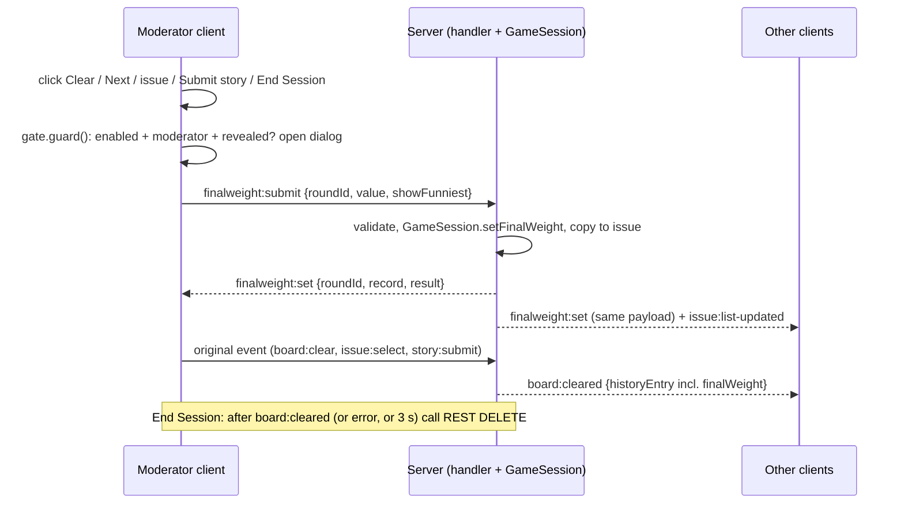

# Design Document: Final Weight and Estimation Accuracy

## Overview

An optional feature, off by default, shipped in release 0.0.10. The Weight_Moderator's client intercepts round-completing actions, shows a picker, sends the chosen weight to the server, waits for the acknowledgement, then continues with the original action. The server stores the weight on the round, computes the accuracy result with shared pure functions, and broadcasts it. All clients show a balloon. A header icon reopens the picker (moderators) or the balloon (everyone).

Design choice: the client drives the flow, the server never waits for a weight, so no existing action can block (R4.15, R13). The weight is set on the still-revealed round, so `clearBoard()` only copies it into the history entry.

## Verified facts from the existing code

These shaped the design and are the reason several earlier assumptions were corrected.

| Fact | Where | Consequence |
|------|-------|-------------|
| Card type is `ExtendedCardValue` (includes `½`, `XS`..`XXL`, 4, 16, 20, 32, 40, 64, 100), not `CardValue` | `shared/types.ts` | All new types use `ExtendedCardValue` |
| `0` is a real card and falsy | `FIBONACCI_SEQUENCE`, ladders | Always compare with `!== undefined` / `=== undefined` |
| `ParticipantVote.cardValue` (not `vote`), nullable; history holds current participants only | `clearBoard` | Votes built the same way live and on restore |
| `CARD_LADDERS['t-shirt']` is `[]`; `ladderIndexOf` and `cardLadderFor` exist | `shared/types.ts` | Reuse them; t-shirt uses `VOTING_SYSTEMS['t-shirt']` |
| Voting system can change mid-session in the settings panel | `session-settings-panel` | Store the system with the weight |
| `board:clear` requires role `moderator`; `story:submit` and `issue:select` require `issue` permission; reveal permission can be `all-players` or `select-specific` | `handler.ts` | Final weight permission is the moderator role, not reveal permission |
| Clear / Next / select exist in facilitator-flow (4 buttons), story-manager (Clear, submit) and issue-list-panel (`selectIssue`) | client | One gate service, six entry points (R4.2) |
| `DELETE /api/sessions/:id` only removes the session from the registry, no broadcast, no history kept | `sessions.ts`, `session-registry.ts` | End Session cannot show a balloon to others; sequencing needed |
| Export is built server side from history by `shared/estimate-export.ts` with a fixed `SUMMARY_HEADER` | `estimate-export.ts` | Append an optional last column; header constant unchanged |
| `markIssueEstimated` runs after `clearBoard` and matches issue by `status === 'estimating'` and title | `handler.ts` | Same lookup is used to copy the weight to the issue |
| `serializeRound` and the client `deserializeRound` / `normaliseHistoryEntry` spread the object | handler, state service | New optional fields travel without extra mapping |
| `issue:list-updated` replaces the whole list on the client | state service | Copying weight to the issue needs one broadcast |
| `selections` is a Map on the server, a Record on the wire | handler | Server computes the result from the Map; the client never needs raw selections for restore (uses history participants or round selections) |

## Existing code touched

| Area | File | Change |
|------|------|--------|
| Types | `shared/types.ts` | setting, resolver, `FinalWeightRecord`, `VotingRound.finalWeight?`, `HistoryEntry.finalWeight?`, `IssueItem.finalWeight?`, events, payloads |
| New shared | `shared/final-weight.ts`, `shared/final-weight-copy.ts` | pure logic and copy |
| Shared | `shared/estimate-export.ts` | optional trailing column |
| Server | `game-session.ts` | `setFinalWeight`, copy in `clearBoard`, issue copy |
| Server | `session-registry.ts` | coerce the key when present |
| Server | `handler.ts` | `handleFinalWeightSubmit` and routing |
| Server | `routes/sessions.ts` | validate `finalWeightEnabled` in `PUT /:id/config` |
| Client | `session-create-page`, `session-settings-panel` | toggle |
| Client | `session-state.service.ts` | signals and `finalweight:set` subscription |
| Client | `facilitator-flow`, `story-manager`, `issue-list-panel`, `session-poker-page` | route actions through the gate, header icon, mount components |
| Client new | `components/final-weight/` | dialog, balloon, header button, gate service |
| Client | `session-history`, `issue-list-panel` | show the weight |
| Docs and release | `README.md`, `helm/scrum-poker/*` | docs and 0.0.10 (`Chart.yaml` version and appVersion, README release references; `client/package.json` and `server/package.json` unchanged; no commit or tag created, R15) |

Retro code is not touched.

## Architecture

The client drives the flow. The gate service wraps the six entry points listed in Requirement 4.2: `facilitator-flow.clearAndNext`, `facilitator-flow.nextIssue` (covering the three Next buttons), `story-manager.clearBoard`, the `story-manager` story submit, `issue-list-panel.selectIssue` and `session-poker-page.confirmEndSession`. With the setting off, the gate runs the original action synchronously, so nothing changes for existing sessions.



Data flow:
- Shared pure functions (`final-weight.ts`, `final-weight-copy.ts`) are used by the server to compute results and by the client to build options and restore results after a reload.
- The server is the only source of an `AccuracyResult` on the wire. It never trusts a client-sent distance or result (R11.6).
- History entries keep the `FinalWeightRecord`; the export, the standings and the history list all derive from history.
- The issue list receives the weight value through the existing `issue:list-updated` broadcast.

## Components and Interfaces

### Shared pure logic (`shared/final-weight.ts`)

```ts
export function scoringLadder(system: VotingSystemType): readonly ExtendedCardValue[]; // CARD_LADDERS, or VOTING_SYSTEMS['t-shirt']

export type OptionReason = 'voted' | 'most-voted' | 'nearest-average' | 'between';
export interface FinalWeightOption { value: ExtendedCardValue; reasons: OptionReason[]; suggested: boolean }
export function buildFinalWeightOptions(votes: readonly ParticipantVote[], system: VotingSystemType):
  { options: FinalWeightOption[]; ladder: readonly ExtendedCardValue[]; hasScorable: boolean };

export interface VoterDistance { userId: string; name: string; card: ExtendedCardValue; distance: number }
export interface AccuracyResult {
  finalWeight: ExtendedCardValue;
  voters: VoterDistance[];     // scorable voters only
  closestIds: string[];
  furthestIds: string[];       // empty when no spread or not comparable
  allExact: boolean;
  comparable: boolean;         // >= 2 scorable voters and weight on ladder
}
export function computeAccuracy(votes: readonly ParticipantVote[], record: FinalWeightRecord): AccuracyResult; // total, never throws
export interface Standing { userId: string; name: string; rounds: number; avgDistance: number; warmingUp: boolean }
export function computeStandings(history: readonly HistoryEntry[]): Standing[]; // each entry uses its own record.votingSystem
export function votesFromRound(selections: ReadonlyMap<string, ExtendedCardValue>, participants: readonly User[]): ParticipantVote[]; // same mapping as clearBoard
```

Notes:
- Index comparison uses `ladder.indexOf(v)` and `=== -1` checks; `0` is index 0 and is never tested for truthiness.
- Option building: `voted` = distinct scorable values by ladder index; `most-voted` = highest counts (all ties); `nearest-average` = ladder card with the smallest `abs(cardNumericValue - avg)`, tie picks the higher (for t-shirt, the rounded mean index); `between` = up to 3 unvoted ladder cards between min and max vote, nearest to the average first. `suggested` is the `nearest-average` option if voted, otherwise the lowest-index `most-voted`; never pre-selected.
- Example, Fibonacci votes 2, 3, 5: options 2, 3, 5; 3 is `nearest-average` and suggested. Votes 2 and 8: options 2, 8 plus between 3, 5.
- Distance counts ladder steps, so 5 to 8 equals 2 to 3. The cards `½` and `1` are one step apart on modified Fibonacci.
- Off-ladder votes (for example cast under a previous system) are skipped.
- `votesFromRound` is used for the live result (current participants), identical to what `clearBoard` stores, so live and restored results match.

### Funny copy store (`shared/final-weight-copy.ts`)

```ts
export type DistanceBand = 'near' | 'mid' | 'far';
export function bandFor(distance: number): DistanceBand; // 1 -> near, 2-3 -> mid, >=4 -> far
export const CLOSEST_TITLES: readonly string[];  // "Sharpshooter", "Crystal Ball", "Estimation Whisperer", ...
export const FURTHEST_TITLES: readonly string[]; // "Bold Explorer", "Wildcard", "Dreamer of Other Sprints", ...
export const CLOSEST_LINES: Record<'exact' | DistanceBand, readonly string[]>;
export const FURTHEST_LINES: Record<DistanceBand, readonly string[]>;
export function pickCopy(pool: readonly string[], roundId: string, salt: number): string; // FNV-1a hash mod length
export function fillCopy(line: string, vars: { name: string; card: string }): string;     // plain text replace
```

Sample furthest lines (all about the guess):
- near: "{name} was just one step off with {card}. Almost a prophet."
- mid: "{name} played {card}. Bold. The team will remember this."
- far: "{name} showed {card} from another galaxy. Is this sprint planning or a treasure map?"

Sample closest: "{name} read the team's mind with {card}." Exact: "{name} hit it dead on with {card}. Spooky." All exact: "Hive mind! Everybody landed on {weight}."

A unit test enforces: banned-word list, fewer than 120 characters per line, at least 5 lines per pool, no leftover `{` after `fillCopy`.

### Server: `GameSession`

```ts
setFinalWeight(roundId: string, value: ExtendedCardValue, showFunniest: boolean):
  { target: 'current' | 'history'; record: FinalWeightRecord; round?: VotingRound; entry?: HistoryEntry; issue?: IssueItem }
```
- Builds `record = { value, votingSystem: this.config.votingSystem, showFunniest }`.
- If `currentRound?.id === roundId` and status is `revealed`: set `currentRound.finalWeight = record`.
- Else if `history[0]?.roundId === roundId`: set `history[0].finalWeight = record` (only the newest entry; older ones stay immutable).
- Else throws `ROUND_NOT_FOUND`.
- Issue copy: for `current`, find the issue with `status === 'estimating' && title === round.storyDescription` (the same rule as `handleBoardClear`); for `history`, find the issue with `historyEntryId === roundId`. If found, set `issue.finalWeight = value`.
- `clearBoard()` adds `finalWeight` to the entry only when the round has one, so entries without the feature are identical to today. `revote()` discards the round and its weight.
- When the weight was set on the current round, the issue already has it before `markIssueEstimated` runs; `markIssueEstimated` is not changed.
- When a revealed round is re-voted, the issue keeps a weight copied earlier. `revote()` therefore clears `finalWeight` on the issue that matches the discarded round.
- No clear/unset method in this release.

### Server: handler

`handleEvent` pre-check: `finalweight:submit` requires `isModerator(session, user.id)`, else `UNAUTHORIZED`. `handleFinalWeightSubmit(data: unknown)`:
1. Narrow with a type guard (`roundId` non-empty string, `value` string or number, `showFunniest` boolean or undefined). Bad shape gives `INVALID_FINAL_WEIGHT`.
2. If `!resolveFinalWeightEnabled(session.config.finalWeightEnabled)` send `FEATURE_DISABLED`.
3. If `scoringLadder(config.votingSystem)` does not contain `value` (strict `includes`), send `INVALID_FINAL_WEIGHT`.
4. Call `setFinalWeight`; on `ROUND_NOT_FOUND` send that code.
5. Compute `AccuracyResult` with `computeAccuracy(votesFromRound(...) or entry.participants, record)`; never from client data.
6. Broadcast `finalweight:set`; if an issue was updated, broadcast `issue:list-updated`.

New code uses `unknown` and guards even though older handlers use `any`.

### Server: REST and registry

- `SessionRegistry.createSession`: if the key `finalWeightEnabled` exists in the incoming config, store `resolveFinalWeightEnabled(value)`; otherwise leave it absent.
- `PUT /:id/config`: if `finalWeightEnabled` is present and not boolean, return 400 `INVALID_SETTING` with `setting: 'finalWeightEnabled'`, before `updateConfig`. Authorisation stays the existing owner-or-moderator check.
- `GET /:id/export`: passes history unchanged; the builder decides whether to add the column.
- End Session stays `DELETE /api/sessions/:id`; the sequencing is client side (see the gate).

### Server: export (`shared/estimate-export.ts`)

Add `FINAL_WEIGHT_HEADER = 'Final Weight'`. In `buildEstimateExportRows`, compute `hasWeights = history.some(e => e.finalWeight !== undefined)`. When true, append the header to the first row and `String(entry.finalWeight.value)` or `-` to each summary row. Vote rows and the vote header are unchanged. When false, the code path is the existing one, so output is byte-identical.

### Client: state (`session-state.service.ts`)

- Computed `finalWeightEnabled = sessionConfig()?.finalWeightEnabled === true`.
- Signal `latestAccuracy: { roundId; record; result } | null` (readonly view).
- Subscribe to `finalweight:set`:
  - set `latestAccuracy`;
  - patch `finalWeight` on `_currentRound` when its id matches, or on the matching entry in `_history`;
  - emit on an `accuracyAnnounced` subject (bridging WS, like `noteAdded`) so the balloon pops, deduplicated by `(roundId, value, showFunniest)`.
  - The issue list is updated by the existing `issue:list-updated` handler.
- Restore (no announcement) on `session:state` and `board:cleared`: use the current round's `finalWeight` if set (votes via `votesFromRound` with participants and selections), else the newest history entry with `finalWeight` (votes from `entry.participants`), using the shared `computeAccuracy`.
- Clear `latestAccuracy` on `history:cleared`, when the setting turns off, and on `round:started` when its `roundId` is not in history (re-vote discarded the round).

### Client: gate (`FinalWeightGateService`)

```ts
guard(action: () => void): void
// shouldAsk() = finalWeightEnabled() && currentUser().role === 'moderator' && isRevealed() && currentRound() != null
// if !shouldAsk(): action() immediately (same synchronous path as today)
// else: open dialog (gate mode); on confirm -> send finalweight:submit, await finalweight:set (5 s) -> action()
//       Skip -> action(); Cancel -> nothing; ROUND_NOT_FOUND -> action(); other errors -> stay open
guardEndSession(action: () => void): void  // action = send board:clear, await board:cleared / error / 3 s, then REST delete
```

Entry points (the six from R4.2), each changed to `gate.guard(() => <existing send>)`:
- `facilitator-flow.clearAndNext` (Clear)
- `facilitator-flow.nextIssue` (covers the three Next buttons)
- `story-manager.clearBoard` (Clear)
- `story-manager` story submit (`story:submit`)
- `issue-list-panel.selectIssue`
- `session-poker-page.confirmEndSession` (via `guardEndSession`, after the existing confirmation)

With the setting off the callback runs synchronously, preserving behaviour and existing spies.

### Client: components (standalone, inline templates, `@if/@for`, BEM-lite)

- `FinalWeightDialogComponent`: inputs `open`, `mode: 'gate' | 'edit'`, `options`, `ladder`, `current`, `error`; outputs `confirm({value, showFunniest})`, `skip`, `cancel`. Radio group, reason badges, "Show all cards", "Show the funniest guess" checkbox, Skip and Confirm. Focus handling as in `feelings-summary-popup`. In `edit` mode Skip is replaced by Close and no original action runs.
- `FinalWeightBalloonComponent`: input `data`, output `closed`. Closest block, "Just for fun" furthest block, collapsible standings. 20 s auto-dismiss, paused on hover and focus.
- `FinalWeightHeaderButtonComponent`: in `__header-right` before the settings panel, only when enabled; emoji icon with `aria-label`, consistent with the existing header buttons.
- Placement: the balloon is checked against `board-overlay-layout.service`, `app-chat-host`, `app-vote-callout-layer` and `app-moderator-note-balloon` to avoid overlap.
- `session-poker-page` hosts the dialog and balloon visibility signals.
- `session-history` and `issue-list-panel` show the weight text.

### Client: settings UI

- `session-create-page`: control `finalWeightEnabled: [false]` in the Additional Options fieldset, always included in the request.
- `session-settings-panel`: control initialised from `config()?.finalWeightEnabled === true`, sent in the update body.

## Data Models

### Shared types (`shared/types.ts`)

```ts
export interface SessionConfiguration {
  // ...existing
  finalWeightEnabled?: boolean;          // absent = off; DEFAULT_SESSION_CONFIG unchanged
}
export function resolveFinalWeightEnabled(v: unknown): boolean { return v === true; }

export interface FinalWeightRecord {
  value: ExtendedCardValue;
  votingSystem: VotingSystemType;        // system when the weight was set
  showFunniest: boolean;
}
// VotingRound, HistoryEntry: finalWeight?: FinalWeightRecord   (omitted when unset)
// IssueItem: finalWeight?: ExtendedCardValue
```

### Events and payloads

```ts
export const FINAL_WEIGHT_SUBMIT = 'finalweight:submit';
export const FINAL_WEIGHT_SET = 'finalweight:set';

export interface FinalWeightSubmitPayload { roundId: string; value: ExtendedCardValue; showFunniest?: boolean }
export interface FinalWeightSetPayload { roundId: string; record: FinalWeightRecord; result: AccuracyResult }
```

### Rejections

```ts
export type FinalWeightRejection = 'FEATURE_DISABLED' | 'ROUND_NOT_FOUND' | 'INVALID_FINAL_WEIGHT';
```

Rejections reuse the existing `error` event `{ message, code }`; `UNAUTHORIZED` is the existing code. The REST config validation uses `{ error: 'INVALID_SETTING', setting: 'finalWeightEnabled' }` with status 400.

### Derived models

`AccuracyResult`, `VoterDistance`, `Standing` and `FinalWeightOption` are defined in `shared/final-weight.ts` (see Components and Interfaces). They are computed, never stored, except that `AccuracyResult` travels in `finalweight:set`.

## Correctness Properties

*A property is a characteristic or behavior that should hold true across all valid executions of a system-essentially, a formal statement about what the system should do. Properties serve as the bridge between human-readable specifications and machine-verifiable correctness guarantees.*

Reflection: the Distance property (Property 4) is kept separate from the `computeAccuracy` invariants (Property 3) because it pins the ladder semantics per voting system, which Property 3 relies on but does not test. The per-field option checks are merged into Property 2.

### Property 1: Setting resolver accepts only boolean true

For any value of any type, `resolveFinalWeightEnabled(value)` returns `true` if and only if the value is the boolean `true`.

**Validates: Requirements 1.2**

### Property 2: Candidate options are complete, ordered and unique

For any list of votes (including special cards, null votes and the card `0`) and any voting system, `buildFinalWeightOptions` never throws, returns no duplicate values, returns only values on the Scoring_Ladder, includes every distinct Scorable_Vote value, and orders the options by Scoring_Ladder position.

**Validates: Requirements 5.2, 5.3, 5.7, 6.4**

### Property 3: Accuracy result invariants

For any list of votes and any Final_Weight_Record (including off-ladder values), `computeAccuracy` never throws, every closest voter has the minimum Distance, every furthest voter has the maximum Distance, `furthestIds` is empty when the maximum equals the minimum, `allExact` is true if and only if every scorable voter equals the weight, and `comparable` is false when fewer than 2 voters are scorable or the weight or a vote is off the ladder.

**Validates: Requirements 6.4, 6.5, 6.6, 6.7, 6.8, 6.9**

### Property 4: Distance equals ladder index difference

For any voting system (using `VOTING_SYSTEMS['t-shirt']` for t-shirt) and any two cards on its Scoring_Ladder, the Distance equals the absolute difference of their ladder indexes, and is symmetric and non-negative.

**Validates: Requirements 6.1, 6.2**

### Property 5: Standings are the per-round mean distance

For any history list, `computeStandings` ignores entries without a Final_Weight_Record and non-comparable entries, scores each entry with its own stored `votingSystem`, and returns for each voter an average Distance equal to the mean of that voter's per-round distances, sorted ascending with voters under 2 scored rounds ranked last.

**Validates: Requirements 6.12, 10.3, 10.4, 10.6**

### Property 6: Copy selection is deterministic and safe

For any `roundId`, salt, name and card, `pickCopy` returns the same line every time from a fixed pool, every pool line passes the banned-word and length checks, and `fillCopy` leaves no unreplaced placeholder in the result and returns plain text.

**Validates: Requirements 9.1, 9.3, 9.8**

### Property 7: History entry carries the weight only when set

For any revealed round, `clearBoard()` produces a history entry whose `finalWeight` equals the record set by `setFinalWeight` when one was set, and an entry without a `finalWeight` key (`'finalWeight' in entry === false`) when none was set.

**Validates: Requirements 4.15, 11.7, 11.8**

### Property 8: Export column is last and absent output is unchanged

For any history list, if no entry has a Final_Weight_Record, the export output is byte-identical to the existing builder output; otherwise `Final Weight` is the last summary column and entries without a weight carry `-` in it, with `SUMMARY_HEADER` unchanged.

**Validates: Requirements 12.2, 12.3, 12.4**

## Error Handling

| Case | Behaviour |
|------|-----------|
| Server rejects the weight (`UNAUTHORIZED`, `FEATURE_DISABLED`, `INVALID_FINAL_WEIGHT`) | Dialog stays open with an inline message; Retry, Skip or Cancel |
| No acknowledgement in 5 s, or WS disconnected | Same inline message and options; original action is not sent |
| `ROUND_NOT_FOUND` (round already cleared or re-voted) | Treated as Skip, original action continues |
| Round stops being revealed while dialog is open | Dialog closes as Skip |
| Feature turned off while dialog is open | Dialog closes as Skip, gate resolves |
| End Session and `board:clear` is rejected or times out | REST delete still runs, as today |
| Voting system changed after the weight was set | Result uses the stored `votingSystem`; unchanged |
| `PUT /config` with a non-boolean `finalWeightEnabled` | 400 `INVALID_SETTING`, no state change, no broadcast |

## Testing Strategy

Dual approach: property tests cover the universal rules in the pure logic, and example tests cover protocol, UI and integration points. Property-based testing applies to the shared pure functions, `GameSession.clearBoard` and the export builder. It does not apply to UI rendering, the WebSocket and REST wiring, or the docs and release edits, which use example-based tests.

Property tests:
- Library: fast-check (already used in the client; server and shared tests under Jest use the same library, no new dependency per R13.7).
- Each property is implemented by a single property-based test with at least 100 runs.
- Each test carries the tag `// Feature: final-weight-accuracy, Property N: <title>`.
- Properties 1 to 8 above map one to one to tests.

Unit and integration tests:
- Server: handler rejects non-moderators, disabled setting, bad shape, bad value, stale round, voting-state round; weight `0` accepted; issue copy and re-vote reset; two moderators; `PUT /config` validation; registry keeps the key absent when absent.
- Client: create-page and settings toggle (default unchecked, payload); gate for confirm, skip, cancel, timeout, rejection; each of the six entry points (clearAndNext, nextIssue with its three buttons, story-manager clearBoard, story submit, selectIssue, confirmEndSession) opens the dialog only when enabled, moderator and revealed; Re-Vote never opens it; non-moderator never sees the dialog but sees the balloon; header icon states for each role; state restore after reload; `round:started` clears a stale result; accessibility; reduced motion.
- Regression (R13): both existing suites run before and after; with the setting off no new DOM element is rendered and no `finalweight:*` event is sent.
- Release (R15): smoke check that `Chart.yaml` has `version: 0.0.10` and `appVersion: "0.0.10"` and no `0.0.9` release references remain in `README.md` and `helm/scrum-poker/README.md`.

## Risks and accepted limitations

- `status: 'completed'` is unused today, so "round complete" is detected at the entry points, not by status.
- A history entry only contains participants present at clear time (existing behaviour).
- Votes cast under a previous voting system can be off-ladder or have a different index meaning; they are skipped or scored on the stored system. This mirrors how existing metrics tolerate mixed history.
- End Session archives the round and then deletes the session; no balloon reaches others and nothing is exported automatically. This is the defined behaviour.
- Names of the furthest voter are visible to the whole team; the moderator can hide that block per round.
