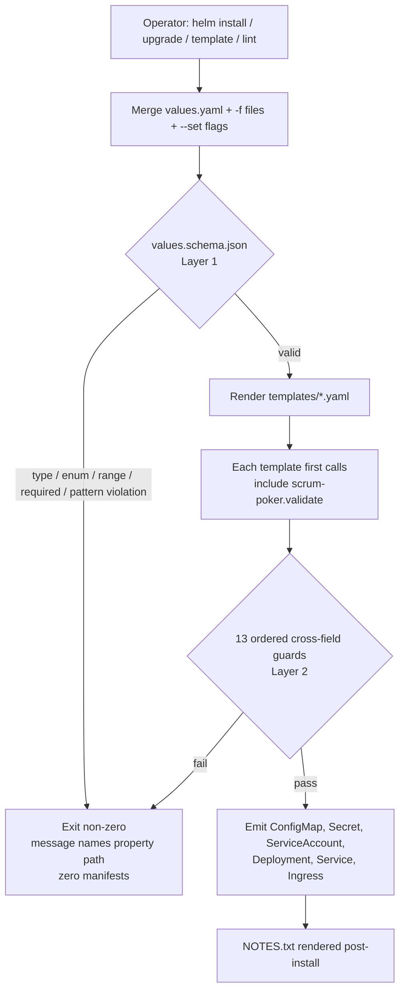
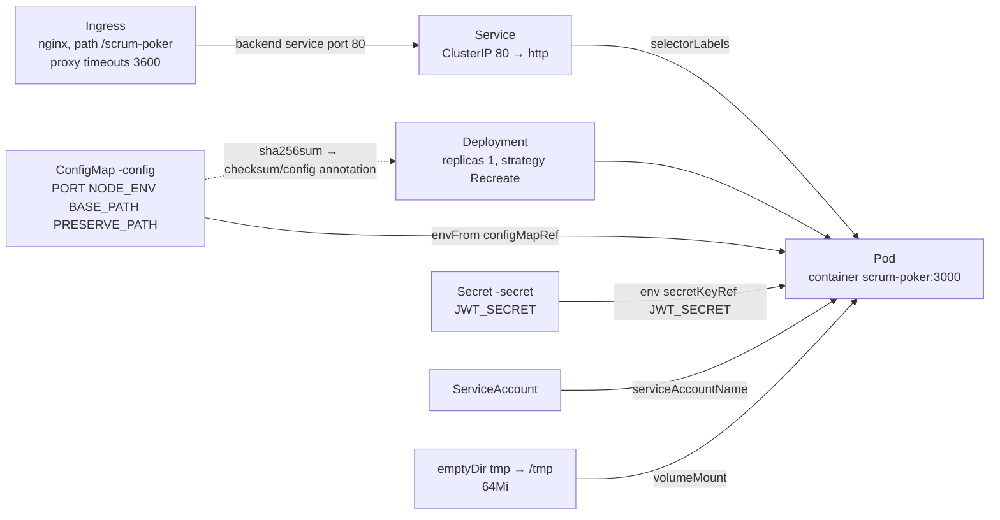
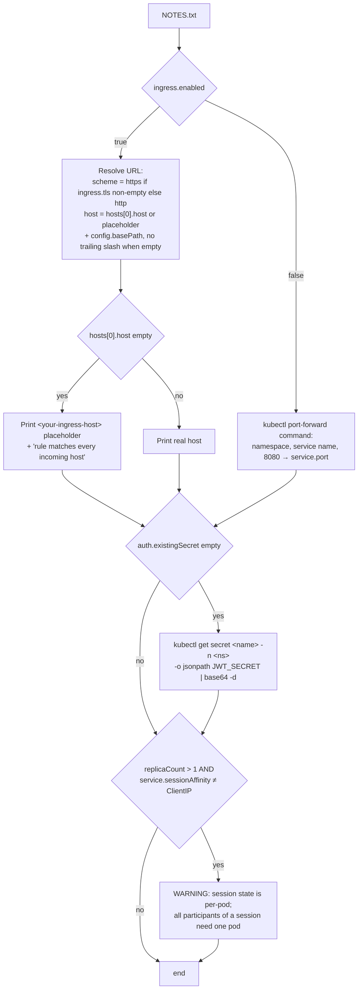
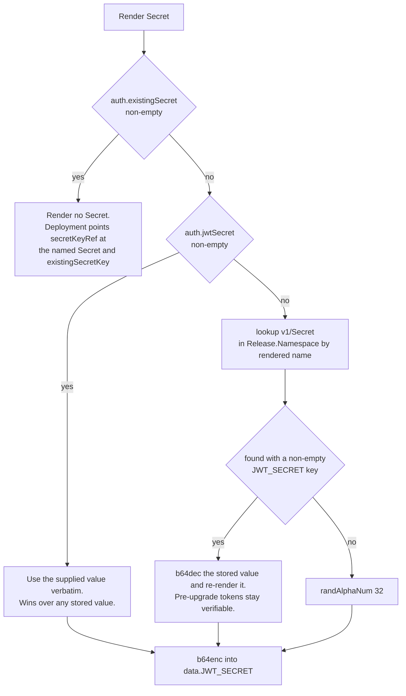

# Design Document

## Overview

This design packages the Scrum Poker application as a Helm chart at `helm/scrum-poker/`. The chart reproduces the topology already encoded in `k8s/k8s.yaml` and `k8s/ingress.yaml` as its default values, and exposes each element of that topology as a configurable input validated by a JSON schema and by template-level guards.

### What the chart deploys

The application is a single container image (`siddhivinayaksk/scrum-pocker`) running one Node.js process. Reading `server/src/server.ts` confirms that one process on port 3000 serves four distinct concerns:

| Concern | Path | Notes |
|---|---|---|
| Health probe | `/api/health` | Registered on the root `app` **before** the base-path `appRouter` is mounted, so the probe path never carries `BASE_PATH` |
| REST API | `{BASE_PATH}/api/auth`, `/api/sessions`, `/api/retro` | Mounted on `appRouter` |
| Angular static bundle | `{BASE_PATH}/*` | `express.static` plus SPA fallback serving a rewritten `index.html` |
| WebSocket | `{BASE_PATH}/retro…` → retro server, everything else → poker server | Routed in the `server.on('upgrade')` handler |

Because all four share one port, the chart renders **one container, one container port, one Service port, and one Ingress backend**. There is no sidecar, no second Service, and no separate WebSocket route — the ingress carries HTTP and WebSocket traffic over the same path prefix, which is why the WebSocket annotations in Requirement 8 are mandatory rather than optional.

### Four application constraints that shape the design

The requirements introduction names four constraints. Each maps to a concrete design mechanism:

1. **In-process session state.** `sessionRegistry` and the retro registry hold every poker and retro session in the memory of a single process. The chart therefore pins `replicaCount` to `1`, defaults `deploymentStrategy.type` to `Recreate` (so an upgrade replaces the session holder instead of briefly running two), fails rendering outright when `autoscaling.enabled` is `true`, and emits a NOTES warning when an operator forces `replicaCount > 1` without `ClientIP` affinity.

2. **Hard-coded JWT fallback.** `server/src/services/auth-service.ts` line 5 reads `process.env.JWT_SECRET || 'scrum-poker-secret-key'`. Any deployment that does not set `JWT_SECRET` signs tokens with a value published in the repository. The chart always injects `JWT_SECRET` from a Secret — either one it renders, or one the operator names via `auth.existingSecret`.

3. **`BASE_PATH` coupled to the ingress path.** The server rewrites `<base href>`, injects `window.__BASE_PATH__`, rewrites relative asset URLs, and chooses the router mount point from `BASE_PATH` and `PRESERVE_PATH`. A mismatch between the ingress path and `BASE_PATH` yields a blank page with 404 assets — a failure mode that produces no Kubernetes-level error. The chart detects the mismatch at render time and refuses to produce manifests.

4. **WebSocket upgrades traverse the ingress.** Default `ingress.annotations` carry `proxy-read-timeout` and `proxy-send-timeout` of `3600`, and optional cookie affinity is available for the (unsupported) multi-replica case.

### Design strategy: two validation layers in a fixed order

Helm evaluates `values.schema.json` **before** it renders any template. The design exploits that ordering deliberately:

- **Layer 1 — schema (`values.schema.json`).** Types, enumerated sets, numeric bounds, string lengths, required keys, and the `config.basePath` leading-slash pattern. Catches typos and out-of-range scalars with a path-naming message, and does so before a single template line executes.
- **Layer 2 — template guards (`scrum-poker.validate`).** Cross-field semantics the schema cannot express: base-path/ingress-path agreement, `auth.jwtSecret` versus `auth.existingSecret` exclusivity, trailing-slash rejection, `extraEnv` entry shape, `autoscaling.enabled`, and empty `ingress.hosts`/`paths` lists.

Both layers abort before any manifest reaches the cluster, satisfying the "leave existing resources unchanged" clauses in Requirements 1.13, 4.9, 4.10, 4.12, 9.6, 10.7, 10.8, and 11.11.

### Tooling baseline

Verified on the development host: `helm v3.15.1`, `kubectl v1.35.0` (client). The chart targets Helm `>= 3.8` and Kubernetes `>= 1.19` (Requirement 13.2); `networking.k8s.io/v1` Ingress and `values.schema.json` enforcement both require those floors.

---

## Architecture

### Rendering pipeline



### Rendered object graph (default values)



Two edges carry design intent worth stating explicitly:

- **`ConfigMap → Deployment` is a checksum edge, not a reference edge.** The Deployment's `checksum/config` pod annotation is `sha256sum` of the fully rendered ConfigMap, so changing `config.basePath` rolls the pod. The Secret is deliberately **excluded** from the checksum, because the JWT value is generated fresh on every `helm template` (see "JWT secret lifecycle") and including it would churn the pod on every upgrade.
- **`Secret → Pod` is by reference only.** The secret value never appears in the Deployment manifest, so Deployment output stays stable even when the Secret's rendered value varies.

### Guard placement and evaluation order

Helm processes files under `templates/` in lexical order, and the first `fail` aborts the whole render. Relying on file order to sequence guards would make error messages depend on which template happened to render first — and worse, a guard living only in `ingress.yaml` would never run when `ingress.enabled=false`.

The design therefore centralises **all** guards in one named template, `scrum-poker.validate`, defined in `_helpers.tpl`, and includes it as the first action of every rendered template file:

```gotemplate
{{- include "scrum-poker.validate" . -}}
```

Consequences:

- Every guard runs for every operation, regardless of which optional resources are enabled.
- Guard order is the order written inside `scrum-poker.validate`, independent of file names, so the error message for a given set of values is deterministic.
- The include yields the empty string with both delimiters chomped, so it contributes no YAML.

The fixed guard order is:

| # | Guard | Value(s) | Requirement |
|---|---|---|---|
| 1 | `replicaCount` present, integer, ≥ 1 | `replicaCount` | 10.8, 2.16 |
| 2 | autoscaling rejected | `autoscaling.enabled` | 10.7 |
| 3 | image repository non-empty | `image.repository` | 2.16 |
| 4 | pull policy in set | `image.pullPolicy` | 2.16 |
| 5 | strategy type in set | `deploymentStrategy.type` | 2.16 |
| 6 | base path leading `/` | `config.basePath` | 4.9 |
| 7 | base path no trailing `/` | `config.basePath` | 4.10 |
| 8 | every `extraEnv` entry has non-empty `name` | `extraEnv` | 4.12 |
| 9 | jwtSecret / existingSecret mutually exclusive | `auth.*` | 5.11 |
| 10 | nodePort in 30000–32767 when type NodePort | `service.nodePort` | 3.10 |
| 11 | enabled ingress has ≥ 1 host entry | `ingress.hosts` | 8.14 |
| 12 | every host entry has ≥ 1 path entry | `ingress.hosts[*].paths` | 9.7 |
| 13 | base path matches every ingress path | `config.basePath` vs paths | 9.1, 9.2 |

Order 6 and 7 **must** precede order 13. A value like `config.basePath=scrum-poker` is both malformed and mismatched; the smoke test (Requirement 12.10) expects the leading-slash message, so the format guards win. Likewise order 12 precedes order 13 because guard 13 iterates the `paths` lists that guard 12 proves non-empty.

---

## Components and Interfaces

### Chart directory layout

```
helm/scrum-poker/
├── Chart.yaml                  # Chart_Metadata
├── values.yaml                 # Values_File — every input, commented
├── values.schema.json          # Values_Schema — Layer 1 validation
├── README.md                   # Chart_Readme — operator documentation
├── .helmignore                 # excludes .git, *.tgz, editor files from packaging
└── templates/
    ├── _helpers.tpl            # named templates + all Layer 2 guards
    ├── configmap.yaml          # ConfigMap_Template
    ├── deployment.yaml         # Deployment_Template
    ├── ingress.yaml            # Ingress_Template
    ├── NOTES.txt               # Notes_Template
    ├── secret.yaml             # Secret_Template
    ├── service.yaml            # Service_Template
    └── serviceaccount.yaml     # ServiceAccount_Template
```

`.helmignore` is additive and not named in Requirement 1.2; it exists purely to keep packaging clean and carries no values-table obligation.

### `_helpers.tpl` — named template contracts

#### Naming and labelling

| Template | Returns | Logic |
|---|---|---|
| `scrum-poker.name` | chart name, ≤ 63 chars | `default .Chart.Name .Values.nameOverride \| trunc 63 \| trimSuffix "-"` |
| `scrum-poker.fullname` | release-qualified name, ≤ 63 chars, no trailing `-` | `fullnameOverride` if set; else `.Release.Name` when it already contains the chart name; else `{release}-{name}`; then `trunc 63 \| trimSuffix "-"` |
| `scrum-poker.chart` | `{name}-{version}` with `+` → `_` | `trunc 63 \| trimSuffix "-"` |
| `scrum-poker.labels` | 5-line label block | `helm.sh/chart`, the two selector labels, `app.kubernetes.io/version` (quoted `.Chart.AppVersion`), `app.kubernetes.io/managed-by` |
| `scrum-poker.selectorLabels` | 2-line label block | `app.kubernetes.io/name`, `app.kubernetes.io/instance` — **and nothing else** |
| `scrum-poker.serviceAccountName` | SA name | `serviceAccount.create` → `default (fullname) serviceAccount.name`; else `default "default" serviceAccount.name` |

`scrum-poker.selectorLabels` deliberately excludes `app.kubernetes.io/version` and `helm.sh/chart`. `Deployment.spec.selector` is immutable after creation; including a version-derived label would make every `appVersion` bump an un-upgradeable release. This is what Requirement 1.11 encodes as the byte-identical-selector-block rule.

#### Derived resource names

The suffixed resources need their own helpers so the 63-character ceiling survives suffixing. Appending `-config` to an already-truncated 63-character `fullname` would yield 70 characters.

| Template | Returns | Logic |
|---|---|---|
| `scrum-poker.configMapName` | ≤ 63 chars | `printf "%s-config" (include "scrum-poker.fullname" . \| trunc 56 \| trimSuffix "-")` |
| `scrum-poker.secretName` | ≤ 63 chars | `printf "%s-secret" (include "scrum-poker.fullname" . \| trunc 56 \| trimSuffix "-")` |

Both suffixes are 7 characters, so the base is truncated to 56. `trimSuffix "-"` is applied to the **base** before the suffix; the final character is always alphanumeric because the suffix itself ends in a letter. Requirements 4.1 and 5.1 describe these as "fullname with suffix `-config` / `-secret`", and this is the implementation that preserves the Requirement 1.9 invariant under long release names.

#### Secret resolution

| Template | Returns | Purpose |
|---|---|---|
| `scrum-poker.jwtSecret` | plain-text JWT signing key | Resolves explicit value → stored cluster value → freshly generated 32-character value |

#### Validation

| Template | Returns | Purpose |
|---|---|---|
| `scrum-poker.validate` | empty string, or aborts | Runs the 13 ordered guards |
| `scrum-poker.normalizedBasePath` | `/` or `config.basePath` | Maps empty `basePath` to `/` for comparison against ingress paths |

### `templates/deployment.yaml` — rendering logic

Renders exactly one `apps/v1` Deployment named by `scrum-poker.fullname`, with exactly one container named `scrum-poker`.

**Pod template metadata.**

```gotemplate
annotations:
  checksum/config: {{ include (print $.Template.BasePath "/configmap.yaml") . | sha256sum }}
  {{- with .Values.podAnnotations }}
  {{- toYaml . | nindent 8 }}
  {{- end }}
```

Re-including the ConfigMap template (rather than hashing `.Values.config`) means the checksum covers the ConfigMap's complete rendered bytes — name, labels, and all four data keys. Identical content yields an identical hash; a one-character difference yields a different hash (Requirement 2.10).

**Strategy.** `spec.strategy.type` is `{{ .Values.deploymentStrategy.type | default "Recreate" }}`, with no `rollingUpdate` block emitted. `Recreate` is the default because two pods would mean two independent `SessionRegistry` instances (Requirement 2.14).

**Image.** `{{ .Values.image.repository }}:{{ .Values.image.tag | default .Chart.AppVersion }}` — a single `default` pipeline covers both Requirement 2.4 (tag set) and 2.15 (tag empty or absent).

**Port.** One entry: `name: http`, `containerPort: {{ .Values.service.targetPort }}`, `protocol: TCP`. The *name* `http` is what the Service and both probes target, so changing `service.targetPort` never desynchronises them.

**Environment.** Ordered so the ConfigMap is the base layer and explicit entries override it:

1. `envFrom: [{configMapRef: {name: <configMapName>}}]` — exactly one entry, delivering all four keys (Requirement 4.4).
2. `env:` — `JWT_SECRET` via `secretKeyRef`, then one entry per `extraEnv` item.

> **Design note: the `env` list always carries `JWT_SECRET`.** Requirements 5.3 and 5.5 require `JWT_SECRET` to be injected via `secretKeyRef`, which is only expressible inside `env`, so the `env` list is never absent. Requirement 4.11 scopes the empty-`extraEnv` case to exactly that single entry: with default values the `env` list holds one item, the `JWT_SECRET` `secretKeyRef`, and nothing else. This satisfies 4.11 together with 5.3 and 5.5. The rejected alternative — delivering the whole Secret through `envFrom.secretRef` — would contradict the explicit `secretKeyRef` wording of 5.3 and 5.5 and would leak every future Secret key into the container environment.

**Secret reference.** Branches on `auth.existingSecret`:

| `auth.existingSecret` | `secretKeyRef.name` | `secretKeyRef.key` |
|---|---|---|
| empty | `scrum-poker.secretName` | `JWT_SECRET` |
| non-empty | `.Values.auth.existingSecret` | `default "JWT_SECRET" .Values.auth.existingSecretKey` |

**Probes.** Each wrapped in `{{- if .Values.readinessProbe.enabled }}` / `{{- if .Values.livenessProbe.enabled }}`, independently, so disabling one leaves the other untouched (Requirements 6.7, 6.8).

```gotemplate
readinessProbe:
  httpGet:
    path: /api/health
    port: http
    scheme: HTTP
  initialDelaySeconds: {{ .Values.readinessProbe.initialDelaySeconds }}
  periodSeconds: {{ .Values.readinessProbe.periodSeconds }}
  timeoutSeconds: {{ .Values.readinessProbe.timeoutSeconds }}
  successThreshold: {{ .Values.readinessProbe.successThreshold }}
  failureThreshold: {{ .Values.readinessProbe.failureThreshold }}
```

The path is a **template literal**, never interpolated with `config.basePath`. This is correct against the application, not merely convenient: `server.ts` registers `app.get('/api/health', …)` on the root app before mounting `appRouter` at `PUBLIC_PATH`, so `/api/health` answers at a fixed location for every `BASE_PATH` value (Requirement 6.3). Each probe field reads its own value, so overriding one leaves the other four at their defaults (Requirement 6.6).

**Resources.** Rendered field-by-field with `quote`, and each of the four omitted when it holds no value:

```gotemplate
{{- with .Values.resources }}
resources:
  {{- with .requests }}
  requests:
    {{- with .cpu }}
    cpu: {{ . | quote }}
    {{- end }}
    {{- with .memory }}
    memory: {{ . | quote }}
    {{- end }}
  {{- end }}
  {{- with .limits }}
  …
  {{- end }}
{{- end }}
```

The outer `with` makes an empty `resources` mapping omit the field entirely (Requirement 7.3). Per-field `with` blocks handle the partial case in Requirement 7.1. `quote` keeps `100m` and `128Mi` as strings and prevents a bare `memory: 1` from being read as a number.

**Volumes.** Gated on `securityContext.readOnlyRootFilesystem`:

```gotemplate
{{- if .Values.securityContext.readOnlyRootFilesystem }}
volumes:
  - name: tmp
    emptyDir:
      sizeLimit: {{ .Values.tmpVolume.sizeLimit | quote }}
{{- end }}
```

with the matching `volumeMounts: [{name: tmp, mountPath: /tmp}]` under the same condition. Volume and mount are produced by one condition, so they can never appear apart (Requirements 7.6, 7.7).

**Optional blocks.** `imagePullSecrets`, `podAnnotations`, `nodeSelector`, `tolerations`, `affinity`, `podSecurityContext`, and container `securityContext` all use `{{- with … }}` + `toYaml | nindent`, which omits the key entirely for an empty or absent value rather than emitting `null` or `{}` (Requirements 2.17, 7.4, 7.8). `toYaml` on the collection preserves entry order for the `imagePullSecrets` and `tolerations` lists (Requirement 2.9).

### `templates/service.yaml` — rendering logic

One `v1` Service, `scrum-poker.fullname`, `scrum-poker.labels`, selector from `scrum-poker.selectorLabels` and nothing more.

```gotemplate
spec:
  type: {{ .Values.service.type | default "ClusterIP" }}
  {{- if eq .Values.service.sessionAffinity "ClientIP" }}
  sessionAffinity: ClientIP
  sessionAffinityConfig:
    clientIP:
      timeoutSeconds: {{ .Values.service.sessionAffinityTimeoutSeconds }}
  {{- else }}
  sessionAffinity: None
  {{- end }}
  ports:
    - name: http
      port: {{ .Values.service.port }}
      targetPort: http
      protocol: TCP
      {{- if and (eq .Values.service.type "NodePort") .Values.service.nodePort }}
      nodePort: {{ .Values.service.nodePort }}
      {{- end }}
```

`targetPort: http` is the **string** container-port name, not a number (Requirement 3.4) — the Service follows `service.targetPort` changes through the name without a second substitution. The `sessionAffinity` branch is exhaustive: anything that is not exactly `ClientIP`, including `None` and the empty string, renders `None` (Requirements 3.8, 3.12). `nodePort` is gated on `service.type` as well as on the value, so a leftover `service.nodePort` is silently ignored for a `ClusterIP` Service (Requirement 3.11) while still being range-checked by guard 10 when the type *is* `NodePort`.

### `templates/configmap.yaml` — rendering logic

```gotemplate
apiVersion: v1
kind: ConfigMap
metadata:
  name: {{ include "scrum-poker.configMapName" . }}
  labels: {{- include "scrum-poker.labels" . | nindent 4 }}
data:
  PORT: {{ .Values.service.targetPort | quote }}
  NODE_ENV: {{ .Values.config.nodeEnv | quote }}
  BASE_PATH: {{ .Values.config.basePath | quote }}
  PRESERVE_PATH: {{ .Values.config.preservePath | quote }}
```

Exactly four keys, every value `quote`d. `quote` on the integer `3000` yields `"3000"`; on the boolean `true` it yields `"true"`; on an empty `basePath` it yields `""` — an empty **present** key, which `server.ts` reads as `rawBasePath = ''` and serves at the cluster root (Requirements 4.2, 4.3, 4.6). Quoting matters because Kubernetes rejects a ConfigMap whose `data` value is not a string, and because an unquoted `PRESERVE_PATH: true` would fail to equal the string `'true'` that `server.ts` compares against.

### `templates/secret.yaml` — rendering logic

```gotemplate
{{- include "scrum-poker.validate" . -}}
{{- if not .Values.auth.existingSecret }}
apiVersion: v1
kind: Secret
metadata:
  name: {{ include "scrum-poker.secretName" . }}
  labels: {{- include "scrum-poker.labels" . | nindent 4 }}
type: Opaque
data:
  JWT_SECRET: {{ include "scrum-poker.jwtSecret" . | b64enc | quote }}
{{- end }}
```

A non-empty `auth.existingSecret` renders zero resources — the whole document body is inside the conditional, so the file produces an empty manifest rather than an empty document separator (Requirements 5.1, 5.4).

### `templates/serviceaccount.yaml` — rendering logic

Gated on `serviceAccount.create`, named by `scrum-poker.serviceAccountName`, labels from `scrum-poker.labels`, `serviceAccount.annotations` rendered via `with`. The Deployment references `scrum-poker.serviceAccountName` unconditionally, so `serviceAccount.create=false` with an empty `serviceAccount.name` resolves to the namespace `default` SA (Requirement 2.11).

### `templates/ingress.yaml` — rendering logic

Entirely wrapped in `{{- if .Values.ingress.enabled }}` (Requirements 8.1, 8.2).

**Annotation merge.** Computed annotations are built into a dict, then the operator's `ingress.annotations` is merged *over* them so an operator-supplied key always wins (Requirement 8.11):

```gotemplate
{{- $ann := dict -}}
{{- if .Values.ingress.websocket.affinity -}}
  {{- $_ := set $ann "nginx.ingress.kubernetes.io/affinity" "cookie" -}}
  {{- $cookie := .Values.ingress.websocket.cookieName | default (include "scrum-poker.fullname" .) -}}
  {{- $_ := set $ann "nginx.ingress.kubernetes.io/session-cookie-name" $cookie -}}
{{- end -}}
{{- if not .Values.config.preservePath -}}
  {{- $_ := set $ann "nginx.ingress.kubernetes.io/rewrite-target" "/" -}}
{{- end -}}
{{- $ann = merge (deepCopy .Values.ingress.annotations) $ann -}}
```

`merge dst src` leaves existing `dst` keys intact, so `ingress.annotations` is `dst`. `deepCopy` prevents mutation of `.Values`, which would otherwise leak between template invocations. Emitting with `range $k, $v := $ann` gives sorted key order — Go template `range` over a map iterates keys in sorted order — making the rendered annotation block byte-stable across runs.

This merge also delivers Requirement 8.13: with `preservePath=true` nothing sets `rewrite-target`, so the key appears only if the operator put it in `ingress.annotations`.

**Rules.** One rule per `ingress.hosts` entry in order, one path per `paths` entry in order:

```gotemplate
rules:
  {{- range .Values.ingress.hosts }}
  - {{- if .host }}
    host: {{ .host | quote }}
    {{- end }}
    http:
      paths:
        {{- range .paths }}
        - path: {{ .path }}
          pathType: {{ .pathType | default "Prefix" }}
          backend:
            service:
              name: {{ include "scrum-poker.fullname" $ }}
              port:
                number: {{ $.Values.service.port }}
        {{- end }}
  {{- end }}
```

An empty `host` omits the `host` field so the rule matches every incoming host (Requirement 8.6) — this is what the current `k8s/ingress.yaml` does, and is the default. Every backend points at the `fullname` Service and the `service.port` **number** (Requirement 8.4); note the Ingress uses the port *number* while the Service uses the port *name* `http` for its target, which is the correct direction for each.

`spec.ingressClassName` is emitted under `{{- with .Values.ingress.className }}`, so an empty value lets the cluster's default IngressClass apply (Requirement 8.12). `spec.tls` is emitted under `{{- with .Values.ingress.tls }}` with `toYaml`, preserving entry order and each entry's `secretName` and `hosts` (Requirement 8.9).

### `templates/NOTES.txt` — rendering branches

Four independent branches, evaluated top to bottom:



Branch details:

- **URL branch (Requirement 9.4).** Exactly one URL line. Scheme is `https` when `ingress.tls` has at least one entry, `http` otherwise. The base path is appended verbatim, so an empty `config.basePath` produces `http://host` with no trailing `/`.
- **Host placeholder (Requirement 9.8).** When `hosts[0].host` is empty — the default — the host segment renders as a literal placeholder and a sentence states that the rule matches every incoming host.
- **Port-forward branch (Requirement 9.5).** Exactly one `kubectl port-forward --namespace {{ .Release.Namespace }} svc/{{ include "scrum-poker.fullname" . }} 8080:{{ .Values.service.port }}` line.
- **Secret-read branch (Requirement 5.10).** Only when `auth.existingSecret` is empty, since otherwise the chart rendered no Secret.
- **Replica warning (Requirement 10.3).** Prints on install and upgrade alike, because NOTES.txt is rendered for both.

### `tests/helm-smoke.test.sh` — design

A Bash script following the structure already established by `tests/docker-smoke.test.sh` and `tests/k8s-smoke.test.sh`: `set -euo pipefail`, `pass`/`fail` helpers incrementing counters, one line printed per check, a totals line, and exit `1` on any failure. It extends that pattern with a third outcome, `skip`, required by Requirement 12.18.

**Preflight.**

| Condition | Behaviour | Requirement |
|---|---|---|
| `helm` absent | print message naming `helm`, exit `1` before any check | 12.13 |
| `kubectl` absent | print message naming `kubectl`, set `KUBECTL_AVAILABLE=0`, record every `kubectl` check as *skipped*, run all other checks | 12.18 |

**Checks.** Every check uses only local sources under `helm/scrum-poker/` and never contacts an API server — `helm template` and `kubectl apply --dry-run=client` are both offline (Requirement 12.2).

| # | Check | Method | Requirement |
|---|---|---|---|
| 1 | lint clean | `helm lint helm/scrum-poker`, expect exit 0 | 12.3 |
| 2 | default render valid | `helm template … \| kubectl apply --dry-run=client -f -`, both exit 0 | 12.4 |
| 3 | one Deployment, one Service | count `kind: Deployment` / `kind: Service` in default render, expect exactly 1 each | 12.5 |
| 4 | two health paths | count `/api/health` in default render, expect exactly 2 | 12.6 |
| 5 | resource values | assert `100m`, `128Mi`, `500m`, `512Mi` present under the container | 12.7 |
| 6 | ingress off | `--set ingress.enabled=false`, exit 0, zero `kind: Ingress` | 12.8 |
| 7 | ingress on | `--set ingress.enabled=true`, exit 0, one `kind: Ingress` carrying `proxy-read-timeout: "3600"` | 12.9 |
| 8 | leading-slash guard | `--set config.basePath=scrum-poker`, expect non-zero exit and `config.basePath` in stderr | 12.10 |
| 9 | consistency guard | `--set config.preservePath=true,ingress.enabled=true,config.basePath=/other`, expect non-zero exit and `config.basePath` in stderr | 12.11 |
| 10 | name truncation | render with a ≥ 40-character lowercase-hyphen release name; every `metadata.name` ≤ 63 chars and last character not `-` | 12.14 |
| 11 | README values table | README exists; one table row for each top-level key in `values.yaml` | 12.15 |

**Negative-check mechanics.** Checks 8 and 9 expect failure, which conflicts with `set -e`. Each is wrapped so the non-zero status is captured rather than aborting the script:

```bash
if OUT=$(helm template rel helm/scrum-poker --set config.basePath=scrum-poker 2>&1); then
  fail "expected rendering to fail for config.basePath=scrum-poker"
elif grep -q "config.basePath" <<<"$OUT"; then
  pass "leading-slash guard rejects config.basePath=scrum-poker"
else
  fail "rendering failed but the message did not name config.basePath"
fi
```

**Check 11 mechanics.** Top-level keys are extracted from `values.yaml` with a comment- and indentation-aware match (`^[a-zA-Z_][a-zA-Z0-9_]*:`), then each is grepped for as a row in the README table. A missing key produces a failure line naming the undocumented key (Requirement 12.15).

**Totals.** After every check, the script prints passed/failed/skipped counts and exits 0 only when failed is 0 (Requirements 12.16, 12.17).

### Out of scope: `tests/k8s-smoke.test.sh`

The existing `tests/k8s-smoke.test.sh` references `k8s/deployment.yaml` and `k8s/service.yaml`. Neither file exists — `k8s/` holds `k8s.yaml` (Deployment + Service in one multi-document file) and `ingress.yaml`. Every one of that script's nine checks therefore fails or errors today.

**Decision: leave the script unchanged and out of scope.** The reasoning:

- It is a pre-existing defect in the raw-manifest validation path, unrelated to the chart.
- `tests/helm-smoke.test.sh` reads only `helm/scrum-poker/` and shares no code or fixtures with it, so the defect cannot affect chart work or chart test results.
- Requirement 12 scopes the deliverable to `tests/helm-smoke.test.sh`; Requirement 13.11 scopes the chart's relationship to `k8s/` to a README statement that the raw manifests remain available and that chart defaults reproduce their topology.

Recorded here so the gap is not mistaken for chart fallout. Realigning it to `k8s/k8s.yaml` (or splitting `k8s.yaml` into the two files it expects) is a separate, small follow-up.

---

## Data Models

### `values.yaml` structure and defaults

Every top-level key carries a comment of at least 10 characters stating its purpose, and comments name the permitted values for every schema-enumerated key (Requirement 13.10). Each top-level key also gets exactly one README values-table row (Requirements 12.15, 13.13).

```yaml
# Number of application pods. The ONLY supported value is 1: poker and retro
# session state lives in the memory of a single Node.js process.
replicaCount: 1

# Container image coordinates for the Scrum Poker application.
image:
  repository: siddhivinayaksk/scrum-pocker
  # Image tag. Empty falls back to Chart.appVersion.
  tag: ""
  # Permitted values: Always, IfNotPresent, Never
  pullPolicy: Always

# Secrets used to pull the image from a private registry. Empty list = omitted.
imagePullSecrets: []

# Overrides the chart name used in resource names and labels.
nameOverride: ""
# Replaces the generated release-qualified resource name outright.
fullnameOverride: ""

# ServiceAccount the pod runs as.
serviceAccount:
  create: true
  name: ""
  annotations: {}

# Extra annotations applied to the pod template. Empty mapping = omitted.
podAnnotations: {}

# Pod-level security context. Empty mapping = omitted.
podSecurityContext: {}

# Container-level security context. readOnlyRootFilesystem=true adds /tmp.
securityContext:
  runAsNonRoot: true
  runAsUser: 1000
  allowPrivilegeEscalation: false
  readOnlyRootFilesystem: true
  capabilities:
    drop:
      - ALL

# Writable scratch volume mounted at /tmp when the root filesystem is read-only.
tmpVolume:
  sizeLimit: 64Mi

# Service fronting the application pod.
service:
  # Permitted values: ClusterIP, NodePort, LoadBalancer
  type: ClusterIP
  port: 80
  targetPort: 3000
  # Only honoured for type NodePort; permitted range 30000-32767.
  nodePort: null
  # Permitted values: ClientIP, None, ""
  sessionAffinity: None
  sessionAffinityTimeoutSeconds: 10800
  annotations: {}

# Deployment update strategy. Permitted values: Recreate, RollingUpdate.
# Recreate is the default so one session holder replaces another.
deploymentStrategy:
  type: Recreate

# Ingress exposing the application, including its WebSocket endpoints.
ingress:
  enabled: true
  className: nginx
  annotations:
    # A WebSocket connection idle longer than this is closed by the proxy.
    nginx.ingress.kubernetes.io/proxy-read-timeout: "3600"
    nginx.ingress.kubernetes.io/proxy-send-timeout: "3600"
  hosts:
    - host: ""
      paths:
        - path: /scrum-poker
          pathType: Prefix
  tls: []
  websocket:
    affinity: false
    cookieName: scrum-poker-affinity

# Application runtime configuration delivered through a ConfigMap.
config:
  # Permitted values: production, development
  nodeEnv: production
  # Public URL prefix. Empty = cluster root. Requires a leading /, rejects a
  # trailing /. Must equal the ingress path when preservePath is true.
  basePath: /scrum-poker
  # true when the ingress forwards the full path including basePath.
  preservePath: true

# JWT signing key handling. Without this the application falls back to a
# hard-coded key compiled into the image.
auth:
  # Empty triggers generation of a 32-character random value at install time.
  jwtSecret: ""
  # Name of a pre-existing Secret; mutually exclusive with jwtSecret.
  existingSecret: ""
  existingSecretKey: JWT_SECRET

# Additional container environment variables; each entry needs a non-empty name.
extraEnv: []

# CPU and memory requests and limits. Empty mapping = cluster defaults apply.
resources:
  requests:
    cpu: 100m
    memory: 128Mi
  limits:
    cpu: 500m
    memory: 512Mi

# Readiness probe against /api/health, which is served at a fixed path.
readinessProbe:
  enabled: true
  initialDelaySeconds: 5
  periodSeconds: 10
  timeoutSeconds: 3
  successThreshold: 1
  failureThreshold: 3

# Liveness probe against /api/health; a failure restarts the container.
livenessProbe:
  enabled: true
  initialDelaySeconds: 10
  periodSeconds: 15
  timeoutSeconds: 3
  successThreshold: 1
  failureThreshold: 3

# Node labels required for scheduling. Empty mapping = omitted.
nodeSelector: {}
# Taints the pod tolerates. Empty list = omitted.
tolerations: []
# Affinity and anti-affinity rules. Empty mapping = omitted.
affinity: {}

# Horizontal autoscaling. Must stay false: the application holds session
# state in process memory and supports exactly one replica.
autoscaling:
  enabled: false
```

Defaults that reproduce `k8s/k8s.yaml` and `k8s/ingress.yaml` exactly: `replicaCount: 1`, `ClusterIP` 80 → 3000, `BASE_PATH=/scrum-poker`, `PRESERVE_PATH=true`, nginx ingress at `/scrum-poker` with no host, probes on `/api/health` with the same delays and thresholds, and requests/limits of `100m`/`128Mi` and `500m`/`512Mi`.

### `Chart.yaml`

```yaml
apiVersion: v2
name: scrum-poker
description: Real-time collaborative planning poker and retrospective tool for Scrum teams
type: application
version: 0.1.0
appVersion: "latest"
kubeVersion: ">=1.19.0-0"
```

`description` is 86 characters, inside the 20–200 window (Requirement 1.6). `version` is a bare `MAJOR.MINOR.PATCH` with no pre-release or build suffix (Requirement 1.4). `appVersion` is quoted so `latest` and any numeric-looking tag both parse as strings (Requirement 1.5).

### `values.schema.json` shape

Draft-07, `type: object`, and — critically — `additionalProperties` is **not** set to `false` at the top level. A chart that forbids unknown top-level keys breaks `helm install -f` with umbrella-chart values and global blocks.

```json
{
  "$schema": "https://json-schema.org/draft-07/schema#",
  "type": "object",
  "required": ["image", "service", "config", "replicaCount"],
  "properties": {
    "replicaCount": { "type": "integer", "minimum": 1 },
    "image": {
      "type": "object",
      "required": ["repository"],
      "properties": {
        "repository": { "type": "string", "minLength": 1, "maxLength": 253 },
        "tag": { "type": "string", "maxLength": 128 },
        "pullPolicy": { "type": "string", "enum": ["Always", "IfNotPresent", "Never"] }
      }
    },
    "service": {
      "type": "object",
      "properties": {
        "type": { "type": "string", "enum": ["ClusterIP", "NodePort", "LoadBalancer"] },
        "port": { "type": "integer", "minimum": 1, "maximum": 65535 },
        "targetPort": { "type": "integer", "minimum": 1, "maximum": 65535 },
        "nodePort": { "type": ["integer", "null"], "minimum": 30000, "maximum": 32767 },
        "sessionAffinity": { "type": "string", "enum": ["ClientIP", "None", ""] },
        "sessionAffinityTimeoutSeconds": { "type": "integer", "minimum": 1, "maximum": 86400 },
        "annotations": { "type": "object", "additionalProperties": true }
      }
    },
    "config": {
      "type": "object",
      "properties": {
        "nodeEnv": { "type": "string", "enum": ["production", "development"] },
        "basePath": { "type": "string", "maxLength": 64, "pattern": "^$|^/" },
        "preservePath": { "type": "boolean" }
      }
    },
    "auth": {
      "type": "object",
      "properties": {
        "jwtSecret": { "type": "string", "maxLength": 256 },
        "existingSecret": { "type": "string", "maxLength": 253 },
        "existingSecretKey": { "type": "string", "maxLength": 253 }
      }
    },
    "securityContext": {
      "type": "object",
      "properties": {
        "runAsNonRoot": { "type": "boolean" },
        "runAsUser": { "type": "integer", "minimum": 1, "maximum": 65535 },
        "allowPrivilegeEscalation": { "type": "boolean" },
        "readOnlyRootFilesystem": { "type": "boolean" }
      }
    },
    "resources": {
      "type": "object",
      "properties": {
        "requests": {
          "type": "object",
          "properties": {
            "cpu":    { "type": "string", "minLength": 1 },
            "memory": { "type": "string", "minLength": 1 }
          }
        },
        "limits": {
          "type": "object",
          "properties": {
            "cpu":    { "type": "string", "minLength": 1 },
            "memory": { "type": "string", "minLength": 1 }
          }
        }
      }
    },
    "tmpVolume": {
      "type": "object",
      "properties": { "sizeLimit": { "type": "string", "minLength": 1 } }
    },
    "readinessProbe": { "$comment": "see probe shape below" },
    "livenessProbe":  { "$comment": "see probe shape below" },
    "extraEnv": {
      "type": "array",
      "items": { "type": "object", "additionalProperties": true }
    },
    "podAnnotations": { "type": "object", "additionalProperties": true },
    "nodeSelector":   { "type": "object", "additionalProperties": true },
    "affinity":       { "type": "object", "additionalProperties": true },
    "tolerations":    { "type": "array" },
    "ingress": {
      "type": "object",
      "properties": {
        "enabled": { "type": "boolean" },
        "className": { "type": "string", "maxLength": 253 },
        "annotations": { "type": "object", "additionalProperties": true },
        "hosts": { "type": "array" },
        "tls": { "type": "array" },
        "websocket": {
          "type": "object",
          "properties": {
            "affinity": { "type": "boolean" },
            "cookieName": { "type": "string", "maxLength": 253 }
          }
        }
      }
    },
    "autoscaling": {
      "type": "object",
      "properties": { "enabled": { "type": "boolean" } }
    }
  }
}
```

The shared probe shape, applied identically to `readinessProbe` and `livenessProbe` (Requirement 6.9):

```json
{
  "type": "object",
  "properties": {
    "enabled": { "type": "boolean" },
    "initialDelaySeconds": { "type": "integer", "minimum": 1, "maximum": 3600 },
    "periodSeconds":       { "type": "integer", "minimum": 1, "maximum": 3600 },
    "timeoutSeconds":      { "type": "integer", "minimum": 1, "maximum": 3600 },
    "successThreshold":    { "type": "integer", "minimum": 1, "maximum": 3600 },
    "failureThreshold":    { "type": "integer", "minimum": 1, "maximum": 3600 }
  }
}
```

Two schema decisions worth their rationale:

- **`nodePort` is `["integer", "null"]`, as Requirement 11.5 specifies.** The declared type set is integer or null, with the 30000–32767 inclusive bounds applying while the value holds the integer type. The default is `null` so the key can exist, be documented, and still be absent from rendering, and so the default values file passes its own schema (Requirement 11.1).
- **`config.basePath` carries `pattern: "^$|^/"` but no trailing-slash rule.** Requirement 4.8 mandates the leading-slash constraint in the schema; the schema fires first and its message names `config.basePath`, which is what the smoke test asserts. The trailing-slash rule (Requirement 4.10) stays in the template guard, where a dedicated message can state the rule instead of showing a regex.

### JWT secret lifecycle



Implemented as `scrum-poker.jwtSecret`:

```gotemplate
{{- define "scrum-poker.jwtSecret" -}}
{{- if .Values.auth.jwtSecret -}}
{{- .Values.auth.jwtSecret -}}
{{- else -}}
{{- $existing := lookup "v1" "Secret" .Release.Namespace (include "scrum-poker.secretName" .) -}}
{{- $stored := "" -}}
{{- if and $existing $existing.data -}}
{{- $stored = index $existing.data "JWT_SECRET" | default "" -}}
{{- end -}}
{{- if $stored -}}
{{- $stored | b64dec -}}
{{- else -}}
{{- randAlphaNum 32 -}}
{{- end -}}
{{- end -}}
{{- end -}}
```

`randAlphaNum 32` draws exactly 32 characters from upper-case letters, lower-case letters, and digits (Requirement 5.6). The precedence order places `auth.jwtSecret` above the stored value (Requirement 5.8) and the stored value above generation (Requirement 5.7).

**`lookup` behaviour, and why it matters here.** Helm's `lookup` returns an empty map whenever there is no live API connection — which is the case for `helm template` and for client-side `helm lint`. Two consequences the design accepts deliberately:

1. **Reuse works only on a real `helm install`/`helm upgrade`.** That is exactly where it is needed. Requirement 5.7 scopes the reuse guarantee to `helm upgrade`.
2. **The rendered Secret is not byte-stable under `helm template`.** Each render generates a fresh random value. The smoke test therefore asserts nothing about the Secret's `data` value, and the render-idempotence property below explicitly excludes it. This is also why the `checksum/config` annotation hashes only the ConfigMap: including the Secret would make every `helm upgrade` roll the pod for no reason.

### Base-path / ingress-path consistency algorithm

Normalisation, then exact string equality against every path (Requirement 9.1):

```
want := config.basePath
if want == "" then want := "/"              # empty basePath means the cluster root

for i, host in ingress.hosts:
    for path in host.paths:
        p := path.path
        if len(p) > 1 and p ends with "/":
            p := p without its trailing "/"  # remove exactly one
        if p != want:
            fail naming config.basePath, p, and index i
```

Only active when `ingress.enabled` **and** `config.preservePath` are both true. With `preservePath=false` the ingress rewrites the path to `/` before forwarding, so the two values are intentionally independent and no comparison applies.

Worked cases:

| `config.basePath` | ingress `path` | Normalised | Result |
|---|---|---|---|
| `/scrum-poker` | `/scrum-poker` | `/scrum-poker` vs `/scrum-poker` | pass (default) |
| `/scrum-poker` | `/scrum-poker/` | `/scrum-poker` vs `/scrum-poker` | pass |
| `""` | `/` | `/` vs `/` | pass (Requirement 9.3) |
| `/scrum-poker` | `/poker` | `/poker` vs `/scrum-poker` | fail, names index 0 and `/poker` |
| `""` | `/scrum-poker` | `/scrum-poker` vs `/` | fail |

`fail` aborts on the first mismatch, and both `range` loops run in supplied order, so "the first mismatched ingress path value" in Requirement 9.2 is well defined.

### Value-to-manifest mapping

The complete flow from input to rendered field, for the values that carry application semantics:

| Value | Rendered as | Consumed by |
|---|---|---|
| `config.basePath` | ConfigMap `BASE_PATH` | `server.ts` `rawBasePath` → `PUBLIC_PATH` → `<base href>`, asset rewriting, router mount, WS path stripping |
| `config.preservePath` | ConfigMap `PRESERVE_PATH` | `server.ts` `preservePath` → router mount point and WS routing prefix |
| `config.nodeEnv` | ConfigMap `NODE_ENV` | Express environment |
| `service.targetPort` | ConfigMap `PORT`, container port `http` | `server.listen(PORT)` |
| `auth.*` | Secret `JWT_SECRET` → env | `auth-service.ts` `JWT_SECRET` (replaces the hard-coded fallback) |
| `service.port` | Service `port`, Ingress backend port number | ingress controller |
| `ingress.annotations` timeouts | Ingress annotations | nginx proxy, keeps poker and retro WebSockets open |

---

## Correctness Properties

*A property is a characteristic or behavior that should hold true across all valid executions of a system — essentially, a formal statement about what the system should do. Properties serve as the bridge between human-readable specifications and machine-verifiable correctness guarantees.*

### Why property-based testing applies to this chart

Helm charts are normally poor PBT candidates: they are declarative configuration, and the usual advice is snapshot tests plus policy checks. This chart is a bounded exception, for three concrete reasons:

- **`helm template` is a pure function.** Merged values in, manifest text out. It needs no cluster, touches no network, and completes in well under a second.
- **The chart carries real computed logic.** Name truncation against a 63-character ceiling, an annotation merge with precedence, a two-step path normalisation and comparison, 13 ordered guards, and conditional omission across 13 optional keys. Each of these has a failure mode that only appears for particular value shapes — a long release name, a colliding annotation key, a partially populated `resources` mapping.
- **The input space is large.** Release names, image tags, annotation maps, nested host/path lists, and probe field combinations are unbounded or combinatorial. A single default render tells you nothing about the 63rd character of a release name.

What PBT does **not** cover here, and is deliberately excluded: the `lookup`-dependent secret reuse (Requirements 5.7, 5.8, 11.11), which needs a live API server and becomes an integration test; and the documentation and file-existence criteria across Requirements 12 and 13, which are deterministic single assertions.

### Property 1: Rendered resource names stay inside Kubernetes bounds

*For any* release name composed of lowercase alphanumeric and hyphen characters and *any* chart `version` and `appVersion` metadata values, every `metadata.name` in the rendered output — including the `-config` and `-secret` suffixed names — is between 1 and 63 characters long and ends in an alphanumeric character, and every label value applied by `scrum-poker.labels` is a non-empty string of at most 63 characters.

**Validates: Requirements 1.9, 1.10, 2.2, 3.2, 4.1, 12.14**

### Property 2: The selector label set is fixed and version-independent

*For any* two renderings that supply identical values but differ in `version`, `appVersion`, or both, the `scrum-poker.selectorLabels` block is byte-identical between them and contains exactly the keys `app.kubernetes.io/name` and `app.kubernetes.io/instance`; and within a single rendering, `Deployment.spec.selector.matchLabels`, `Deployment.spec.template.metadata.labels`, and `Service.spec.selector` all carry that same key/value set.

**Validates: Requirements 1.11, 2.8, 3.6**

### Property 3: Rendering is well-formed, deterministic, and faithfully checksummed

*For any* values document that satisfies `values.schema.json`, rendering exits with status 0 and produces output that parses as a YAML stream; rendering the same document twice with `auth.jwtSecret` set to a non-empty value produces byte-identical output; and the `checksum/config` pod annotation is equal between two renderings exactly when their rendered ConfigMaps are byte-equal.

**Validates: Requirements 1.12, 2.10**

### Property 4: The image reference is the exact concatenation of repository, colon, and resolved tag

*For any* `image.repository` value and *any* `image.tag` value, the rendered container `image` equals `image.repository` + `:` + `image.tag` when `image.tag` is non-empty, and equals `image.repository` + `:` + `Chart.appVersion` when `image.tag` is empty or absent, with no additional characters in either case.

**Validates: Requirements 2.4, 2.15**

### Property 5: An empty or absent optional value omits its key rather than rendering empty or null

*For any* assignment in which each of `imagePullSecrets`, `podAnnotations`, `nodeSelector`, `tolerations`, `affinity`, `podSecurityContext`, `securityContext`, `resources` and each of its four leaf entries, `service.annotations`, `service.nodePort`, `ingress.className`, and `ingress.tls` is independently empty, absent, or populated, each corresponding field is present in the rendered output exactly when its input is populated, never renders as `null` or as an empty collection, and leaves behind no empty parent key; and `nodePort` is additionally absent whenever `service.type` differs from `NodePort`, regardless of the value `service.nodePort` holds.

**Validates: Requirements 2.17, 3.9, 3.11, 7.1, 7.3, 7.4, 7.8, 8.12**

### Property 6: Operator-supplied collections reach the manifest with count, order, and content preserved

*For any* generated `imagePullSecrets` list, `podAnnotations` map, `nodeSelector` map, `tolerations` list, `affinity` mapping, `ingress.hosts` list of host entries each holding a `paths` list, and `ingress.tls` list, the rendered output contains the same number of entries in the same order as supplied, every key and value survives unchanged, every rendered ingress path entry carries the supplied `pathType` or `Prefix` when none was supplied, and every rendered ingress backend names the `scrum-poker.fullname` Service and the port number held in `service.port`.

**Validates: Requirements 2.9, 2.12, 2.13, 8.4, 8.5, 8.9, 11.8**

### Property 7: Application configuration round-trips from values into the container environment

*For any* `service.targetPort`, `config.nodeEnv`, `config.basePath`, and `config.preservePath` values, the rendered ConfigMap holds exactly the four keys `PORT`, `NODE_ENV`, `BASE_PATH`, and `PRESERVE_PATH`, each value is a double-quoted string whose parsed content equals the stringified input — `""` when `config.basePath` is empty, with the key still present — and the rendered container carries exactly one `envFrom` entry naming that ConfigMap, positioned before the `env` list, with one `env` entry per `extraEnv` item carrying that item's `name` and `value`.

**Validates: Requirements 4.2, 4.3, 4.6, 4.7**

### Property 8: The JWT secret survives encoding and is generated to specification

*For any* non-empty `auth.jwtSecret` value, the rendered Secret holds exactly one data key `JWT_SECRET` whose base64 decoding equals that value; *for any* rendering with `auth.jwtSecret` and `auth.existingSecret` both empty and no stored Secret available, the decoded value is exactly 32 characters drawn only from upper-case letters, lower-case letters, and digits; and *for any* non-empty `auth.existingSecret` and *any* `auth.existingSecretKey`, the container's `secretKeyRef` names that Secret and uses that key, or `JWT_SECRET` when the key is empty.

**Validates: Requirements 5.2, 5.5, 5.6**

### Property 9: Probe paths are invariant under base path

*For any* valid `config.basePath` value, including the empty string and multi-segment prefixes, both the readiness and liveness probe `path` fields render as the literal string `/api/health`, and the rendered output contains exactly two occurrences of that path when both probes are enabled.

**Validates: Requirements 6.3**

### Property 10: Probe fields and probe blocks are independently controlled

*For any* single probe field among `initialDelaySeconds`, `periodSeconds`, `timeoutSeconds`, `successThreshold`, and `failureThreshold` on either `readinessProbe` or `livenessProbe`, overriding only that field changes only that field's rendered value and leaves every other probe field on both probes at its default; and *for any* combination of `readinessProbe.enabled` and `livenessProbe.enabled`, each probe block is present in the rendered container exactly when its own flag is true.

**Validates: Requirements 6.6, 6.7, 6.8**

### Property 11: The tmp volume and its mount appear and disappear together

*For any* `securityContext.readOnlyRootFilesystem` value and *any* `tmpVolume.sizeLimit` value, the rendered Pod contains an `emptyDir` volume named `tmp` with that `sizeLimit` and a container `volumeMount` of the same name at `/tmp` when the flag is `true`, and contains neither the volume nor the mount when the flag is anything else — the two never appear apart.

**Validates: Requirements 7.6, 7.7**

### Property 12: Operator ingress annotations take precedence over computed ones

*For any* `ingress.annotations` map, *any* `ingress.websocket.affinity` value, and *any* `config.preservePath` value, every key/value pair supplied in `ingress.annotations` appears verbatim in the rendered Ingress annotations; every computed annotation whose key was not supplied appears with its computed value; and `nginx.ingress.kubernetes.io/rewrite-target` is absent whenever `config.preservePath` is `true` and the operator did not supply that key.

**Validates: Requirements 8.11, 8.13**

### Property 13: Base path and ingress path agreement decides rendering

*For any* `config.basePath` value and *any* `ingress.hosts` structure, with `ingress.enabled` and `config.preservePath` both `true`, rendering succeeds exactly when every ingress `path` — after removing one trailing `/` from values longer than one character, and treating an empty `config.basePath` as `/` — equals `config.basePath` by exact string comparison; and whenever rendering fails, the message names `config.basePath`, the first mismatched `path` value in supplied iteration order, and the zero-based index of the `ingress.hosts` entry holding it.

**Validates: Requirements 9.1, 9.2, 9.3**

### Property 14: The post-install URL is composed without a trailing separator

*For any* `ingress.tls` list, *any* `ingress.hosts[0].host` value, and *any* valid `config.basePath` value, the rendered notes contain exactly one application URL whose scheme is `https` when `ingress.tls` holds at least one entry and `http` otherwise, whose host segment is the supplied host or a placeholder accompanied by a statement that the rule matches every incoming host when the supplied host is empty, and which ends without a trailing `/` when `config.basePath` is empty.

**Validates: Requirements 9.4, 9.8**

### Property 15: Every guard rejects cleanly, names its value, and emits nothing

*For any* values document that violates exactly one of the 13 cross-field guards — a `replicaCount` below 1 or non-integer, `autoscaling.enabled` true, an empty `image.repository`, an out-of-set `image.pullPolicy` or `deploymentStrategy.type`, a `config.basePath` without a leading `/` or with a trailing `/`, an `extraEnv` entry with a missing or empty `name`, both `auth.jwtSecret` and `auth.existingSecret` non-empty, an out-of-range `service.nodePort` with `service.type` of `NodePort`, an enabled ingress with zero host entries, or a host entry with an absent or empty `paths` list, or a base-path mismatch — rendering exits with a non-zero status, writes a message naming the offending value path, and emits zero Kubernetes resource manifests on standard output.

**Validates: Requirements 2.16, 3.10, 4.9, 4.10, 4.12, 5.11, 8.14, 9.6, 9.7, 10.7, 10.8**

### Property 16: Every schema constraint rejects before any template runs

*For any* values document that violates a declared `values.schema.json` constraint — a wrong JSON type, a value outside an enumerated set, a number outside its declared bounds, a string past its maximum length, a `config.basePath` failing the leading-slash pattern, or an absent member of the top-level `required` set — each of `helm template`, `helm lint`, `helm install`, and `helm upgrade` exits with a non-zero status, writes a message naming the offending property path, and emits zero Kubernetes resource manifests.

**Validates: Requirements 1.13, 4.8, 5.12, 6.9, 6.10, 7.9, 10.2, 11.7, 11.9, 11.10**

---

## Error Handling

### Failure taxonomy

Every error this chart can produce falls into one of four classes, each with a defined detection point, exit behaviour, and message shape.

| Class | Detected by | Exit | Manifests emitted | Cluster effect |
|---|---|---|---|---|
| Schema violation | Helm, before rendering | non-zero | zero | none; existing release stays at its current revision |
| Cross-field guard violation | `scrum-poker.validate`, during rendering | non-zero | zero | none; existing release stays at its current revision |
| Kubernetes admission rejection | API server, after rendering | non-zero | rendered but rejected | partial apply possible; Helm rolls back on `--atomic` |
| Runtime misconfiguration | the running pod | n/a | n/a | pod crash-loops, serves a broken page, or drops connections |

The first two classes are the chart's responsibility and are the only two the chart can guarantee. Both abort before anything reaches the API server, which is what satisfies the "SHALL leave existing cluster resources unchanged" clauses throughout the requirements.

### Message format

Guard messages follow one shape so they are greppable by the smoke test and readable by an operator:

```
<values.path>: <what is wrong> (<what is permitted>)
```

Concrete examples:

```
config.basePath: must begin with "/" (got "scrum-poker")
config.basePath: must not end with "/" (got "/scrum-poker/")
config.basePath: "/scrum-poker" does not match ingress.hosts[0].paths[].path "/poker".
  With config.preservePath=true the ingress forwards the full path, so the two must be equal.
autoscaling.enabled: must be false — the application holds poker and retro session
  state in process memory and supports exactly one replica
auth.jwtSecret and auth.existingSecret are mutually exclusive: set one or neither
service.nodePort: 80 is outside the permitted range 30000-32767
replicaCount: must be an integer of at least 1
extraEnv: every entry requires a non-empty name
ingress.hosts: an enabled ingress requires at least one host entry
ingress.hosts[1]: requires at least one path entry
```

Every message begins with the values path, satisfying the "SHALL report a message naming X" clauses in Requirements 2.16, 3.10, 4.9, 4.10, 4.12, 5.11, 8.14, 9.2, 10.7, and 10.8.

### Guarantee of zero partial output

Helm's `fail` aborts the entire render, not the current file, and Helm writes nothing to stdout unless every template succeeds. Because `scrum-poker.validate` is included as the first action of every template file, no guard can be bypassed by a resource being disabled, and no partially rendered manifest can escape. This is what makes the "emits no manifest output" half of Property 15 hold for every guard rather than only for guards that happen to live in a template that renders early.

### Runtime failure modes the chart mitigates

These are failures of the *application* that correct chart values prevent. They are documented here because they are the reason several guards exist, and the README troubleshooting section (Requirement 13.12) maps symptom to value.

| Symptom | Cause | Chart mitigation |
|---|---|---|
| Blank page, assets 404 | ingress path ≠ `BASE_PATH` with `PRESERVE_PATH=true`; `server.ts` rewrites `<base href>` and asset URLs to a prefix the ingress does not forward | guard 13 refuses to render |
| Blank page after switching to a path-stripping ingress | `PRESERVE_PATH=true` while the ingress rewrites to `/`, so `appRouter` is mounted at a prefix the container never receives | `config.preservePath=false` drives the `rewrite-target` annotation, keeping the two consistent |
| Tokens rejected after an upgrade | a newly generated `JWT_SECRET` invalidates every token signed with the old one | `lookup`-based reuse keeps the stored value across upgrades |
| Tokens verifiable by anyone | `JWT_SECRET` unset, so `auth-service.ts` falls back to the published literal | `JWT_SECRET` is always injected from a Secret |
| Pod crash-loops with EROFS | `readOnlyRootFilesystem: true` with no writable `/tmp` | the `tmp` emptyDir is rendered by the same condition as the flag |
| WebSocket drops after ~60s idle | nginx default proxy read/send timeout | default annotations set both to `3600` |
| Votes disappear, participants see different state | two replicas, two independent `SessionRegistry` instances | `replicaCount` defaults to 1, `autoscaling.enabled=true` fails rendering, NOTES warns when forced |
| Session lost during a rolling upgrade | two pods briefly coexist and the Service load-balances between them | `deploymentStrategy.type` defaults to `Recreate` |
| Probe failures after setting a base path | probe path interpolated with `BASE_PATH` while the app serves `/api/health` at the root | probe paths are template literals (Property 9) |

### Smoke test error handling

Three behaviours the harness needs that the existing scripts in `tests/` do not have:

- **`set -e` versus expected failures.** Checks 8 and 9 expect a non-zero exit. Each negative check captures the status with an `if cmd; then fail … else …; fi` form so the script is not killed by its own expected failure.
- **Missing `helm` is fatal; missing `kubectl` is not.** `helm` absent means no check can run, so the script prints a message naming it and exits 1 before the first check (Requirement 12.13). `kubectl` absent only removes the dry-run validation, so those checks are recorded as *skipped* and the rest proceed (Requirement 12.18) — a developer without `kubectl` still gets lint and render coverage.
- **A failed check never aborts the run.** `fail` increments a counter and returns; the script runs every check and reports complete totals, so one broken template does not hide nine other problems.

---

## Testing Strategy

Three layers, each with a distinct job and cost.

| Layer | Tool | Runs | Covers | Cost |
|---|---|---|---|---|
| Smoke | `tests/helm-smoke.test.sh` (Bash) | CI on every push, locally before commit | the 18 criteria of Requirement 12 — lint, default render, dry-run, counts, defaults, the two negative guards, long-name truncation, README completeness | seconds |
| Property | Vitest + `fast-check` in `tests/helm/` | CI on chart changes, on demand locally | the 16 correctness properties | minutes |
| Integration | manual or cluster CI | before a chart version bump | the three `lookup`-dependent criteria | needs a cluster |

### Unit and smoke testing

`tests/helm-smoke.test.sh` is the fast gate and the one that maps 1:1 onto Requirement 12. It follows the `pass`/`fail` counter structure already used by `tests/docker-smoke.test.sh`, adding a `skip` outcome. Its eleven checks and their mechanics are specified in the Components section above.

The deliberately example-based checks — the four resource values, the six probe defaults per probe, the `Chart.yaml` literals, the enumerated `service.type` and `image.pullPolicy` cases, the four `serviceAccount` combinations, the four NOTES branches — stay example-based. Generating inputs for a criterion that asserts one literal default adds runtime and no coverage.

### Property-based testing

**Library: [`fast-check`](https://fast-check.dev/).** Chosen because the repository already uses it — `client/package.json` carries `fast-check` `^4.7.0` as a devDependency for the client's property tests — so there is one PBT library in the project rather than two. It is a mature library; nothing about property generation, shrinking, or counterexample reporting is implemented from scratch.

**Harness: Vitest in a Node environment, at `tests/helm/`.** The chart is exercised as a subprocess, so the harness needs `child_process` and a real filesystem. The client's Vitest project runs under the Angular CLI in a browser-like environment and the server's Jest project is scoped to `server/src` and `shared` — neither is the right host. `tests/helm/` gets its own minimal `package.json` with `vitest` and `fast-check` as pinned devDependencies and a `test:helm` script. The chart directory itself stays test-free so `helm package` produces a clean artifact.

**Shared render helper.** Every property funnels through one function, so generated values reach `helm template` exactly as an operator's `-f` file would:

```ts
interface RenderResult {
  status: number;
  stdout: string;
  stderr: string;
  docs: unknown[];        // parsed YAML documents, empty when status !== 0
}

function renderChart(
  values: Record<string, unknown>,
  opts?: { releaseName?: string; namespace?: string }
): RenderResult;
```

It writes the generated values to a temp file, spawns `helm template <release> helm/scrum-poker -f <tmp> --namespace <ns>`, captures status, stdout and stderr, parses the YAML stream on success, and deletes the temp file. Using a values *file* rather than `--set` matters: `--set` has its own type-coercion and escaping rules that would make generated annotation keys containing dots or commas untestable.

**Configuration.**

- Minimum 100 iterations per property (`fc.assert(..., { numRuns: 100 })`), raised where the input space is small enough to make 100 cheap.
- Each property test carries a comment tagging it to this design: `// Feature: helm-chart-deployment, Property 3: Rendering is well-formed, deterministic, and faithfully checksummed`.
- One property test per correctness property — 16 tests, not 16 suites.
- `fast-check`'s shrinking reports the minimal failing values document, which is the counterexample an operator would need anyway.

**Generators.** Written once in a shared module and reused:

| Generator | Produces | Targets |
|---|---|---|
| `releaseNameArb` | `[a-z0-9-]` strings of length 1–80, biased toward 40–70 and toward trailing hyphens | Property 1 |
| `validValuesArb` | complete schema-valid values documents with each optional block independently empty, absent, or populated | Properties 3, 5 |
| `annotationMapArb` | maps with dotted keys, numeric-looking values, values containing `:` and quotes, and keys that deliberately collide with the computed ingress annotations | Properties 6, 12 |
| `hostsArb` | 1–4 host entries, each with 1–3 paths, mixed empty and non-empty hosts, mixed and absent `pathType` | Properties 6, 13 |
| `basePathArb` | `""`, `/x`, multi-segment prefixes, values at the 64-character boundary, and (for negative tests) missing-leading-slash and trailing-slash values | Properties 7, 9, 13 |
| `secretValueArb` | strings across length classes that straddle base64 padding boundaries, including non-ASCII | Property 8 |
| `guardViolationArb` | a (guard id, violating value) pair for each of the 13 guards | Property 15 |
| `schemaViolationArb` | a (property path, violating value) pair per declared schema constraint | Property 16 |

**Cost control.** One `helm template` spawn is roughly 100–300 ms, so 16 properties × 100 runs is a few minutes. Three mitigations: each iteration renders **once** and derives every assertion for that property from the single result; the `validValuesArb` properties share a render where their assertions are independent; and the property suite runs on chart changes rather than on every push, with the Bash smoke test as the always-on gate.

**Determinism caveat, restated because it shapes two tests.** `lookup` returns an empty map without a live API connection, so `helm template` generates a fresh `randAlphaNum 32` on every render when `auth.jwtSecret` is empty. Property 3 therefore pins `auth.jwtSecret` to a non-empty value before asserting byte-identical output, and Property 8 asserts the *shape* of the generated value (length 32, alphanumeric alphabet) across repeated renders rather than its stability. No other resource varies between renders, which Property 3 also asserts.

### Integration testing

Three criteria need a real API server and get one example each, not a hundred:

| Criterion | Test |
|---|---|
| 5.7 — upgrade reuses the stored secret | install, read `JWT_SECRET`, `helm upgrade` with unchanged values, assert the value is identical |
| 5.8 — explicit secret wins over stored | install with generation, upgrade with an explicit `auth.jwtSecret`, assert the explicit value is stored |
| 11.11 — rejected upgrade leaves the revision unchanged | note `helm list` revision, attempt an upgrade with schema-invalid values, assert non-zero exit and an unchanged revision |

A fourth, end-to-end check is worth running once per chart version bump against a real cluster, because it exercises the coupling no offline test can: install with defaults, port-forward, confirm `/scrum-poker` serves the Angular app with a `<base href="/scrum-poker/">`, confirm `/api/health` returns `{"status":"ok"}`, and confirm a poker WebSocket connects and survives longer than the nginx default timeout.

### What is not tested, and why

- **Cluster-state preservation on guard failure** (Requirements 1.13, 9.6, 10.7, 10.8, 11.11 second clauses). Guaranteed by Helm's own ordering — rendering precedes any API call — rather than by chart code. One integration test covers it; repeating it per guard would test Helm, not the chart.
- **nginx ingress controller behaviour.** That the controller honours `proxy-read-timeout` is the controller's contract. The chart's obligation is to emit the annotation with the right value, which Property 12 and smoke check 7 cover.
- **Application behaviour under each `BASE_PATH`.** Covered by the existing server test suite and `tests/docker-smoke.test.sh`. The chart's obligation stops at delivering the right environment variables, which Property 7 covers.
- **`tests/k8s-smoke.test.sh`.** Out of scope, as recorded in the Components section: it references `k8s/deployment.yaml` and `k8s/service.yaml`, which do not exist, and shares nothing with the chart test path.
