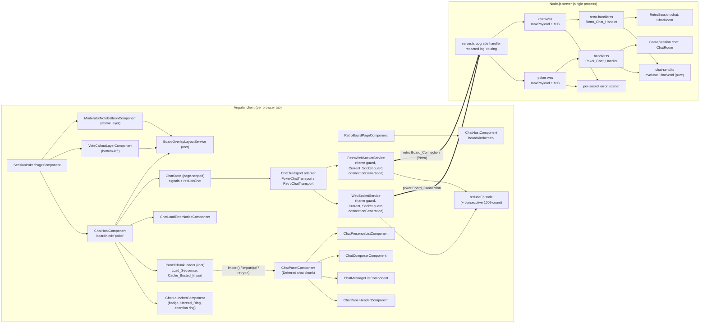
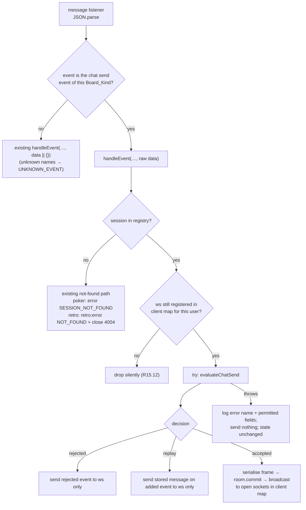

# Design Document: Session Chat

## Overview

This design adds a floating, session-scoped plain-text chat to the poker board (`SessionPokerPageComponent`) and the retro board (`RetroBoardPageComponent`), hardens the WebSocket transport both boards use (Requirements 23 and 25), and ships as release `0.0.9` (Requirement 26). Chat runs over the existing Board_Connection of each page. It adds four event names per Board_Kind, no HTTP route and no WebSocket path.

The design has five parts:

1. **Shared contract** (`shared/types.ts`, new `shared/chat-text.ts`). The `ChatMessage` type, event names, constants, the `isChatMessage` guard and the pure Chat_Validator. Client and server import the same validator, which gives the client-server parity of R14.14 by construction.
2. **Server chat state** (new `server/src/services/chat-room.ts`). A `ChatRoom` class holds the Chat_Buffer (ring buffer), the Sequence_Number counter, the Dedup_Record and the Chat_Rate_Limiter, all driven by an injectable clock. Each `GameSession` and each `RetroSession` owns one `ChatRoom` instance, so chat state lives and dies with the session object (R18.7). A pure decision function (new `server/src/websocket/chat-send.ts`) runs the six checks of R14.11 in order; the poker and retro handlers each call it and do their own broadcasting through their own client maps (R15.6).
3. **Client chat** (new `client/src/app/components/chat/`, new services). A `ChatHostComponent` placed on each board page provides a page-scoped `ChatStore`, a Board_Kind-specific `ChatTransport` adapter and the always-loaded `ChatLauncherComponent`. The Chat_Panel lives in the Deferred chat chunk, which a root `PanelChunkLoader` loads with bounded, cache-busted retries (R20.4, R20.10–R20.18). All chat state logic is a pure reducer (`reduceChat`) wrapped by a signal-based service, following the `connection-episode.ts` pattern.
4. **Transport hardening and layout changes.** `server.ts` redacts the upgrade log line, sets `maxPayload` to 1 MiB and attaches an `error` listener to every accepted socket. The connection-episode reducer gains a bounded count of consecutive 1009 closes. Both client WebSocket services gain a frame-size guard, a boolean `send()` result, a Current_Socket guard that ignores every event of a Stale_Socket, and a `connectionGeneration` signal (R25). The poker Vote_Callout_Layer moves to the bottom-left corner, the Moderator_Note_Balloon stack stacks above it, and the far-prompt entrance is mirrored to the left edge (R12.13), coordinated by a new root `BoardOverlayLayoutService`.
5. **Release.** `Chart.yaml`, the chart README and the root README move from `0.0.8` to `0.0.9` in the commit the maintainer tags `v0.0.9` (R26, see the Release section).

### Key design decisions

| # | Decision | Rationale | Requirements |
|---|---|---|---|
| D1 | Chat state per session object (`GameSession.chat`, `RetroSession.chat`), as instances of one shared `ChatRoom` class | Deleting the session removes chat state with no extra cleanup; the class is a pure definition, each instance is per session, so poker/retro isolation holds (same precedent as the shared `connection-episode` reducer) | R18.6, R18.7, R17.5, R15.6 |
| D2 | Chat_Buffer is a fixed-capacity ring buffer indexed by Sequence_Number | O(1) add, O(1) eviction, O(1) lookup by seq for duplicate replay, because buffered seqs are always contiguous | R18.1–R18.3, R20.2, R16.5 |
| D3 | One pure `evaluateChatSend` decision function, separate from commit | Check order is testable without sockets; commit happens after the outgoing frame is serialised so an exception cannot leave half-applied state | R14.11, R14.12, R20.7 |
| D4 | Client chat state as a pure reducer `reduceChat(state, action) → { state, effects }` plus a signal wrapper | Same shape as `reduceEpisode`; reconnect merge, dedup, ack timers and unread logic are all provable with fast-check without a DOM | R8, R9, R16.8–R16.12, R2 |
| D5 | Unread_Count is derived (`computed`), never counted incrementally | `count(confirmed, !own && seq > readMarker)` satisfies R2.5–R2.8 and R16.8 at once and cannot drift | R2.4–R2.8 |
| D6 | Chat_History merge is "union by id, keep the 200 highest seqs", applied only to a Chat_History whose Connection_Generation is new | Equivalent to the "replace" of R9.4 in every reachable state (see Data Models) and confluent for every arrival order, which R16.9 requires; the generation gate gives R25.11 and R25.12 | R9.4, R16.9, R16.10, R18.12, R25.11, R25.12 |
| D7 | Panel implementation loaded by a `PanelChunkLoader` through a programmatic `import()`, retried as a Cache_Busted_Import, not `@defer` | `@defer` swaps once and its `@error` state is final. A plain `import()` retry is answered from the module map's cached failure in Chromium-based browsers; a new query string makes a new module-map key (C6) | R20.4, R20.10–R20.18 |
| D8 | `ChatStore` provided by `ChatHostComponent`, not `providedIn: 'root'` | One store per Board_Page instance; a new page instance starts empty; poker and retro never share a store | R1.8, R18.11, R15.11 |
| D12 | `PanelChunkLoader` is `providedIn: 'root'` | The `retry=<n>` counter, the "a failure happened in this document" flag and the loaded component class must outlive one Board_Page (R20.13, R20.17); a root service is document-scoped, and only one Board_Page exists at a time | R20.13, R20.15, R20.17 |
| D13 | Each WebSocket service keeps one `SocketRecord` per created socket and checks `record === this.current` in every handler | A closure-captured record is the only way to tell sockets apart, because the browser events carry no identity the service set; the same check makes every stale-socket rule (R25.3–R25.5) one `if` per handler | R25.1–R25.8 |
| D14 | `connectionGeneration` is read with `untracked()` at the moment a Chat_History is dispatched, and passed into the reducer | The reducer stays pure; the generation the store records is the one of the socket that delivered the history, because stale sockets deliver nothing (D13) | R25.9, R25.11, R25.12 |
| D9 | Chat host rendered as a sibling after `.session-poker-page` / `.retro-board`, outside every Interaction_Blocker | Keeps the existing "layer is the last child of `.session-poker-page`" tests passing and keeps chat outside `inert` wrappers and outside the page's `:deep(button:active)` transform rule | R1.5, R20.8 |
| D10 | Bottom-left arrangement coordinated by a root `BoardOverlayLayoutService` exposing signals | The callout layer, the balloon stack and the chat are separate components; measured sizes (ResizeObserver) flow through one signal graph with no polling | R12.3, R12.4, R12.11, R12.12 |
| D11 | Server logs no line per chat message; only exceptions are logged | A flood of rejected sends would otherwise flood the log; R19.2 restricts content when a line is written, it does not require one | R19.1, R19.2, R19.6 |

### Conflicts between requirements and code reality

Each item names what the code does today, why it matters, and what this design does. Items marked **resolved** were decided by the user and are now covered by requirements.md. Items marked **open** are new findings that the user should confirm or that requirements.md leaves unspecified.

| # | Finding in the code | Impact on requirements | Design resolution |
|---|---|---|---|
| C1 | Both handlers call `handleEvent(..., message.data \|\| {})`, so a `null`, `0`, `false` or `""` payload becomes `{}` | R14.10 wants `CHAT_INVALID` for a `null` or primitive payload; after coercion it would fail the session check with `CHAT_SESSION_MISMATCH` | Chat events receive the raw `message.data`. Every other event keeps the `\|\| {}` coercion, so R20.6 holds. |
| C2 | In `WebSocketService` and `RetroWebSocketService`, the handlers of a replaced socket stay attached. When `connect()` runs while a socket exists, the old socket's later `onclose` sets `this.ws = null` (dropping the new socket reference) and dispatches a `close`, which schedules a reconnect and opens a third socket. Messages carry no socket identity, so a consumer cannot tell which socket delivered them | R15.11 requires discarding chat events from a connection other than the current one; the reconnect merge of R9.4–R9.7 needs to know when a new connection started | **Resolved (Requirement 25).** Each service keeps one `SocketRecord` per created socket and ignores every event whose record is not the Current_Socket (D13). Both services expose `connectionGeneration` (R25.7), which the Chat_Store uses to choose between first history, reconnect merge and ignore (R25.9, R25.11, R25.12). R23.15 and R20.6 now permit the change for all events. See "WebSocketService and RetroWebSocketService". |
| C3 | Both board pages read `:sessionId` once from `route.snapshot`. Angular reuses a routed component when only its parameter changes, so `/session/A` → `/session/B` keeps the page, its `sessionId` signal and its socket on A | R18.11's "route parameter changes to a different Board_Session ID" cannot happen today: the page and the socket both stay on A, so chat stays consistent with A | `ChatHostComponent` takes `sessionId` as an input and resets the store when the input changes, so R18.11 holds as soon as a page starts updating it. No page change in this feature. |
| C4 | `server.ts` reads `BASE_PATH` / `PRESERVE_PATH` at import time and calls `server.listen()` at import | R22.10 needs upgrade-log tests under several `BASE_PATH` / `PRESERVE_PATH` combinations; R23.15 confines the change to `server.ts` | `server.ts` exports a factory `createUpgradeHandler(options)` and a pure `redactUpgradeUrl(url)`. The module-level handler is built from env as today. Tests import `server.ts` once (as `server.test.ts` already does) and build handlers with explicit options against their own `http.Server`. |
| C5 | `RetroSessionRegistry.startCleanup()` is never called in production code (only in tests). `server.ts` starts only the poker cleanup timer | The Introduction says retro sessions are also removed by the 30-minute inactivity cleanup. In practice retro sessions, and so retro chat, live until `DELETE` or a restart | No change here (out of scope). Retro chat memory is still bounded per session (200 messages, 50 dedup entries per author, 5 rate-limit times per author). Recommend a separate fix that calls `retroSessionRegistry.startCleanup()` in `server.ts`. |
| C6 | Angular `@defer` swaps its placeholder once; the `@error` block is terminal and the loading state is stored per template, so a later activation cannot re-trigger loading. In Chromium-based browsers a failed module fetch stays in the document's module map under its URL, so a plain retry of the same `import()` rejects without a network request until reload ([whatwg/html#6768](https://github.com/whatwg/html/issues/6768)) | R20.10–R20.18 require retries that really fetch the chunk again | **Resolved (R20.4, R20.10–R20.18).** The `PanelChunkLoader` runs Load_Sequences of 1 attempt plus retries at 1,000, 2,000 and 4,000 ms with a 10,000 ms attempt timeout. Every attempt after a failure is a Cache_Busted_Import of the Chunk_URL, which the loader reads from the compiled importer's source text and resolves against `import.meta.url` (the technique of [`retry-dynamic-import`](https://github.com/fatso83/retry-dynamic-import)). A build-output check (R22.19) proves on every production build that the specifier is readable and that the chunk's static imports are already loaded. See "PanelChunkLoader". |
| C7 | A `CHAT_DUPLICATE` rejection means the original message was evicted from the server buffer, so the client never learns its Sequence_Number | R8.3 marks the Own_Message `sent` with a local timestamp | **Resolved (R5.1).** R5.1 now places every Unsequenced_Own_Message (including `sent` after `CHAT_DUPLICATE`) after the confirmed messages in send order. Such an entry stays in the outbox with Delivery_State `sent` and its local timestamp; if the server copy ever arrives it replaces the entry (R16.12). |
| C8 | Moving the Vote_Callout_Layer to the left means the Far_From_Average_Prompt's `callout-slide-in` keyframe (`translateX(calc(100% + var(--callout-edge-gap))) rotate(9deg)` in `vote-callout.keyframes.scss`) would start on the far side of the prompt, inside the viewport. vote-reveal R5.2 requires the entrance to start outside the nearest viewport edge | `vote-callout.stylesheet.spec.ts` asserts the positive `100% +` offset | **Resolved (R12.13, R20.8, R22.20).** The 0% keyframe becomes `translateX(calc(-100% - var(--callout-edge-gap))) rotate(-9deg)`; the 100% keyframe stays `translateX(0) rotate(0deg)`. The R5.2 slide-in assertion is replaced by its mirrored form. See "Changes to existing components". |
| C9 | Existing handler tests read `sentMessages[0]` as `session:state` and the next message as `participant:joined` | R18.4 / R18.5 require the Chat_History after `session:state` and before any added event, not immediately after | The history is sent after the existing `participant:joined` / `retro:participant:joined` broadcast. Both criteria still hold and existing message indexes stay unchanged. |
| C10 | `retro-layout.property.spec.ts` (Property 27) requires every margin, padding and gap of the retro surfaces to be a plain px/rem value on a 4 px scale; `calc()` and `max()` make it throw | R12.5's 88 px clearance on `.retro-board__columns` | The retro clearance is the literal `padding-bottom: 88px` (88 = 22 × 4). |
| C11 | The global `*:focus-visible { outline: 2px solid #1976d2 }` reaches about 1.26:1 against the launcher's `#667eea` gradient stop | R11.11 requires 3:1 for the launcher's focus indicator | The launcher overrides `:focus-visible` with a two-tone ring (white inner band, `--text-primary` outer band), the same construction as the Unread_Ring. |
| C12 | `requestIdleCallback` is missing in Safari | R20.4 prefetches the chunk "when the browser reports idle through `requestIdleCallback`" | Where `requestIdleCallback` is undefined, there is no idle prefetch; the chunk loads on first activation only. |
| C13 | On the retro server, `role:change` updates `wsUserMap` but the message listener keeps using the `participant` captured at connect | R15.1 takes the Authenticated_Identity "as held at the moment of acceptance" | No impact: the chat uses only `id` and `displayName`, which `role:change` never changes. |
| C14 | R26.7 keeps `client/package.json` and `server/package.json` unchanged in the Release_Commit, and R26.10 puts the Chat_Feature in that same commit | The Chat_Feature can add no npm script and no dependency, so the build-output check of R22.19 cannot be wired as `npm run …` | **Open, resolved in design.** The check is a plain Node script, `client/scripts/check-chat-chunk.mjs`, run as `npx ng build --stats-json && node scripts/check-chat-chunk.mjs` in `client/`. It uses only Node built-ins. No new dependency is needed anywhere in the feature (`fast-check`, `@testing-library/angular` and `ws` are already installed). If the maintainer wants an npm script, it has to land in a separate commit before or after the release, which R26.7 allows only outside the Release_Commit. |
| C15 | R20.10 says an attempt that succeeds after its timeout "SHALL still be used if no later attempt has succeeded yet", but does not say what happens when that late success arrives after the whole Load_Sequence has already failed and the Chat_Load_Error_Notice is shown | Unspecified case | **Open, resolved in design.** The loader stores the component class (state `loaded`, R20.17) and hides the Chat_Load_Error_Notice, but does not set Panel_State to `open`, because the user's activation that asked for the panel has already been answered with the notice. The next activation opens the panel at once. Recommend adding this sentence to R20.10. |
| C16 | R1.6 says activating the Chat_Launcher sets Panel_State to `open`; R20.11 says that while a Load_Sequence runs the launcher is busy and the panel opens when an attempt succeeds | On the first activation the panel cannot open before its chunk exists | No change to requirements. Panel_State stays `closed` during the Load_Sequence and becomes `open` within 100 ms of the successful attempt (R20.11). Once the chunk is loaded, R1.6 applies with no delay (R20.17). |

## Architecture

### Component diagram



### Send, acknowledge and reconnect

```mermaid
sequenceDiagram
  participant C as Composer
  participant S as ChatStore (reduceChat)
  participant T as ChatTransport
  participant H as Chat handler
  participant R as ChatRoom
  C->>S: send(draft)
  S->>S: validateChatText(draft) → Normalised_Text
  S->>S: add outbox entry (pending, new UUID)
  S->>T: send({sessionId, clientMessageId, text})
  S->>S: start ack timer (connected time only)
  T->>H: chat:message:send
  H->>H: registered? session exists?
  H->>R: evaluateChatSend (shape, session, id, text, dedup, rate)
  alt accepted
    R-->>H: decision accepted(message)
    H->>H: serialise frame, then commit
    H-->>T: chat:message:added (broadcast to session)
    T->>S: added(message) → replace outbox entry, stop timer
  else rejected
    H-->>T: chat:message:rejected (sender only)
    T->>S: rejected → failed / sent (duplicate)
  end
  Note over T,H: connection drops: timers suspend, entry stays pending
  T->>H: reconnect (new generation)
  H-->>T: session:state, participant:joined, chat:history
  T->>S: history(gen) → gen > applied: union merge, reconcile outbox, resend pending once
  Note over T,S: a history with gen ≤ applied is ignored (R25.12); events of a Stale_Socket never reach T (R25.4)
```

### Server event routing for chat

The chat branch is added to each handler's existing `switch` so the existing order of checks stays in force: the session lookup (`SESSION_NOT_FOUND` for poker, the `NOT_FOUND` + 4004 path for retro) runs first, then the chat branch.



## Components and Interfaces

### Shared module

#### `shared/types.ts` additions

All names below are exported from `shared/types.ts` (R13.1–R13.7, R23.4). No chat field is added to `GameSessionState` or `RetroSessionState` (R13.10).

```ts
// --- Session chat ---
export const CHAT_MESSAGE_MAX_LENGTH = 500;
export const CHAT_RAW_TEXT_MAX_LENGTH = 2000;
export const CHAT_HISTORY_LIMIT = 200;
export const CHAT_RATE_LIMIT_COUNT = 5;
export const CHAT_RATE_LIMIT_WINDOW_MS = 5000;
export const CHAT_ACK_TIMEOUT_MS = 10000;
export const CHAT_DEDUP_PER_AUTHOR = 50;

export const CHAT_MESSAGE_SEND = 'chat:message:send';
export const CHAT_MESSAGE_ADDED = 'chat:message:added';
export const CHAT_MESSAGE_REJECTED = 'chat:message:rejected';
export const CHAT_HISTORY = 'chat:history';
export const RETRO_CHAT_MESSAGE_SEND = 'retro:chat:message:send';
export const RETRO_CHAT_MESSAGE_ADDED = 'retro:chat:message:added';
export const RETRO_CHAT_MESSAGE_REJECTED = 'retro:chat:message:rejected';
export const RETRO_CHAT_HISTORY = 'retro:chat:history';

export type BoardKind = 'poker' | 'retro';

export interface ChatMessage {
  id: string;              // canonical UUID
  seq: number;             // 1 … Number.MAX_SAFE_INTEGER
  clientMessageId: string; // canonical UUID
  authorId: string;        // non-empty
  authorName: string;
  text: string;
  sentAt: string;          // YYYY-MM-DDTHH:mm:ss.sssZ
}

export type ChatRejection =
  | 'CHAT_SESSION_MISMATCH' | 'CHAT_INVALID' | 'CHAT_EMPTY'
  | 'CHAT_TOO_LONG' | 'CHAT_RATE_LIMITED' | 'CHAT_DUPLICATE';

export interface ChatMessageSendPayload { sessionId: string; clientMessageId: string; text: string; }
export interface ChatMessageAddedPayload { message: ChatMessage; }
export interface ChatHistoryPayload { messages: ChatMessage[]; }
export interface ChatMessageRejectedPayload {
  clientMessageId: string;
  code: ChatRejection;
  message: string;
  retryAfterMs?: number;   // present only for CHAT_RATE_LIMITED
}

/** Event names per Board_Kind, so shared client code never hard-codes a prefix. */
export const CHAT_EVENTS: Readonly<Record<BoardKind, {
  send: string; added: string; rejected: string; history: string;
}>> = { /* poker → CHAT_*, retro → RETRO_CHAT_* */ };

export function isCanonicalUuid(value: unknown): value is string; // 8-4-4-4-12 hex, any version, any case
export function isChatMessage(value: unknown): value is ChatMessage;

// --- WebSocket transport limits (R23.4) ---
export const WS_MAX_PAYLOAD_BYTES = 1048576;
export const WS_PAYLOAD_TOO_LARGE_CLOSE_LIMIT = 3;

// --- Deferred chat chunk loading (R20.12) ---
export const CHAT_PANEL_LOAD_RETRY_DELAYS_MS: readonly number[] = Object.freeze([1000, 2000, 4000]);
export const CHAT_PANEL_LOAD_ATTEMPT_TIMEOUT_MS = 10000;
```

`isChatMessage` returns true exactly when the value is a non-null, non-array object and:

- `id` and `clientMessageId` pass `isCanonicalUuid` (`/^[0-9a-f]{8}-[0-9a-f]{4}-[0-9a-f]{4}-[0-9a-f]{4}-[0-9a-f]{12}$/i`);
- `seq` is `Number.isSafeInteger` and `>= 1`;
- `authorId` is a non-empty string; `authorName` and `text` are strings;
- `sentAt` matches `/^\d{4}-\d{2}-\d{2}T\d{2}:\d{2}:\d{2}\.\d{3}Z$/` **and** `new Date(sentAt).toISOString() === sentAt`. The second test rejects calendar-invalid strings such as month 13, which also covers R5.14's "`sentAt` does not parse as a valid date".

Extra fields are ignored (R13.7).

#### `shared/chat-text.ts` (new)

The Chat_Validator, shared by the composer and both handlers (R14.1–R14.8, R14.14).

```ts
export type ChatTextResult =
  | { ok: true; text: string }   // Normalised_Text, 1..500 code units
  | { ok: false; code: 'CHAT_INVALID' | 'CHAT_TOO_LONG' | 'CHAT_EMPTY' };

export function validateChatText(value: unknown): ChatTextResult;
export function normaliseChatText(raw: string): string; // steps 1–3 only, no length checks
```

`validateChatText` runs, in order:

1. `typeof value !== 'string'` → `CHAT_INVALID` (R14.2).
2. `value.length > CHAT_RAW_TEXT_MAX_LENGTH` → `CHAT_TOO_LONG` without normalising (R14.3).
3. `normaliseChatText`: replace `/\r\n?/g` with `\n`; remove `/[\u0000-\u0008\u000B-\u001F\u007F\u202A-\u202E\u2066-\u2069]/g`; trim the characters U+0009, U+000A, U+FEFF, U+2028, U+2029 and `\p{Zs}` from both ends with two index loops (R14.4).
4. Empty → `CHAT_EMPTY`; longer than 500 → `CHAT_TOO_LONG`; otherwise `{ ok: true, text }` (R14.5, R14.6).

The trim uses index loops rather than a `^[…]+|[…]+$` regex. On a 2,000-character string of spaces followed by a non-space character, the end-anchored regex backtracks from every start position (O(n²)); the loops are O(n). After the removal step, the trim set equals the ECMAScript `String.prototype.trim` set (VT, FF and CR are already gone), so the two agree; the explicit set documents R14.4 exactly.

The function reads no clock and no global state and does not mutate its input (R14.1).

### Server

#### `server/src/services/chat-room.ts` (new)

```ts
export type Clock = () => number; // epoch milliseconds

export class ChatBuffer {
  constructor(capacity: number = CHAT_HISTORY_LIMIT);
  push(message: ChatMessage): ChatMessage | null; // returns the evicted message, if any
  getBySeq(seq: number): ChatMessage | undefined;  // O(1): seqs in the buffer are contiguous
  toArray(): ChatMessage[];                        // ascending seq, fresh array
  get size(): number;
}

export class ChatDedupRecord {
  constructor(perAuthor: number = CHAT_DEDUP_PER_AUTHOR);
  get(authorId: string, clientMessageId: string): number | undefined; // recorded seq
  record(authorId: string, clientMessageId: string, seq: number): void; // evicts that author's oldest at 50
}

export class ChatRateLimiter {
  constructor(clock: Clock, count = CHAT_RATE_LIMIT_COUNT, windowMs = CHAT_RATE_LIMIT_WINDOW_MS);
  check(authorId: string): { ok: true } | { ok: false; retryAfterMs: number };
  record(authorId: string): void;   // records clock() as an acceptance time
}

export type ChatSubmitDecision =
  | { kind: 'accepted'; message: ChatMessage; commit: () => void }
  | { kind: 'replay'; message: ChatMessage }
  | { kind: 'rejected'; code: 'CHAT_DUPLICATE' | 'CHAT_RATE_LIMITED'; retryAfterMs?: number };

export class ChatRoom {
  constructor(options?: { clock?: Clock; idFactory?: () => string; onAccepted?: (atMs: number) => void });
  /** Steps 5 and 6 of R14.11, plus message construction. Pure until `commit()` runs. */
  prepare(author: { id: string; displayName: string }, clientMessageId: string, text: string): ChatSubmitDecision;
  history(): ChatMessage[];
}
```

Behaviour:

- **Ring buffer (D2).** A fixed array of 200 slots, a `head` index and the `lowestSeq` held. `push` writes at `(head + size) % cap`; when full it overwrites the slot of `lowestSeq` and increments both. `getBySeq(s)` returns the slot `(head + (s - lowestSeq)) % cap` when `lowestSeq <= s < lowestSeq + size`. Sequence_Numbers are never reused because the counter is separate from the buffer (R16.2, R18.2).
- **Dedup record.** `Map<authorId, Map<clientMessageId, seq>>`. The inner `Map` keeps insertion order, so the oldest entry is `inner.keys().next()` (O(1) eviction, R16.4). `clientMessageId` is lower-cased before lookup and storage so `A…` and `a…` are one id; the rejection still echoes the raw payload value (R14.15).
- **Rate limiter.** `Map<authorId, number[]>` of at most 5 acceptance times. `check` drops times with `now - t >= windowMs`; if 5 remain it returns `retryAfterMs = clamp(t_oldest + windowMs - now, 1, windowMs)`. The clamp keeps R17.2's range when the injected clock moves backwards. Times are recorded only on acceptance (R17.3). Role is never consulted (R17.9).
- **`prepare`** looks up the dedup record first. A hit whose seq is still buffered returns `replay` with the stored message unchanged (R16.5); a hit whose seq was evicted returns `rejected CHAT_DUPLICATE` (R16.6). A miss, or a hit only under another author, continues (R16.11). The rate-limit check runs next (R17.4). On success it builds the message with `id = idFactory()`, `seq = nextSeq`, `sentAt = new Date(max(clock(), lastSentAtMs)).toISOString()` (R16.1, R16.2) and returns `accepted` with a `commit` closure. Nothing is mutated before `commit()`.
- **`commit()`** runs, in this order with no throwing call between the first and the last mutation: buffer push, `nextSeq++`, `lastSentAtMs` update, dedup record, rate-limit record, `onAccepted(atMs)`.

`GameSession` and `RetroSession` each gain:

```ts
readonly chat: ChatRoom;
// constructor(sessionId, ownerId, config, options?: { chatClock?: Clock })
```

`onAccepted` sets `lastActivityAt = new Date(atMs).toISOString()` (R18.10); the private `touch()` is not reused because it reads `new Date()` rather than the injected clock. The new constructor parameter is optional, so `SessionRegistry`, `RetroSessionRegistry` and every existing test keep compiling. `history:clear`, `board:clear` and `retro:board:complete` do not touch `chat` (R18.8, R18.9).

#### `server/src/websocket/chat-send.ts` (new)

The single place that applies R14.11's order. It imports neither handler and no poker module, so the retro handler may import it without breaking the import scan in `isolation.spec.ts` (that scan forbids `session-registry`, `session-manager`, `game-session`, `metrics-engine`, `websocket/handler` and `routes/sessions`).

```ts
export interface ChatSendContext {
  connectionSessionId: string;
  author: { id: string; displayName: string };
  room: ChatRoom;
}

export type ChatSendOutcome =
  | { kind: 'accepted'; message: ChatMessage; commit: () => void }
  | { kind: 'replay'; message: ChatMessage }
  | { kind: 'rejected'; payload: ChatMessageRejectedPayload };

export function evaluateChatSend(raw: unknown, ctx: ChatSendContext): ChatSendOutcome;

export const CHAT_REJECTION_MESSAGES: Readonly<Record<ChatRejection, string>>;

export function formatChatLogLine(fields: ChatLogFields): string;
export interface ChatLogFields {
  boardKind: BoardKind; sessionId: string; event: string;
  code?: ChatRejection; bufferSize?: number; broadcastCount?: number;
  textLength?: number; errorName?: string;
}
```

`evaluateChatSend` checks, stopping at the first failure:

1. `raw` is a non-null, non-array object, else `CHAT_INVALID` (R14.10).
2. `raw.sessionId` is a string equal to `connectionSessionId`, else `CHAT_SESSION_MISMATCH` (R15.2).
3. `isCanonicalUuid(raw.clientMessageId)`, else `CHAT_INVALID` (R14.9).
4. `validateChatText(raw.text)`, else its code (R14.2–R14.6).
5. and 6. `room.prepare(...)`: duplicate check, then rate limit (R16.5, R16.6, R17.2, R17.4).

Every rejection payload carries `clientMessageId` = the raw value when it is a string, else `''`, the code, and the fixed message (R14.15):

| Code | Message |
|---|---|
| `CHAT_SESSION_MISMATCH` | "This message was addressed to a different session." |
| `CHAT_INVALID` | "The message could not be read." |
| `CHAT_EMPTY` | "Message text is required." |
| `CHAT_TOO_LONG` | "Messages can be at most 500 characters long." |
| `CHAT_RATE_LIMITED` | "You're sending messages too fast." |
| `CHAT_DUPLICATE` | "This message was already delivered." |

`retryAfterMs` is set only for `CHAT_RATE_LIMITED` (R13.5). Author fields in the payload are never read (R15.1).

`formatChatLogLine` builds `chat <boardKind> session=<id> event=<name> [code=…] [buffer=…] [broadcast=…] [textLength=…] [error=<name>]` from the whitelisted fields only; its parameter type has no field for text, author name, payload or token, so R19.1, R19.2 and R19.6 are enforced by the type (D11).

#### Handler changes (`handler.ts`, `retro-handler.ts`)

Both handlers change in the same way, each through its own maps and registry (R15.6):

1. **Raw payload for chat (C1).** The message listener passes `message.data` unchanged when `message.event` is the chat send event of its Board_Kind, and `message.data || {}` otherwise.
2. **New `case`** in the routing `switch` (`CHAT_MESSAGE_SEND` in `handleEvent`, `RETRO_CHAT_MESSAGE_SEND` in `handleRetroEvent`). It sits after the existing session lookup, so a missing session follows the existing paths (R15.3, R15.4). It is not in the poker permission switch or the retro moderator-only list (R15.8, R1.12). The other Board_Kind's chat names still hit `default` → `UNKNOWN_EVENT` (R15.7).
3. **`handleChatSend(ws, user, sessionId, session, raw)`:**
   - Returns at once if `clientMap.get(sessionId)?.get(user.id)?.has(ws)` is false (R15.12). For a removed participant, `participant:remove` deletes the user's entry before calling `close(4010)`, so their sends stop here and broadcasts exclude them (R15.13).
   - Wraps the rest in its own `try/catch`. The retro handler's outer `catch` (which sends `retro:error` with the error message) is never reached by chat errors. The `catch` logs `formatChatLogLine({ …, errorName: err.name })` and sends nothing (R19.6, R20.7).
   - Calls `evaluateChatSend`. `rejected` → `ws.send` of the rejected event (R14.12, R14.13). `replay` → `ws.send` of the added event with the stored message (R16.5). `accepted` → build the frame string with `createMessage(added, { message })`, call `commit()`, then send that one string to every socket in the session's client map whose `readyState === OPEN`, each `send` in its own `try/catch` (R15.5, R20.1).
4. **History on connect.** Right after the existing `participant:joined` / `retro:participant:joined` broadcast in `handleWebSocket` / `handleRetroWebSocket`, the handler sends `chat:history` / `retro:chat:history` with `{ messages: session.chat.history() }` to the new socket only (R18.4, R18.5, C9). Connections to a deleted session close with 4004 before this point (R18.14).
5. **Lookup export for the error log.** `getRegisteredPokerSessionId(ws)` / `getRegisteredRetroSessionId(ws)` return the session ID from `wsSessionMap` only when the socket is still in the client map (R23.8).

#### `server.ts` changes (R23.1–R23.9)

```ts
export function redactUpgradeUrl(url: string | undefined): string; // text before the first '?', '' for undefined
export interface UpgradeHandlerOptions {
  publicPath: string;          // PUBLIC_PATH as derived today
  preservePath: boolean;
  pokerWss: WebSocketServer;
  retroWss: WebSocketServer;
  log?: (line: string) => void;  // defaults to console.log
  lookupSessionId?: { poker(ws: WebSocket): string | undefined; retro(ws: WebSocket): string | undefined };
}
export function createUpgradeHandler(o: UpgradeHandlerOptions):
  (request: IncomingMessage, socket: Duplex, head: Buffer) => void;
export function attachSocketErrorLog(ws: WebSocket, boardKind: BoardKind,
  lookupSessionId: (ws: WebSocket) => string | undefined, log: (line: string) => void): void;
```

- Both servers: `new WebSocketServer({ noServer: true, maxPayload: WS_MAX_PAYLOAD_BYTES })` (R23.4). `ws` 8.18.1 then rejects a message whose payload, across all fragments, exceeds the limit with error code `WS_ERR_UNSUPPORTED_MESSAGE_LENGTH`, closes the socket with 1009 and emits `error`, before any `message` listener runs (R23.5).
- The upgrade handler logs `WebSocket upgrade request: ${redactUpgradeUrl(request.url)}` exactly once. It computes the routing path as today (strip `publicPath` only when `preservePath`, the prefix is non-empty and the URL starts with it) and passes the untouched `request` to `handleUpgrade` (R23.1, R23.3).
- Inside each `handleUpgrade` callback, before `emit('connection', ws, request)`, it calls `attachSocketErrorLog(ws, kind, …)` (R23.7). Event listeners run in registration order, so the error listener is in place before `handleWebSocket` / `handleRetroWebSocket` runs, including for sockets those handlers then close with 4001, 4004 or 4009.
- `attachSocketErrorLog` stores the error's `code` in a closure on `error`, and on the socket's `close` event writes at most one line `WebSocket error: kind=<kind>[ session=<id>] [code=<code>] close=<closeCode>` (R23.8). Logging at `close` gives the real close code without reading `ws` private symbols. The session ID comes from the lookup, never from the URL.
- The 1009 close then follows the existing `close` listener (`removePokerConnection` / `removeRetroConnection`) and the liveness probe's `close` bookkeeping, both of which ignore the code (R23.9).
- The module-level instance is `server.on('upgrade', createUpgradeHandler({ publicPath: PUBLIC_PATH, preservePath, pokerWss: wss, retroWss, lookupSessionId: … }))`. `createUpgradeHandler` and `redactUpgradeUrl` are exported for tests (C4).

No other server log line writes a URL or token today (finding 1 of the Introduction), so R23.2 is met by the upgrade line, the error line and `formatChatLogLine`.

### Client: transport changes

#### `connection-episode.ts` (R23.11–R23.14)

`EpisodeState` gains `consecutiveTooLarge: number` and `haltedTooLarge: boolean`; `EpisodeEffect` gains `{ kind: 'toast-payload-too-large' }`. Changed rows of the transition table:

| Event | Guard | Next state | Effects |
|---|---|---|---|
| `close` 1009 | `haltedTooLarge` | unchanged, `disconnected` | none |
| `close` 1009 | `consecutiveTooLarge + 1 >= 3` | `disconnected`, episode closed, `haltedTooLarge = true`, count 3 | `toast-payload-too-large` (no navigation, no reconnect) |
| `close` 1009 | otherwise, not gave up | `reconnecting`, count + 1 | `dismiss-connection-toasts`, `schedule-reconnect` (existing backoff) |
| `close` other code | — | existing rows, count reset to 0 | existing effects |
| `close` any | `haltedTooLarge` | `disconnected` | none (no further notification) |
| `open` | — | existing row; count and `haltedTooLarge` unchanged | existing |
| `manual-disconnect` | — | existing row; count 0, `haltedTooLarge = false` | none |

`connect()` already resets `episode` to `initialEpisodeState`, which now includes count 0 and `haltedTooLarge = false` (R23.13). Reserved codes, the give-up threshold and `navigate-login` are unchanged. The 1009 notification text is "The connection was closed because a message was too large. Reload the page to reconnect." (R23.12), shown with the existing `connection` tag; no later `open` happens in that episode to dismiss it.

#### `WebSocketService` and `RetroWebSocketService`

- **Frame guard (R23.10, R23.16).** `send(event, data): boolean`. While the socket is not `OPEN` it returns `false` and does nothing else, as today. Otherwise it serialises the envelope once, measures `utf8ByteLength(json)` (new pure helper in `services/frame-guard.ts`, using `TextEncoder`; `JSON.stringify` escapes lone surrogates, so the count matches the bytes the browser sends), and if the length exceeds `WS_MAX_PAYLOAD_BYTES` shows `toastService.show('error', 'This change is too large to send.')` with **no tag** (so `dismiss-connection-toasts` never removes it), logs nothing and returns `false`. It returns `true` after `ws.send`. The existing `try/catch` toast stays. Existing callers ignore the result; the retro `sendX` helpers keep `void`.
- **1009 dispatch.** No change: `onclose` of the Current_Socket already dispatches `{ kind: 'close', code }`.

`IssueListPanelComponent.bulkImport()` clears `bulkText` and closes the panel only when `send()` returns `true` (R23.16).

#### Current_Socket guard and `connectionGeneration` (R25)

Both services get the same change. Today `this.ws` is the only socket reference, and the handlers of a replaced socket stay attached (C2). The change keeps the class shape and the reducer and adds one record per created socket (D13):

```ts
interface SocketRecord {
  readonly socket: WebSocket;
  closeEmitted: boolean;   // the socket fired `close`
  closeCalled: boolean;    // the service called `socket.close()`
}

private current: SocketRecord | null = null;               // the Current_Socket, or none
private readonly _generation = signal(0);
readonly connectionGeneration: Signal<number> = this._generation.asReadonly(); // R25.7
```

`this.ws` is replaced by `this.current?.socket` everywhere. The rules:

- **Closing a socket.** A private `retire(record)` calls `record.socket.close()` only when `!record.closeEmitted && !record.closeCalled`, then sets `closeCalled = true`. It never calls `close()` twice and never on a socket that already closed (R25.1, R25.2).
- **`openConnection()`** retires `this.current` if there is one, sets `_connectionState('reconnecting')` as today, creates `const record: SocketRecord = { socket: new WebSocket(url), closeEmitted: false, closeCalled: false }`, assigns `this.current = record`, and attaches the four handlers. Each handler starts with `if (record !== this.current) { …stale branch…; return; }` (R25.1).
- **Stale branches** (R25.3–R25.5):
  - `onopen`: `retire(record)`; dispatch nothing; generation unchanged.
  - `onmessage`: return without parsing, so no `on<T>()` subscriber (including the retro service's own `retro:session:ended` subscription) sees it.
  - `onclose`: set `record.closeEmitted = true`; nothing else. No dispatch, no change to `this.current`, the reconnect timer, the episode state or the toasts.
  - `onerror`: nothing, as today.
- **Current_Socket branches** (R25.6) are today's code, with these edits:
  - `onopen`: `this._generation.update(g => g + 1)` **before** `dispatch({ kind: 'open' })`, so a consumer that reacts to `connected` already reads the new generation.
  - `onclose`: `record.closeEmitted = true`, and the record **stays** `this.current` (today's `this.ws = null` is removed). The record is closed, so `send()` returns `false` (it is not `OPEN`) and the next `openConnection()` does not call `close()` on it. The rest is unchanged: `manualDisconnect` (set by a reserved code, the give-up and, on retro, `sessionEnded`) → `manual-disconnect`; otherwise `close` with its code.
- **`disconnect()`** (R25.2): sets `manualDisconnect`, clears the reconnect timer, retires `this.current`, sets `this.current = null`, and dispatches exactly one `manual-disconnect` as today. The retired socket's later `close` takes the stale branch, so it no longer dispatches a second `manual-disconnect`.
- **`connect()`** is unchanged apart from going through `openConnection()`; it resets `episode` (and so the 1009 count) as today. Generation is never reset (R25.7).
- **`send(event, data): boolean`** (R25.10, R23.10, R23.16): returns `false` unless `this.current?.socket.readyState === WebSocket.OPEN`; then applies the frame guard and returns `true` after `socket.send(json)`. A Stale_Socket is never written to because only `this.current` is consulted.
- **Reconnect timer.** `scheduleReconnect` is unchanged. A stale `close` cannot cancel or reschedule it because the stale branch never reaches `dispatch` (R25.5).

At most one record is "live" (neither `closeEmitted` nor `closeCalled`) at any time: `openConnection()` retires the old record before creating the new one, and `disconnect()` retires the current one. That is the second half of R25.8.

The retro service's `handleSessionEnded` keeps its logic; it now runs only for a `retro:session:ended` delivered by the Current_Socket (R25.4, R25.6).

The public surface grows by exactly `connectionGeneration` and the boolean result of `send()` (R25.10). `RetroWebSocketService`'s `sendX` helpers keep their `void` signatures and ignore the result.

**Testability.** The existing specs replace `globalThis.WebSocket` with a `MockWebSocket` class that records every instance; the R25 tests reuse that pattern. The mock gains `emitOpen()`, `emitMessage(data)`, `emitClose(code)` and `emitError()` and a `closeCalls` counter, so a test can address any created instance, current or stale.

### Client: chat

#### Files

| Path | Kind | Purpose |
|---|---|---|
| `client/src/app/services/chat-transport.ts` | interface + token + 2 adapters | `ChatTransport`, `CHAT_TRANSPORT`, `PokerChatTransport`, `RetroChatTransport` |
| `client/src/app/services/chat-store.ts` | pure | `ChatState`, `ChatAction`, `ChatEffect`, `reduceChat`, merge helpers, selectors |
| `client/src/app/services/chat-store.service.ts` | `@Injectable()` (page-scoped) | Signals, effect execution, timers, UI state |
| `client/src/app/services/chat-read-marker.ts` | pure + storage wrapper | Key format, parse/serialise, safe `sessionStorage` access |
| `client/src/app/services/panel-chunk-loader.ts` | `providedIn: 'root'` | Panel_Chunk_Loader: Load_Sequences, timeouts, Cache_Busted_Import, idle prefetch, loaded class (D12) |
| `client/src/app/services/chunk-url.ts` | pure | `CHUNK_SPECIFIER_PATTERN`, `readChunkSpecifier`, `resolveChunkUrl`, `withRetryParam` |
| `client/src/app/components/chat/chat-panel-importer.ts` | module | `importChatPanel` (the only `import()` of the panel) and `CHAT_PANEL_IMPORTER_BASE_URL = import.meta.url` |
| `client/src/app/components/chat/chat-load-error-notice.component.ts` | component | Chat_Load_Error_Notice with "Try again" and "Dismiss" |
| `client/scripts/check-chat-chunk.mjs` | Node script | Build-output check of R22.19 (C14) |
| `client/src/app/services/board-overlay-layout.service.ts` | `providedIn: 'root'` | Signals for the bottom-left arrangement and header bottom |
| `client/src/app/services/board-overlay-layout.ts` | pure | Geometry: rectangles of every overlay from viewport, state and measured sizes |
| `client/src/app/services/frame-guard.ts` | pure | `utf8ByteLength`, `exceedsFrameLimit` |
| `client/src/app/components/chat/chat-host.component.ts` | component | Providers, launcher, panel outlet, focus and scroll-lock coordination |
| `client/src/app/components/chat/chat-launcher.component.ts` | component | Button, Unread_Badge, Unread_Ring, attention ring |
| `client/src/app/components/chat/chat-attention.ts` | pure | `reduceAttention` state machine for R24 |
| `client/src/app/components/chat/chat-panel.component.ts` | component (lazy chunk) | Dialog shell, status region, layout modes |
| `client/src/app/components/chat/chat-panel-header.component.ts` | component | Title, online count, presence toggle, minimize, restore, close |
| `client/src/app/components/chat/chat-message-list.component.ts` | component | Log region, rendering, scroll anchoring, New_Messages_Indicator |
| `client/src/app/components/chat/chat-composer.component.ts` | component | Text area, send, counter, rate-limit text |
| `client/src/app/components/chat/chat-presence-list.component.ts` | component | Presence_List |
| `client/src/app/components/chat/chat-format.ts` | pure | Initials, palette index, timestamp, badge, accessible names, indicator text, paste clamp |

All components are standalone with `ChangeDetectionStrategy.OnPush`, use `inject()` and signals, and import shared names through `@shared/types` and `@shared/chat-text` (R13.11). `chat-panel.component.ts` and its children are referenced only from the dynamic `import()` in `chat-panel-importer.ts`, so the build puts them in a separate chunk (R20.4). Both board routes are already lazy, so the launcher, the store and the loader land in the page chunks (or a chunk shared by both) and the `initial` budget is unaffected (R20.16).

The panel components may import only modules that the launcher side also imports: Angular packages, `@shared/types`, `@shared/chat-text`, `chat-store.service.ts`, `chat-transport.ts`, `chat-format.ts` and `board-overlay-layout.service.ts`, plus modules used only inside the panel. Both board pages render `ChatHostComponent`, so every launcher-side module is imported by both page chunks, and esbuild places each module the panel shares with them in `main` or in a chunk that both page chunks import statically. Modules used only by the panel stay inside the Deferred chat chunk. Together these give the R20.4 precondition. Because the panel's static imports keep their URLs under a Cache_Busted_Import, the retried panel also resolves the same `ChatStore` class and DI token as the launcher side. The build-output check (R22.19) enforces it.

#### `ChatTransport`

```ts
export interface ChatTransport {
  readonly boardKind: BoardKind;
  readonly connectionState: Signal<ConnectionState>;
  readonly connectionGeneration: Signal<number>;
  readonly participants: Signal<readonly User[]>;
  readonly currentUserId: Signal<string | null>;
  readonly added$: Observable<unknown>;    // ws.on(CHAT_EVENTS[kind].added)
  readonly history$: Observable<unknown>;
  readonly rejected$: Observable<unknown>;
  send(payload: ChatMessageSendPayload): boolean;
}
export const CHAT_TRANSPORT = new InjectionToken<ChatTransport>('CHAT_TRANSPORT');
```

- `PokerChatTransport` wraps `WebSocketService`, `SessionStateService.participants` (which already follows `session:state`, `participant:joined`, `participant:left` and `role:changed`, R10.4) and `AuthService.getCurrentUser()`.
- `RetroChatTransport` wraps `RetroWebSocketService`, `RetroStateService.participants` and `RetroStateService.currentUserId`.

The adapters only re-expose existing signals and `on<T>()` streams (R20.5, R10.5); payloads arrive as `unknown` and are validated in the reducer.

#### `ChatHostComponent`

```html
<!-- poker page, inside the @else branch, after the .session-poker-page div (D9) -->
<app-chat-host boardKind="poker" [sessionId]="sessionId()" />
<!-- retro page, after the .retro-board div -->
<app-chat-host boardKind="retro" [sessionId]="sessionId()" />
```

- `providers: [ChatStore, { provide: CHAT_TRANSPORT, useFactory: chatTransportFor }]`. The `PanelChunkLoader` is a root service (D12) and is only injected here. The factory reads the `boardKind` attribute through `HostAttributeToken` and returns the matching adapter, so a page can only bind its own connection (R1.1, R1.2).
- Because the host is inside the poker page's `@else` branch, switching to "Session Not Found" destroys it, together with any open panel (R1.3). Page destruction destroys it on every navigation (R1.9, R9.8).
- An `effect` on `sessionId` dispatches `reset(sessionId)` whenever the value changes (R18.11, C3).
- It renders `<app-chat-launcher>`, `<app-chat-load-error-notice>` while `loader.errorShown()` is true, and, while `panelState !== 'closed'` and `loader.panelClass()` is set, `<ng-container *ngComponentOutlet="loader.panelClass()" />`.
- Responsibilities kept here because they outlive the panel component: the narrow-viewport scroll lock (records `window.scrollX/Y` and `documentElement.style.overflow`, restores both on unlock, R4.10), focus return to the launcher on close (R11.7), and publishing the top edge of the minimized header or of the Chat_Load_Error_Notice (whichever is shown) to `BoardOverlayLayoutService`.

#### `ChatStore` service

The service owns no logic beyond running the reducer and its effects. Its public surface is signals plus intent methods.

```ts
@Injectable()
export class ChatStore {
  // reducer-owned (read-only)
  readonly entries: Signal<readonly ChatEntry[]>;       // confirmed by seq, then outbox in send order
  readonly unreadCount: Signal<number>;
  readonly historyStatus: Signal<'loading' | 'loaded' | 'timed-out'>;
  readonly rateLimitUntil: Signal<number | null>;
  readonly sendable: Signal<boolean>;                   // validateChatText(draft).ok && connected (R7.6)
  readonly unreadIncreaseCount: Signal<number>;         // monotonically counts Unread_Increase events
  // UI state that must survive the panel being destroyed
  readonly panelState: WritableSignal<'closed' | 'open' | 'minimized'>;
  readonly draft: WritableSignal<string>;
  readonly caret: WritableSignal<number>;
  readonly scroll: WritableSignal<{ top: number; atBottom: boolean } | null>;
  readonly newIndicatorCount: WritableSignal<number>;
  readonly presenceOpen: WritableSignal<boolean>;
  readonly everOpened: WritableSignal<boolean>;
  // intents
  sendDraft(): void;
  retry(clientMessageId: string): void;
  discard(clientMessageId: string): void;
}
```

- Subscribes to `added$`, `history$` and `rejected$` with `takeUntilDestroyed` and dispatches `added`, `history(raw, untracked(transport.connectionGeneration))` and `rejected` (D14, R25.9). The service delivers messages of the Current_Socket only (R25.4) and the store is reset when `sessionId` changes, which together satisfy R15.11.
- An `effect` on `connectionState` dispatches `connection(state, now)`. A timer started on the first `connected` dispatches `historyTimeout` after `CHAT_ACK_TIMEOUT_MS` if no history has arrived (R5.13).
- Effects: `send` → `transport.send(payload)`; `startAckTimer(id, ms)` / `cancelAckTimer(id)` → `setTimeout` / `clearTimeout` through an injectable `CHAT_TIMERS` token (`{ now, setTimeout, clearTimeout }`, defaulting to `window`); `writeReadMarker(n)`; `announce(text)`.
- `sendDraft()` generates `crypto.randomUUID()` (canonical, lower-case, R7.11), dispatches `send`, clears `draft` and `caret`.
- Read_Marker effect (R2.4): while `panelState() === 'open'`, the `visibilitychange`-backed `documentVisible()` signal is true and at least one confirmed message exists, dispatches `markRead(maxSeq)`. The reducer keeps `max(current, maxSeq)`.
- `newIndicatorCount` follows R6.2, R6.8 and R6.9: on each new non-Own confirmed message (and on each new non-Own message a history adds above the previous highest seq) it increments while `scroll().atBottom` is false, including while the panel is not `open`. The list resets it on At_Bottom and the composer resets it on send.

#### `reduceChat` (pure)

See Data Models for `ChatState`. Actions and their effects:

| Action | State change | Effects |
|---|---|---|
| `reset(sessionId)` | Empty state for the new session; Read_Marker loaded for `(kind, sessionId)` | cancel every ack timer |
| `connection(state, now)` | Leaving `connected`: each pending entry adds `now - segmentStart` to `ackElapsedMs`, `segmentStart = null`. Entering `connected`: `segmentStart = now` | leaving: cancel timers; entering: `startAckTimer(id, CHAT_ACK_TIMEOUT_MS - ackElapsedMs)` per pending |
| `send(clientMessageId, text, now)` | Append outbox entry `pending`, `firstSentAt = now`, `ackElapsedMs = 0`, `segmentStart = now` | `send`, `startAckTimer(id, 10000)` |
| `added(raw)` | Drop if `!isChatMessage(raw.message)` (R13.12). If `authorId === me` and an outbox entry has the same `clientMessageId`: remove the entry and insert the message as confirmed (R8.2). Else merge by id (no-op if the id is present, R16.8). Cap at 200 by highest seq (R18.12) | `cancelAckTimer` when an entry was replaced |
| `history(raw, generation)` | Ignore if `raw.messages` is not an array (R13.13); drop invalid entries. Then by generation (R25.9, R25.11, R25.12): **first** (`historyGeneration === null`): `confirmed = top200(union(confirmed, messages))`, replace every outbox entry whose `clientMessageId` appears under `authorId === me` (R16.12), resend nothing, `historyGeneration = generation`, `historyStatus = 'loaded'` (R18.13). **Reconnect** (`generation > historyGeneration`): the same merge and replacement (R9.4, R9.5), then resend every remaining `pending` entry once in send order with a fresh 10,000 ms timer (R9.6); `failed` entries stay (R9.7); `historyGeneration = generation`. **Stale** (`generation <= historyGeneration`): return the state unchanged with no effects (R25.12) | first and reconnect: `cancelAckTimer` per replaced entry; reconnect only: `send` and `startAckTimer` per resent entry |
| `rejected(raw)` | Ignore unless an outbox entry has this `clientMessageId` and state `pending` or `failed` (R8.12). `CHAT_DUPLICATE` → `sent`, keep local `firstSentAt` as its timestamp (R8.3, C7). Other codes → `failed`, `notice = raw.message` (R8.4). `CHAT_RATE_LIMITED` always sets `rateLimitUntil = now + retryAfterMs`, matched or not (R8.9, R8.12) | `cancelAckTimer`; `announce('Message not sent.')` on a transition to `failed` (R11.18) |
| `ackTimeout(id)` | If still `pending`: `failed`, `notice = 'Delivery could not be confirmed.'` (R8.5) | `announce` |
| `retry(id, now)` | Only when `failed` and connected: `pending`, notice cleared, `ackElapsedMs = 0` (R8.7) | `send` (same id and text), `startAckTimer(id, 10000)` |
| `discard(id)` | Only when `failed`: remove entry (R8.8) | `cancelAckTimer` |
| `markRead(seq)` | `readMarker = max(readMarker ?? 0, seq)` | `writeReadMarker` if changed (R2.10) |
| `historyTimeout` | If still `loading`: `historyStatus = 'timed-out'` (R5.13) | none |

Selectors:

- `entries = [...confirmed, ...outbox]` (R5.1, C7).
- `unreadCount = confirmed.filter(m => m.authorId !== me && m.seq > (readMarker ?? 0)).length` (D5, R2.5–R2.8).
- Unread_Increase is detected in the service by comparing consecutive `unreadCount` values; each increase bumps `unreadIncreaseCount`. A history that lowers or keeps the count is not an increase (R24.2).

A history after a reconnect therefore resends a pending entry at most once per Connection_Generation, even if the same history were delivered twice (R16.10, R25.11). `reset(sessionId)` sets `historyGeneration = null`, so the first history after a session change is again a "first" history with no resend (R25.9, R18.11). Generations only grow (R25.7), so `historyGeneration` is the highest generation applied.

#### `ChatLauncherComponent`

- Native `<button type="button" class="chat-launcher">` with `aria-controls="chat-panel-<kind>"`, `aria-expanded` = `panelState === 'open'` (R11.1), accessible name from `launcherLabel(unread)` (R11.2), `aria-busy="true"` and the visible text "Loading chat…" while `loader.busy()` is true, which covers the attempts and the waits between them (R20.11). Click and native Enter/Space activation run `ChatHost.toggleFromLauncher()`: while busy, nothing (R20.11); while the panel class is not loaded, `loader.requestOpen()` (see PanelChunkLoader); otherwise `closed`/`minimized` → `open` and `open` on a Wide_Viewport → `closed` (R1.6, R1.7, C16). On a Narrow_Viewport with the panel open the launcher is hidden (`display: none`), so it is not activatable (R4.4).
- Fixed `right: 16px; bottom: 16px`, 56 px (48 px below 768 px) circle, `z-index: 910`, `background: var(--gradient-primary)`, icon `var(--text-on-primary)` (R1.4, R12.1, R12.2).
- **Unread_Badge** `<span aria-hidden="true">` with `badgeText(unread)` (`'1'…'99'`, `'99+'`, hidden at 0), `background: var(--status-fault)` with white text (6.54:1, R11.12). It is hidden from assistive technology because the button name already carries the count (R24.9).
- **Unread_Ring**: `box-shadow: 0 0 0 2px var(--text-on-primary), 0 0 0 4px var(--text-primary)` while `unread > 0 && panelState !== 'open'` (4 px total; Inner_Band and Outer_Band 2 px each, R24.5). Box shadows do not change the bounding box or the hit target (R24.3).
- **Focus indicator (C11)**: `:focus-visible { outline: none; box-shadow: 0 0 0 3px var(--text-on-primary), 0 0 0 6px var(--text-primary); }`. It replaces the Unread_Ring while focused and stays within 7 px.
- **Attention ring**: a `::after`-like child `<span class="chat-launcher__pulse" aria-hidden="true">` with `position: absolute; inset: 0; border-radius: 50%; border: 2px solid var(--text-on-primary); pointer-events: none`, animated with `@keyframes chat-pulse { from { transform: scale(1); opacity: .6 } to { transform: scale(1.25); opacity: 0 } }`, `animation: chat-pulse 1200ms ease-out 0ms 3 both` (R24.1, R24.3). At scale 1.25 a 56 px ring reaches 7 px beyond the edge (48 px: 6 px). Restarting is done by re-keying the span (`@for (run of [attentionRun()]; track run)`), which creates a new element and restarts the CSS animation from its first iteration (R24.2).
- `reduceAttention` (pure, `chat-attention.ts`) decides `attentionRun` and visibility from events `{ unreadIncrease, panelState, visibility, reducedMotion, tick(now) }`:
  - start or restart on an Unread_Increase while `closed`/`minimized`, visible and not reduced motion (R24.1, R24.2);
  - remember a pending start while hidden and start once on becoming visible (R24.10);
  - stop at `start + 3600 ms`, on `open`, on `unread === 0`, or on reduced motion turning on (R24.4, R24.6, R24.7);
  - leave a running animation alone on `closed` ↔ `minimized` (R24.12).

  The service applies "stop" by removing the span; a timer at 3,600 ms ends the run.
- `@media (prefers-reduced-motion: reduce)`: no pulse element is rendered and the Unread_Ring has no transition (R24.7).

#### `ChatPanelComponent` and children

The panel is created only while `panelState !== 'closed'` (R3.3). It reads all state from `ChatStore`, so it can be destroyed and recreated without losing state (R3.13).

- **Shell**: `<section id="chat-panel-<kind>" role="dialog" aria-label="Session chat" [attr.aria-modal]="modal()">`, where `modal = narrow && panelState === 'open'` (R11.3–R11.5). `z-index: 920` (R12.2). `background: var(--surface-board)`, `color: var(--text-primary)`, `box-shadow: var(--shadow-lg)`.
- **Layout modes** (R4):
  - Wide open: `position: fixed; right: 16px; bottom: 80px; width: 360px; max-height: min(520px, 70vh, calc(100vh - 80px - var(--chat-header-clearance)))`, where `--chat-header-clearance` is `headerBottom + 8` from `BoardOverlayLayoutService`; a flex column with the header and composer `flex: none` and the list `flex: 1; min-height: 0; overflow-y: auto` (R4.1, R4.2).
  - Narrow open: `inset: 0; width: 100vw; height: 100dvh` (R4.3). When `visualViewport` exists, a listener on its `resize` and `scroll` events sets `height = visualViewport.height` and `top = visualViewport.offsetTop` in the same frame, so the composer stays inside the visual viewport (R4.5). Without `visualViewport`, only `100dvh` applies (R4.11).
  - Minimized: only the header, `right: 16px; bottom: 80px` (narrow: `bottom: 72px`), `width: min(360px, 100vw - 32px)` (R3.2, R4.9).
  - Breakpoint changes come from a `matchMedia('(max-width: 767px)')` signal; the panel stays mounted across the switch, so focus, draft, list contents and scroll stay unchanged (R4.6).
- **Status region** (R11.18): one `<p role="status" class="chat-status">` that exists whenever the panel is `open`. It holds, in this priority, the offline text (R9.1), the rate-limit text (R8.9) and the last `announce()` text.
- **Transitions**: `transform` and `opacity` only, 150 ms; none under `prefers-reduced-motion: reduce` (R12.7, R11.14).
- **Focus** (R3.12, R11.6, R11.16): on entering `open`, `afterNextRender` focuses the composer text area; on `open → minimized`, focus moves to the restore control.
- **Focus containment** (narrow open only, R11.5): a `keydown` Tab handler wraps focus inside the panel, and a document `focusin` listener returns focus to the panel unless the target is inside `[role="dialog"]`, `[role="alertdialog"]`, `[role="menu"]` or `app-countdown-overlay` outside the panel. That exception gives R12.10 (a page dialog that takes focus is left alone until it closes).
- **Escape** (R3.7): `keydown` on the shell; `!event.isComposing` → `closed`.

`ChatPanelHeaderComponent` renders "Chat", `onlineLabel(participants)` ("N online", R10.1), the Presence_List toggle ("Show participants", `aria-expanded`, R10.2), the minimize ("Minimize chat") and close ("Close chat") buttons. While minimized, the title and Unread_Count area is one `<button>` named "Restore chat", with `aria-describedby` pointing at a visually hidden "N unread messages" element while unread > 0 (R3.5, R11.3), and the Unread_Dot (`aria-hidden`, 10 px, `var(--color-primary-dark)`, 4.81:1 on white and at least 3.93:1 on the translucent `--surface-board` over every `--gradient-page-bg` stop, R24.8; `--color-primary` reached only 2.99:1 there).

`ChatMessageListComponent`:

- `<div role="log" aria-label="Chat messages" aria-live="polite" aria-relevant="additions" tabindex="0" [attr.aria-busy]="applyingHistory()">` (R11.8, R11.15, R11.17). The panel is not rendered while closed and minimized hides the list with `hidden`, which removes it from the accessibility tree (R11.8).
- `@for (entry of store.entries(); track entry.key)` where `key` is the message `id` or `out:<clientMessageId>` (R20.3).
- Each row exposes, in DOM order, author name ("You" for own), `<time [attr.datetime]="sentAt">` with `formatChatTime(sentAt, now)` or the delivery text ("Sending…" / "Not sent"), then the text. The avatar is `aria-hidden="true"` (R5.2, R5.3, R5.5, R8.10, R11.9).
- Text renders with `{{ }}` interpolation inside `white-space: pre-wrap; overflow-wrap: anywhere` (R5.8, R5.9, R4.8, R19.4).
- Own rows: `align-self: flex-end`, `background: var(--color-primary-dark)` (#5a67d8, 4.8:1 with white). Others: `background: var(--chat-bubble-other)` (new token `#edf2f7`, about 15.7:1 with `--text-primary`) (R5.6, R5.7).
- Failed rows show "Retry sending message" (disabled while not connected) and "Discard message" buttons (R8.6, R8.11, R9.9).
- Empty state "No messages yet. Say hello to your team." when `historyStatus === 'loaded'` and no entries; "Loading messages…" while `loading`; "Earlier messages could not be loaded." when `timed-out` (R5.10, R5.11, R5.13).
- **Scroll anchoring (R6.2, R6.8).** Safari does not support `overflow-anchor`, so the list sets `overflow-anchor: none` and anchors by hand. Before each change to `entries` it records the first row whose bottom is below the viewport top and that row's offset; after render (`afterRenderEffect`) it adjusts `scrollTop` by the offset change. When the list was At_Bottom (`scrollHeight - scrollTop - clientHeight <= 48`) before the change, it scrolls to the end instead (R6.1). Scrolls to the end use `behavior: 'smooth'` unless reduced motion is set, where they are a single `scrollTop` assignment (R6.6).
- **New_Messages_Indicator**: `<button>` pinned to the bottom (`position: sticky; bottom: 0`), text from `indicatorText(n)` (R6.7). Activation scrolls to the end, resets the count and focuses the composer (R6.4). A `scroll` listener resets it on At_Bottom (R6.5).
- On every `scroll` event the list writes `store.scroll` so the panel can restore it (R3.8, R6.9).

`ChatComposerComponent`:

- `<textarea aria-label="Message" maxlength="500" rows="1">` plus `<button aria-label="Send message" [disabled]="!store.sendable()">` (R7.6, R7.7, R11.10). `maxlength` blocks typed input beyond 500 code units (R7.8). A `paste` handler inserts `clampPaste(draft, selection, pasted)`, which cuts at the remaining space minus one when the cut would split a surrogate pair (R7.12).
- **Auto-grow** (R7.1): after each input, `height = auto`, then `min(scrollHeight, 5 × lineHeight + padding)`. `scrollHeight` counts soft-wrapped lines. CSS `field-sizing: content` is not used because Firefox and Safari do not support it.
- **Keys**: Enter without Shift, when `!event.isComposing && event.keyCode !== 229`: `preventDefault()`, and send only if sendable (R7.2, R7.4, R7.7). Shift+Enter keeps the default line break (R7.3). The `229` check covers Safari, which reports `isComposing === false` on the Enter that ends some IME compositions.
- Counter `<span id=…>` with `${length}/500` while `length >= 400` (R7.9). Rate-limit text "You're sending messages too fast. Try again in N s." with `N = ceil((until - now) / 1000)`, updated by a 1 s interval while shown (R8.9). `aria-describedby` lists only the elements currently shown (R11.10).
- The offline text sits above the composer; the text area stays editable while offline (R9.1, R9.2).
- Draft and caret are written to `ChatStore` on every input, never to storage (R3.10).

`ChatPresenceListComponent` renders `presenceEntries(participants, me)`: one entry per distinct user ID, sorted case-insensitively with accents significant by `localeCompare(…, undefined, { sensitivity: 'accent' })`, ties broken by user ID; "(you)" and "Moderator" as visible text (R10.3, R10.6). Visibility comes from `store.presenceOpen`, which starts `false` and survives panel state changes (R10.7). Offline, it keeps the last list because the source signals keep their last value (R10.8).

#### `chat-format.ts` (pure)

| Function | Output | Requirements |
|---|---|---|
| `avatarInitials(authorName)` | Upper-cased first code point of the first two whitespace-separated words; `?` when there is none | R5.3 |
| `avatarColorIndex(authorId)` | FNV-1a 32-bit hash of the UTF-16 code units, mod 8 | R5.3 |
| `AVATAR_PALETTE` | `#2b6cb0, #276749, #6b46c1, #c53030, #b83280, #2c7a7b, #975a16, #4a5568` (each ≥ 5.0:1 with `#ffffff`) | R5.4, R12.1 |
| `formatChatTime(sentAt, now)` | `HH:mm` on the same local day, else `MMM d, HH:mm` with English month abbreviations | R5.5 |
| `badgeText(n)` | `''` for 0, `'1'…'99'`, `'99+'` | R2.1–R2.3, R2.9 |
| `launcherLabel(n)` | "Open chat" / "Open chat, 1 unread message" / "Open chat, N unread messages" | R11.2 |
| `unreadDescription(n)` | "1 unread message" / "N unread messages" | R11.3 |
| `indicatorText(n)` | "1 new message" / "N new messages" / "99+ new messages" | R6.7 |
| `onlineLabel(participants)` | "N online", N = distinct user IDs | R10.1 |
| `presenceEntries(participants, me)` | Sorted, de-duplicated entries with `isYou`, `isModerator` | R10.3, R10.6 |
| `clampPaste(draft, selStart, selEnd, pasted)` | New draft and caret, ≤ 500 code units, no split surrogate pair | R7.12 |
| `rateLimitSeconds(until, now)` | `ceil(max(0, until - now) / 1000)` | R8.9 |

#### `BoardOverlayLayoutService` and the bottom-left arrangement

```ts
@Injectable({ providedIn: 'root' })
export class BoardOverlayLayoutService {
  readonly viewport: Signal<{ width: number; height: number }>; // resize, not debounced
  readonly headerBottomPx: Signal<number>;
  readonly chatDockTopPx: Signal<number | null>;             // top of the minimized header or the Chat_Load_Error_Notice, narrow only
  readonly calloutLayerHeightPx: Signal<number>;             // 0 when no callout is visible
  readonly baseOffsetPx: Signal<number>;                     // Bottom_Left_Base_Offset
  readonly balloonBottomPx: Signal<number>;
  readonly balloonMaxHeightPx: Signal<number>;
  readonly balloonHidden: Signal<boolean>;                   // space < 64 px
  trackHeader(el: Element, destroyRef: DestroyRef): void;    // called by both board pages
  trackCalloutLayer(el: Element, destroyRef: DestroyRef): void;
  setChatDockTop(px: number | null): void;
}
```

The computeds call the pure functions in `board-overlay-layout.ts`:

- `baseOffsetPx = narrow && chatDockTop !== null ? viewportH - chatDockTop + 8 : 16` (the Bottom_Left_Base_Offset, including the Chat_Load_Error_Notice case of R12.12).
- `balloonBottomPx = calloutLayerHeight > 0 ? layerBottom + calloutLayerHeight + 8 : baseOffsetPx`.
- `balloonMaxHeightPx = min(0.5 × viewportH, viewportH - balloonBottomPx - (headerBottom + 8))`.
- `balloonHidden = balloonMaxHeightPx < 64` (R12.11).

Measurements come from `ResizeObserver`, which reports before paint, so positions update in the same frame. That satisfies the 100 ms bounds of R12.4 and R12.12. The `viewport` signal listens to `resize` without the layer's existing 150 ms debounce; the breakpoint itself is a CSS media query and applies at once.

Changes to existing components:

- **`VoteCalloutLayerComponent`**: `left: 16px` replaces `right: 16px`; `align-items: flex-start`; the narrow rule drops `left/right: 16px` and sets `max-width: calc(100vw - 88px)` while keeping `max-height: 45vh; overflow-y: auto` (R12.3). `bottomPx` becomes `max(baseOffsetPx, inset > 0 ? inset + 16 : 16)`, returned as `null` when it equals 16, so the existing "no inline bottom when no keyboard" behaviour stays. The layer calls `trackCalloutLayer(hostDiv)`.
- **`vote-callout.keyframes.scss`** (R12.13, C8): `callout-slide-in` is mirrored about the vertical axis. The duration, easing, `opacity` stops, the other keyframes and the reduced-motion rules stay as they are.

  ```scss
  /* Far prompt: slide in and settle. R5.2 / R12.13: starts fully off the left edge at -9deg (magnitude 6-15), ends at 0. */
  @keyframes callout-slide-in {
    0%   { transform: translateX(calc(-100% - var(--callout-edge-gap))) rotate(-9deg); opacity: 0; }
    65%  { transform: translateX(2%) rotate(1.2deg); opacity: 1; }   /* mirrored overshoot */
    100% { transform: translateX(0) rotate(0deg); opacity: 1; }
  }
  ```

  The layer's left edge is 16 px from the viewport edge and `--callout-edge-gap` is 16 px, so the 0% position puts the prompt's right edge at the viewport's left edge or further left.
- **`NearAverageCalloutComponent`**: narrow `max-width: calc(100vw - 88px)` (R12.3).
- **`ModeratorNoteBalloonComponent`**: `[style.bottom.px]="layout.balloonBottomPx()"`, `[style.max-height.px]="layout.balloonMaxHeightPx()"`, narrow `max-width: calc(100vw - 88px)`, and `@if (visible() && !layout.balloonHidden())`. Hiding keeps `_balloons` and the timers untouched (R12.4, R12.11).
- **Scroll containers (R12.5)**: `padding-bottom: 88px` on `.session-poker-page__board-area`, `.session-poker-page__sidebar--desktop`, `.session-poker-page__sidebar-overlay` and, below 768 px, `.session-poker-page` (the document scrolls there); `padding-bottom: 88px` on `.retro-board__columns` (C10).
- **`styles.scss`**: new token `--chat-bubble-other: #edf2f7`. No `color-mix()` is used in chat styles, following the html2canvas note in `styles.scss`.

Every chat component stylesheet stays under the 6 kB `anyComponentStyle` warning (R12.8). The pulse keyframes go into a new `chat.keyframes.scss` imported once from `styles.scss`, following the `vote-callout.keyframes.scss` precedent; emulated encapsulation does not scope `@keyframes`, and this keeps the launcher's component styles small.

#### `PanelChunkLoader` (R20.4, R20.10–R20.18)

##### The importer and the Chunk_URL

`chat-panel-importer.ts` is the only module that names the panel:

```ts
export const importChatPanel = (): Promise<Type<unknown>> =>
  import('./chat-panel.component').then((m) => m.ChatPanelComponent);
export const CHAT_PANEL_IMPORTER_BASE_URL: string = import.meta.url;
```

The Angular 21 application builder bundles with esbuild and rewrites the specifier to the emitted file, relative to the chunk that holds the call. The current production output shows the form, for example `loadComponent:()=>import("./chunk-EVDY74SK.js").then(t=>t.SessionPo…` in `main-<HASH>.js`. Both constants come from one source module, and esbuild never splits a module across chunks, so `import.meta.url` is the URL of the chunk that holds the rewritten specifier, including any `BASE_PATH` prefix.

`chunk-url.ts` (pure):

```ts
/** First relative specifier of an import() call in a function's source text. */
export const CHUNK_SPECIFIER_PATTERN = /\bimport\(\s*(["'`])(\.{1,2}\/[^"'`]+)\1\s*\)/;
export function readChunkSpecifier(importer: () => unknown): string | null;   // Function.prototype.toString + pattern
export function resolveChunkUrl(importer: () => unknown, baseUrl: string): string | null; // new URL(spec, baseUrl).href, null on any failure
export function withRetryParam(url: string, n: number): string;               // '?retry=n', or '&retry=n' when url already has '?'; keeps any '#'
```

`readChunkSpecifier` returns `null` when `toString()` throws, when no relative specifier is found (for example after a future builder emits `import(variable)`), and `resolveChunkUrl` returns `null` when `new URL` throws. `null` selects the fallback of R20.18.

A Cache_Busted_Import runs `import(/* @vite-ignore */ url)`. The comment stops the Vite-based dev server from warning about a non-literal specifier; esbuild leaves an `import()` of a variable untouched. The cache-busted module is a new module record with a new `ChatPanelComponent` class, but its static imports resolve to the URLs already in the module map, so it shares `ChatStore`, `@shared/types` and Angular with the launcher side (see the R20.4 precondition above).

##### Interface

```ts
export interface PanelChunkLoaderDeps {
  importer: () => Promise<Type<unknown>>;               // default importChatPanel
  baseUrl: string;                                      // default CHAT_PANEL_IMPORTER_BASE_URL
  importUrl: (url: string) => Promise<Type<unknown>>;   // default: url => import(url).then(m => m.ChatPanelComponent)
  timers: { setTimeout; clearTimeout; now };            // default window
  requestIdle: ((cb: () => void) => void) | null;       // default window.requestIdleCallback, or null
}
export const PANEL_CHUNK_LOADER_DEPS = new InjectionToken<PanelChunkLoaderDeps>('PANEL_CHUNK_LOADER_DEPS', { factory: defaultDeps });

@Injectable({ providedIn: 'root' })
export class PanelChunkLoader {
  readonly panelClass: Signal<Type<unknown> | null>;  // set once, kept for the document (R20.17)
  readonly busy: Signal<boolean>;                     // a user-started Load_Sequence is running (R20.11)
  readonly errorShown: Signal<boolean>;               // Chat_Load_Error_Notice visible (R20.14)
  readonly opened: Observable<void>;                  // emits when a user-started sequence succeeds
  prefetchWhenIdle(): void;                           // called once by ChatHost (R20.4, R20.15, C12)
  requestOpen(): void;                                // launcher or "Try again" activation
  dismissError(): void;                               // "Dismiss"
}
```

`ChatHost` subscribes to `opened` and sets Panel_State `open` (the store write is synchronous, so the panel opens in the same task, within the 100 ms of R20.11). The injected `importUrl` is a thin wrapper so tests never execute a real dynamic import.

##### State and rules

Document-wide fields: `panelClass`, `anyFailed` (some attempt in this document failed, prefetch included), `retryCounter` (last `n` used), and the current `sequence` (or none). A sequence holds `attemptIndex` (0–3), `userStarted`, the pending attempt promises, and the retry timer.

- **Attempt URL** (R20.13, R20.18). If `!anyFailed`, call `importer()`. Otherwise, compute `chunkUrl = resolveChunkUrl(importer, baseUrl)` once and cache it; if it is a string, call `importUrl(withRetryParam(chunkUrl, ++retryCounter))`; if it is `null`, call `importer()` unchanged. The counter is document-wide, so no URL repeats across Load_Sequences or pages.
- **Attempt outcome.** Each attempt races its promise against a `CHAT_PANEL_LOAD_ATTEMPT_TIMEOUT_MS` timer. Rejection or timeout counts as a failure and sets `anyFailed = true`. The promise of a timed-out attempt stays subscribed: if it later resolves while `panelClass` is still `null`, it is used (R20.10).
- **Sequence** (R20.10, R20.12). After failed attempt k (k = 0, 1, 2), schedule attempt k + 1 after `CHAT_PANEL_LOAD_RETRY_DELAYS_MS[k]`. The number of retries is the array length, so at most 4 attempts run. No attempt starts before its delay. The first success sets `panelClass`, cancels the retry timer and ends the sequence.
- **Success.** `panelClass.set(cls)`; `busy` false; `errorShown` false; if `userStarted`, emit `opened`. After this no attempt or prefetch ever runs again (R20.17).
- **Exhaustion** (R20.14). After the fourth failure: `busy` false; if `userStarted`, `errorShown` true and Panel_State stays `closed`.
- **Late success after exhaustion** (C15). `panelClass` is set, `errorShown` becomes false, `opened` is not emitted.
- **`requestOpen()`** (R20.11, R20.14, R20.15). If `panelClass` is set, emit `opened` at once. If a user-started sequence is running, do nothing. If the idle prefetch attempt is running, mark its sequence `userStarted` and set `busy` (the prefetch attempt becomes the initial attempt, and its retries follow the normal schedule). Otherwise hide the notice and start a new user-started sequence.
- **`prefetchWhenIdle()`** (R20.4, R20.15). Once per document, when `requestIdle` exists and `panelClass` is `null`, it schedules one non-user-started attempt. If that attempt fails and no user has adopted it, the sequence ends silently with no retry, no notice and no toast; `anyFailed` makes the next attempt cache-busted.
- **`dismissError()`** hides the notice and starts nothing. The notice component then focuses the launcher through `ChatHost`.

While `panelClass` is `null` nothing else in the chat stops: the store keeps reducing events and the launcher keeps its badge, ring and attention animation (R20.16).

##### `ChatLoadErrorNoticeComponent`

Fixed at the minimized-header position (`right: 16px; bottom: 80px`, narrow `bottom: 72px`, `width: min(360px, 100vw - 32px)`), `z-index: 920`, `background: var(--surface-board)`, `box-shadow: var(--shadow-lg)` (R20.14). Content: `<p role="alert">Chat could not be loaded.</p>`, then `<button type="button">Try again</button>` and `<button type="button">Dismiss</button>`, each at least 44 × 44 px with the chat focus ring (R11.11). "Try again" calls `requestOpen()`; "Dismiss" calls `dismissError()` and focuses the launcher. Its rectangle feeds `BoardOverlayLayoutService.setChatDockTop` on a Narrow_Viewport (R12.12).

##### Build-output check (R22.19)

`client/scripts/check-chat-chunk.mjs`, run in `client/` after `npx ng build --stats-json` (C14). The builder writes the esbuild metafile to `dist/client/stats.json` and the files to `dist/client/browser/`. The script uses only `node:fs` and `node:path` and exits non-zero with a message naming the failed condition:

1. **Find the chunks.** In `metafile.outputs`, the Deferred chat chunk is the output whose `inputs` contain a key ending in `components/chat/chat-panel.component.ts`; the importer chunk is the output whose `inputs` contain a key ending in `components/chat/chat-panel-importer.ts`; the board page chunks are the outputs whose `inputs` contain `session-poker-page.component.ts` and `retro-board-page.component.ts`. Output keys are matched by base name, so the check does not depend on the `dist` prefix. Each must exist exactly once.
2. **Readable specifier.** The importer chunk's text must contain a match of the same `CHUNK_SPECIFIER_PATTERN` whose specifier, resolved against the importer chunk's own path, names the Deferred chat chunk, and that file must exist in `dist/client/browser/`. A Vitest test asserts that the pattern literal in the script equals `CHUNK_SPECIFIER_PATTERN.source`, so the two cannot drift.
3. **Not initial.** The initial set is the closure over `import-statement` imports of the outputs that have an `entryPoint` ending in `main.ts` or `polyfills` (cross-checked against the `<script>` and `modulepreload` tags of `dist/client/browser/index.html`). The Deferred chat chunk must not be in it.
4. **Static imports already loaded.** For each board page chunk, `loaded(page) = initial ∪ staticClosure(page)`. Every `import-statement` import of the Deferred chat chunk must lie in `loaded(poker) ∩ loaded(retro)`.

**If the check cannot pass.** A failure of condition 4 is fixed in code: the module the panel pulls in alone is imported by the launcher side too, or moved into a module the launcher already imports. A failure of condition 2 means a builder version stopped emitting a literal relative specifier; then the fallback of the Introduction applies: `chat-panel-importer.ts` imports the panel statically, the board page chunks contain the panel, the Panel_Chunk_Loader resolves at once, and R20.4's deferral and R20.10–R20.18's retries become moot. That fallback changes requirements and needs the user's agreement first.

## Data Models

### Shared message model

`ChatMessage` (see Components and Interfaces). It is a plain object; every collection crosses the WebSocket as a plain array (R13.9). `isChatMessage` is the only validity test on the client, and `sentAt` validity is part of it.

### Server state per Board_Session

```ts
class ChatRoom {
  private readonly buffer: ChatBuffer;          // ≤ 200 messages, ascending seq, contiguous seqs
  private nextSeq = 1;                          // issued, never reused
  private lastSentAtMs = -Infinity;             // keeps sentAt non-decreasing
  private readonly dedup: ChatDedupRecord;      // authorId → (clientMessageId → seq), ≤ 50 per author
  private readonly limiter: ChatRateLimiter;    // authorId → acceptance times, ≤ 5 per author
  private readonly clock: Clock;
}
```

Invariants that hold after every `commit()`:

- `buffer.toArray().map(m => m.seq)` is `[nextSeq - size, …, nextSeq - 1]`.
- Each author has at most 50 dedup entries and at most 5 limiter times.
- `sentAt` is non-decreasing in seq order.

Memory per session is bounded by 200 messages of at most 500 code units each, plus 50 dedup entries and 5 timestamps per distinct author.

### Client state

```ts
interface ChatState {
  readonly boardKind: BoardKind;
  readonly sessionId: string;
  readonly me: string | null;                 // current user ID
  readonly confirmed: readonly ChatMessage[]; // ascending seq, unique id, ≤ 200
  readonly outbox: readonly OutboxEntry[];    // first-send order
  readonly historyStatus: 'loading' | 'loaded' | 'timed-out';
  readonly historyGeneration: number | null;  // highest Connection_Generation applied; null after render or reset (R25.9)
  readonly connection: ConnectionState;
  readonly readMarker: number | null;         // highest seq shown while open and visible
  readonly rateLimitUntil: number | null;     // epoch ms
}

interface OutboxEntry {
  readonly clientMessageId: string;
  readonly text: string;                      // Normalised_Text
  readonly firstSentAt: number;               // epoch ms, the local timestamp after CHAT_DUPLICATE
  readonly state: 'pending' | 'failed' | 'sent';
  readonly ackElapsedMs: number;              // connected time accumulated since last (re)send
  readonly segmentStart: number | null;       // start of the current connected segment
  readonly notice: string | null;             // rejection or timeout text
}

type ChatEntry =
  | { key: string; kind: 'confirmed'; message: ChatMessage; own: boolean }
  | { key: string; kind: 'outbox'; entry: OutboxEntry };
```

Invariants:

- No `clientMessageId` of the current user appears twice across `confirmed` and `outbox` (R16.12).
- No `id` appears twice in `confirmed` (R16.8).
- `confirmed` is sorted by seq and has at most 200 entries (R18.12).
- `readMarker` never decreases (R2.4).

**Why the union merge (D6) equals the "replace" of R9.4.** A Chat_History H is the server buffer at one moment: the most recent `min(n, 200)` accepted messages, with contiguous seqs.

- If `|H| < 200`, the server has never evicted, so H holds every seq from 1 to `max(H)`. The client holds no confirmed seq ≤ `max(H)` that is not in H, so the union adds only seqs greater than `max(H)`.
- If `|H| = 200`, keeping the 200 highest seqs of the union drops every client message below `min(H)`.

In both cases the result is H plus messages newer than H. On a fresh connection none exist, because the server sends the history before any added event. The union form also gives the same result for every arrival order, which the confluence property (R16.9) needs.

**Generation gate.** For a history received at generation g: `historyGeneration === null` → first history (merge, no resend); `g > historyGeneration` → reconnect merge with resends; otherwise ignored. Because the services increment the generation only on `open` of the Current_Socket and deliver messages only from it, every history the server sends on one connection carries that connection's generation, and the server sends exactly one per connection (R18.4, R18.5).

### Client transport state

| Holder | Field | Meaning |
|---|---|---|
| Each WebSocket service | `current: SocketRecord \| null` | The Current_Socket; `null` before the first `connect()` and after `disconnect()` |
| `SocketRecord` | `closeEmitted`, `closeCalled` | Whether the socket fired `close` / whether the service called `close()` on it; "live" means both false, and at most one record is live (R25.8) |
| Each WebSocket service | `connectionGeneration` | 0 at creation, +1 per `open` of the Current_Socket, never reset (R25.7) |
| `EpisodeState` | `consecutiveTooLarge`, `haltedTooLarge` | The count of consecutive 1009 closes and the halted flag (R23.11–R23.13) |

### Panel_Chunk_Loader state

| Field | Scope | Meaning |
|---|---|---|
| `panelClass` | document | The loaded `ChatPanelComponent` class, or `null`; never cleared (R20.17) |
| `anyFailed` | document | An attempt failed earlier in this document, idle prefetch included; selects a Cache_Busted_Import (R20.13, R20.15) |
| `retryCounter` | document | The last `n` used in `retry=<n>`; strictly increasing (R20.13) |
| `chunkUrl` | document | Cached `resolveChunkUrl` result; `null` selects the R20.18 fallback |
| `sequence` | one Load_Sequence | `attemptIndex` 0–3, `userStarted`, the retry timer and the outstanding attempt promises (R20.10, R20.11) |
| `errorShown` | document | Chat_Load_Error_Notice visible (R20.14) |

### Read_Marker storage

- Key: `scrum-poker-chat-read:<boardKind>:<sessionId>` in `sessionStorage`.
- Value: the seq as a decimal string matching `/^[1-9]\d*$/` and `Number.isSafeInteger`; anything else reads as "no Read_Marker" and is overwritten on the next change (R2.11).
- Every access is in `try/catch`; on failure the value is kept in memory only, with no error shown (R2.12).
- It is the only chat key written to browser storage (R19.7).

### Overlay geometry model

`board-overlay-layout.ts` computes, for a viewport `(w, h)`, a narrow flag, a Panel_State, whether the Chat_Load_Error_Notice is shown, and measured sizes, the rectangles of the launcher (with its 7 px ring extent), the open panel, the minimized header, the Chat_Load_Error_Notice, the Vote_Callout_Layer at its maximum size and the balloon stack at its maximum size. Both the service and the geometry tests use these functions (R22.15). Values at the edges of the narrow layout:

| Element | Left | Right | Notes |
|---|---|---|---|
| Bottom-left arrangement (narrow) | 16 | `w - 72` | width ≤ `w - 88` |
| Launcher with 7 px ring (narrow) | `w - 71` | `w - 9` | 48 px launcher at right 16 |
| Bottom-left arrangement (wide, `w` = 768) | 16 | 376 | width ≤ 360 |
| Open panel / minimized header / Chat_Load_Error_Notice (wide, `w` = 768) | 392 | 752 | width 360 at right 16 |


## Correctness Properties

*A property is a characteristic or behavior that should hold true across all valid executions of a system-essentially, a formal statement about what the system should do. Properties serve as the bridge between human-readable specifications and machine-verifiable correctness guarantees.*

The properties below come from the prework analysis after merging redundant ones: for example, the classification criteria of the Chat_Validator (R14.2–R14.6) and its output invariant (R14.8) are one model-based property, and every criterion about server check order, rejection side effects and role independence is one property. Criteria that depend on real layout, real sockets or build output are covered by example, integration and smoke tests in the Testing Strategy.

### Shared contract and validation

### Property 1: `isChatMessage` accepts exactly well-formed messages

*For any* value, `isChatMessage` returns true if and only if the value is a non-null, non-array object whose seven fields satisfy R13.1. Extra fields do not change the result. Changing any single field of a valid message to a value outside its constraint (non-UUID id, seq of 0, a negative, fractional or unsafe seq, empty `authorId`, non-string text, a `sentAt` in another format or naming an impossible date) makes it return false.

**Validates: Requirements 13.7, 5.14**

### Property 2: Chat payload JSON round trip

*For any* `ChatMessage` accepted by `isChatMessage`, and *for any* `ChatHistoryPayload` built from such messages, `JSON.parse(JSON.stringify(x))` is deeply equal to `x`, every message in the result is accepted by `isChatMessage`, and `messages` is a plain array.

**Validates: Requirements 13.8, 13.9**

### Property 3: Chat_Validator agrees with the reference specification

*For any* value (non-strings, strings around the 500 and 2,000 code-unit limits, strings made only of whitespace and Disallowed_Characters, strings with `\r\n`, lone `\r`, bidi controls, Zs spaces, lone surrogates and interior tabs), `validateChatText` returns the same result as a straightforward reference implementation of R14.2–R14.6. Whenever it accepts, the Normalised_Text contains no Disallowed_Character and no `\r`, has no leading or trailing whitespace from the R14.4 set, and is 1 to 500 code units long. Calling it twice on the same input gives equal results.

**Validates: Requirements 14.1, 14.2, 14.3, 14.4, 14.5, 14.6, 14.8**

### Property 4: Normalisation is idempotent

*For any* string `s`, `normaliseChatText(normaliseChatText(s)) === normaliseChatText(s)`.

**Validates: Requirements 14.7**

### Property 5: Client and server reach the same text verdict

*For any* value `t`, the text verdict the handlers reach (the `evaluateChatSend` outcome for a payload that passes the shape, session and id checks and carries `text: t`, against a room with no duplicate and no rate-limit history) equals `validateChatText(t)`: the same rejection code, or acceptance with a stored `text` equal to the Normalised_Text. The composer's sendable decision for `t` while connected equals `validateChatText(t).ok`.

**Validates: Requirements 14.14**

### Property 6: Sendability depends only on the validator and the connection

*For any* Draft, Connection_State and generated board state (poker round state, countdown, retro phase, `isCompleted`), the composer's `sendable` signal equals `validateChatText(draft).ok && connectionState === 'connected'`.

**Validates: Requirements 7.6, 1.11**

### Server chat handling

### Property 7: The first failing check decides, and a rejection changes nothing

*For any* send payload built by independently corrupting its shape, `sessionId`, `clientMessageId` and `text`, *for any* sender role and `revealPermission` / `issuePermission` mode, *for any* poker round state or retro phase (including `isCompleted`), and *for any* prior room state, the handler's single response matches the first failing check in the order of R14.11:

- A rejection goes only to the sending socket and carries the payload's `clientMessageId` (or `''` when it is not a string) and the fixed message for its code, which contains none of the submitted text.
- After a rejection, the Chat_Buffer, the Sequence_Number counter, the Dedup_Record, the rate-limiter state and `lastActivityAt` are identical to their values before the send, nothing is broadcast and the socket stays open.

**Validates: Requirements 14.9, 14.10, 14.11, 14.12, 14.15, 15.2, 15.8, 1.12, 16.3, 18.10**

### Property 8: Authorship comes only from the connection

*For any* accepted send whose payload also carries arbitrary `authorId`, `authorName` or other author fields, the stored and broadcast message has `authorId` and `authorName` equal to the Authenticated_Identity of the sending connection.

**Validates: Requirements 15.1**

### Property 9: Sessions are isolated

*For any* interleaving of chat sends across two or more Board_Sessions of both Board_Kinds, each session's Chat_Buffer holds only messages sent on that session's connections, and every connection receives each accepted message of its own session exactly once and no message or history of any other session.

**Validates: Requirements 15.10, 15.5**

### Property 10: Sequence numbers are contiguous and `sentAt` never decreases

*For any* sequence of accepted sends in one room, driven by a generated clock that may move backwards, the assigned Sequence_Numbers are 1, 2, 3, … with no gap or reuse (also after eviction), every `id` is a distinct canonical UUID, and `sentAt` is non-decreasing in seq order and equals the later of the clock reading and the previous `sentAt`.

**Validates: Requirements 16.1, 16.2**

### Property 11: The Chat_Buffer matches a list model

*For any* sequence of send events, the room's `history()` equals the model "the last `min(n, 200)` messages that produced a new message, in ascending seq", where n excludes rejected sends and duplicate replays. Its length never exceeds 200.

**Validates: Requirements 18.1, 18.2, 18.3, 20.2**

### Property 12: Duplicate sends match the dedup model

*For any* sequence of sends by several authors that reuse Client_Message_Ids (within one author and across authors):

- A resend by the same author whose recorded message is still buffered returns that stored message, unchanged, to the sender only.
- A resend whose recorded message was evicted is rejected with `CHAT_DUPLICATE`.
- The same id from a different author is treated as a new message.
- Each author's record keeps at most the 50 most recent ids, evicting only that author's oldest.
- No duplicate is counted or checked by the rate limiter.
- When fewer than 50 other messages of that author were accepted between the first acceptance and the last resend, exactly one message with that id and author is ever added.

**Validates: Requirements 16.4, 16.5, 16.6, 16.7, 16.11, 17.4**

### Property 13: The rate limiter allows at most five per window

*For any* sequence of timestamped sends by one author from any number of connections, *for any* author role:

- The accepted messages in every half-open interval `[t, t + 5000)` number at most 5.
- A rejected send records no time.
- Each `CHAT_RATE_LIMITED` rejection carries `retryAfterMs = (t_oldest + 5000) − now`, an integer in [1, 5000].
- A send made after that delay, passing the earlier checks, is accepted.

**Validates: Requirements 17.1, 17.2, 17.3, 17.6, 17.8, 17.9**

### Property 14: Rate limits are isolated per author and session

*For any* interleaving of sends by two or more authors across two or more Board_Sessions of either kind, whether one author's send in one session is rate-limited depends only on that author's accepted messages in that same session.

**Validates: Requirements 17.10**

### Client chat store

### Property 15: Merging confirmed messages is confluent

*For any* set of confirmed messages, split between added events and Chat_Histories in any order and with any duplicates, the resulting confirmed list is the same. It is sorted by seq, holds each `id` once, keeps the 200 highest seqs, and never counts `pending` or `failed` outbox entries toward the 200.

**Validates: Requirements 16.8, 16.9, 18.12**

### Property 16: Applying the same Chat_History twice equals applying it once

*For any* store state and Chat_History H, applying H twice, the second time with the same or a later Connection_Generation, leaves the confirmed messages, every outbox entry's Delivery_State and the Unread_Count identical to applying it once. With the same generation, the second application also emits no resend.

**Validates: Requirements 16.10**

### Property 17: Outbox entries follow the delivery state machine

*For any* sequence of sends, matching and non-matching added events, rejections of every code (matching and non-matching ids), retries and discards, the store satisfies these rules:

- It never holds more than one entry per Client_Message_Id of the current user.
- `entries()` lists confirmed messages by seq followed by outbox entries in first-send order.
- A matching arrival replaces its entry with the confirmed message.
- `CHAT_DUPLICATE` turns a `pending`/`failed` entry into `sent` with its local first-send time.
- Any other matching code turns it `failed` with the rejection message.
- A retry resends the original id and text and returns the entry to `pending`.
- A discard removes the entry, and a later arrival of that id is added as an ordinary confirmed message.
- A rejection with no matching `pending`/`failed` entry changes no entry, except that `CHAT_RATE_LIMITED` still sets the composer notice.

**Validates: Requirements 5.1, 8.1, 8.2, 8.3, 8.4, 8.7, 8.8, 8.12, 16.12**

### Property 18: Reconnect merge resends each pending message once

*For any* store that has already applied a Chat_History, holds pending and failed entries, and *for any* Chat_History whose Connection_Generation is greater than every applied one:

- The confirmed list becomes the history's messages (plus any newer confirmed ones) in seq order.
- Every outbox entry whose Client_Message_Id appears in the history is replaced by that message.
- Every remaining `pending` entry is resent exactly once, in first-send order, with its original id and text and a fresh 10,000 ms timer.
- No `failed` entry is resent.

**Validates: Requirements 9.4, 9.5, 9.6, 9.7**

### Property 19: The acknowledgement timer counts only connected time

*For any* timeline of Connection_State changes and *for any* pending entry with no acknowledgement, the entry becomes `failed` exactly when its accumulated time in `connected` since its most recent send or resend reaches 10,000 ms. A disconnect of any length, on its own, never makes it `failed`.

**Validates: Requirements 8.5, 9.3**

### Property 20: The Unread_Count matches its definition

*For any* sequence of added events, Chat_Histories (with and without a stored Read_Marker), own sends, Panel_State changes and visibility changes:

- The Unread_Count equals the number of confirmed messages not authored by the current user whose seq exceeds the Read_Marker (0 when there is none).
- The Read_Marker never decreases.
- While the panel is `open` and the document visible, the Read_Marker equals the highest confirmed seq, so the count is 0.
- A new non-own message received while closed, minimized or hidden raises the count by exactly 1.
- An own message never changes it.

**Validates: Requirements 2.4, 2.5, 2.6, 2.7, 2.8**

### Property 21: Malformed inbound events change nothing they should not

*For any* added event whose `message` fails `isChatMessage`, the store is unchanged. *For any* history payload whose `messages` is not an array, the store is unchanged. *For any* history array mixing valid and invalid entries, the result equals applying the valid entries alone.

**Validates: Requirements 5.14, 13.12, 13.13**

### Property 22: Read_Marker storage round trip

*For any* positive safe integer n, parsing the stored form of n gives n. *For any* string that is not the decimal form of a positive safe integer (empty, signed, zero, leading zeros, fractions, exponents, whitespace, over `MAX_SAFE_INTEGER`), parsing gives "no Read_Marker".

**Validates: Requirements 2.10, 2.11**

### Client presentation helpers

### Property 23: Count texts follow their formats

*For any* non-negative integer n:

- `badgeText(n)` is `''` for 0, the decimal n for 1–99, and `'99+'` above 99.
- `launcherLabel(n)` is "Open chat", "Open chat, 1 unread message" or "Open chat, n unread messages", always with the exact n.
- `indicatorText(n)` is "1 new message", "n new messages" for 2–99, and "99+ new messages" above 99.
- The counter is shown exactly when the draft length is at least 400, as `<length>/500`.
- `rateLimitSeconds(until, now) = ceil(max(0, until − now) / 1000)`.

**Validates: Requirements 2.1, 2.2, 2.3, 2.9, 6.7, 7.9, 8.9, 11.2**

### Property 24: Timestamps follow the two display forms

*For any* valid `sentAt` and rendering moment `now` in the browser's time zone, `formatChatTime` returns zero-padded 24-hour `HH:mm` when both fall on the same local calendar day, and otherwise `MMM d, HH:mm` with an English three-letter month and an unpadded day.

**Validates: Requirements 5.5**

### Property 25: Avatars are deterministic

*For any* `authorName`, `avatarInitials` returns the upper-cased first code point of each of its first two whitespace-separated words, or `?` when it has none, and never splits a surrogate pair. *For any* `authorId`, `avatarColorIndex` returns the same index in 0–7 on every call.

**Validates: Requirements 5.3**

### Property 26: Presence is derived from the participant list

*For any* participant list (with duplicate user IDs, equal display names in different cases, and moderators), `presenceEntries` has exactly one entry per distinct user ID, sorted case-insensitively by display name and then by user ID. Only the current user's entry is marked "(you)", exactly the moderators are marked "Moderator", and `onlineLabel` reports the number of distinct IDs.

**Validates: Requirements 10.1, 10.3, 10.6**

### Property 27: Paste never overfills the draft

*For any* draft of at most 500 code units, selection range and pasted string, `clampPaste` returns a draft of at most 500 code units. The result is the draft with the selection replaced by the longest prefix of the pasted text that fits, one code unit shorter when the cut would split a surrogate pair. The caret ends after the inserted text.

**Validates: Requirements 7.12**

### Property 28: Sent payloads carry normalised text and fresh ids

*For any* sequence of sendable drafts sent from one tab, each emitted payload has `text` equal to the draft's Normalised_Text, `sessionId` equal to the page's session ID, and a canonical 36-character `clientMessageId` that differs from every earlier one.

**Validates: Requirements 7.11**

### Property 29: Message content renders as plain text

*For any* `text` and `authorName`, including strings with `<script>`, ``, entities and other markup, the rendered row's text content contains each string literally, and the message list contains no element created from either string.

**Validates: Requirements 5.8**

### Property 30: The New_Messages_Indicator counts what arrived out of view

*For any* sequence of added events (own and other authors, including own messages from other tabs), Chat_Histories after reconnects, scroll-state changes and Panel_State changes, the indicator count equals the number of non-own messages added since the list was last At_Bottom. A history counts only its non-own messages above the previously highest seq.

**Validates: Requirements 6.2, 6.8**

### Property 31: Overlays never overlap

*For any* viewport from 320 × 400 CSS pixels upward, *for any* Panel_State (excluding narrow `open`), and *for any* measured callout-layer height and header bottom, the geometry functions give these results:

- The launcher (including its 7 px ring extent), the open panel, the minimized header and the Chat_Load_Error_Notice have zero intersection with the Vote_Callout_Layer and the balloon stack.
- The layer and the stack do not intersect each other.
- The open panel's top is at least 8 px below the header bottom.
- The balloon stack's bottom is 8 px above the layer's top when a callout is visible, and at the Bottom_Left_Base_Offset otherwise.
- The stack's maximum height equals `min(50vh, space to header + 8)`.
- The stack is hidden exactly when that space is under 64 px.

**Validates: Requirements 4.2, 12.4, 12.9, 12.11, 12.12, 20.14**

### Property 32: The attention animation follows the Unread_Increase rules

*For any* sequence of Unread_Count changes, Panel_State changes, visibility changes, reduced-motion changes and clock ticks, `reduceAttention` reports the animation as running exactly when all of the following hold:

- Panel_State is `closed` or `minimized`, the document is visible and reduced motion is off.
- The Unread_Count is greater than 0.
- Less than 3,600 ms has passed since the latest start.

A start happens on each Unread_Increase under those conditions, and once on becoming visible if an increase happened while hidden. A restart begins a new first iteration. `closed` ↔ `minimized` never restarts it. A decrease or an unchanged count never starts it. The static Unread_Ring is shown exactly when the count is greater than 0 and the panel is not `open`.

**Validates: Requirements 2.13, 24.1, 24.2, 24.4, 24.6, 24.7, 24.10, 24.12**

### Transport hardening and privacy

### Property 33: Reconnection is bounded on repeated oversized-frame closes

*For any* sequence of `open`, `attempt`, `manual-disconnect` and `close` events (codes mixing 1009, 1006, 1000, 4004, 4009, 4010 and others), fed to `reduceEpisode` from `initialEpisodeState`:

- At most `WS_PAYLOAD_TOO_LARGE_CLOSE_LIMIT − 1` reconnections are scheduled between the first and last close of any run of consecutive 1009 closes.
- Reaching the limit ends the episode `disconnected` with exactly one too-large notification, no navigation and no later reconnection or notification.
- Any non-1009 close, `manual-disconnect` or new initial state resets the count, while `open` does not.
- No episode makes more than 10 attempts.
- The existing reserved-code and give-up behaviour is unchanged.

**Validates: Requirements 23.11, 23.12, 23.13, 23.14**

### Property 34: The frame guard sends exactly the frames that fit

*For any* event name and JSON-serialisable data (including multi-byte, emoji and lone-surrogate strings) sent while the socket is `OPEN`, `send()` hands the frame to the socket and returns true if and only if `utf8ByteLength(JSON.stringify(envelope)) <= WS_MAX_PAYLOAD_BYTES`. Each rejected call shows exactly one untagged error notification. The guard never changes Connection_State, the 1009 count or the socket. `utf8ByteLength` equals the length of `TextEncoder` output.

**Validates: Requirements 23.10**

### Property 35: Upgrade logging is redacted and routing is unchanged

*For any* request URL (with and without a query string, with `token`, `sessionId` and arbitrary parameters, with and without the base-path prefix, or absent) and *for any* `BASE_PATH` / `PRESERVE_PATH` combination:

- The upgrade handler writes exactly one log line, equal to `WebSocket upgrade request: ` followed by the URL text before the first `?`.
- No log line contains the query string or the token value.
- The request reaches the WebSocketServer chosen by the pre-feature routing rule with its URL unmodified.

**Validates: Requirements 23.1, 23.2, 23.3**

### Property 36: Chat logs carry only permitted fields

*For any* chat send payload, Normalised_Text, author name, JWT and thrown exception (with an arbitrary message) passing through either chat handler, the captured console output contains none of the text, author name, payload values, JWT or exception message. Every chat log line contains only the keys Board_Kind, session ID, event name, rejection code, buffer size, broadcast count, text length and error name.

**Validates: Requirements 19.1, 19.2, 19.6, 23.2**

### Stale sockets, generations and chunk loading

### Property 37: Stale-socket events change nothing

*For any* sequence of `connect()`, `disconnect()`, `send()`, reconnect-timer expiries and `open`, `message`, `close` (any code, including 1000, 1006, 1009, 4004, 4009 and 4010) and `error` events addressed to the Current_Socket or to any Stale_Socket, run against `WebSocketService` and, separately, `RetroWebSocketService` with a mock `WebSocket` and fake timers:

- The observable log (Connection_State after each step, `connectionGeneration`, scheduled reconnect delays, toasts shown and dismissed, navigations, messages delivered to `on<T>()` subscribers, and frames written by `send()` with its results) equals the log of the same sequence with every Stale_Socket event removed.
- After every step, at most one created socket has neither emitted `close` nor had `close()` called on it.
- Frames are written only to the Current_Socket while it is `OPEN`; `send()` returns `false` otherwise.
- `connectionGeneration` starts at 0, increases by exactly 1 on each `open` of the Current_Socket and changes on nothing else.

**Validates: Requirements 25.1, 25.2, 25.3, 25.4, 25.5, 25.6, 25.7, 25.8, 25.10**

### Property 38: The generation gate decides how each Chat_History is applied

*For any* sequence of Chat_Histories with generated Connection_Generations (repeated, increasing and decreasing), interleaved with added events, sends, rejections and `reset` actions, the store's confirmed messages, outbox entries, Delivery_States, emitted resends and Unread_Count equal those of a model in which:

- a history is a **first** history when no history was applied since the last `reset` or since the start, and is merged with no resend;
- a history whose generation exceeds every generation applied since then is a **reconnect** history, merged with exactly one resend of each remaining `pending` entry;
- every other history is ignored.

**Validates: Requirements 9.4, 18.13, 25.9, 25.11, 25.12**

### Property 39: The Panel_Chunk_Loader follows its retry schedule

*For any* vector of per-attempt outcomes (resolve after d ms, reject after d ms, never settle, or resolve after the timeout), *for any* optional idle prefetch at time 0 with its own outcome, and *for any* times of launcher activations, "Try again" and "Dismiss":

- Within one Load_Sequence at most 4 attempts start, attempt k + 1 starts exactly `CHAT_PANEL_LOAD_RETRY_DELAYS_MS[k]` ms after attempt k failed, and an attempt fails exactly at rejection or at `CHAT_PANEL_LOAD_ATTEMPT_TIMEOUT_MS` after its start, whichever is earlier.
- The sequence ends at the first success, including a late success of a timed-out attempt when no later attempt succeeded first.
- `busy` is true exactly while a user-started sequence runs; an activation while busy starts no attempt; an activation during the idle prefetch adopts it as the initial attempt.
- A failed prefetch that nobody adopted causes no retry and no notice.
- The notice is shown exactly when a user-started sequence ends with 4 failures, and hidden by "Try again", by an activation, by "Dismiss" or by a late success.
- Every attempt after the first failure in the document is a Cache_Busted_Import, and no URL is imported twice.
- After the first success, no attempt is ever made again.

**Validates: Requirements 20.10, 20.11, 20.13, 20.14, 20.15, 20.17**

### Property 40: The Chunk_URL is resolved from the importer's source

*For any* relative specifier (`./` or `../`, letters, digits, `-`, `_`, `.`), *for any* quote style, *for any* whitespace inside the parentheses, and *for any* base URL (with or without a `BASE_PATH` prefix, a query string and a fragment):

- `resolveChunkUrl` of a function whose source contains `import(<specifier>)` equals `new URL(specifier, base).href`.
- `withRetryParam(url, n)` keeps the origin and path, adds `retry=n` with `?` or `&` as R20.13 requires, and keeps every existing query parameter and the fragment.
- For any function source with no relative `import()` specifier, `resolveChunkUrl` returns `null` without throwing, and the loader then calls the importer unchanged.

**Validates: Requirements 20.13, 20.18**

## Error Handling

### Server

| Situation | Behaviour | Requirements |
|---|---|---|
| Malformed JSON or missing `event` | Existing `INVALID_MESSAGE` path, unchanged | R20.6 |
| Chat send for a deleted poker session | Existing `error` `SESSION_NOT_FOUND`; socket stays open; nothing stored | R15.3 |
| Chat send for a deleted retro session | Existing `retro:error` `NOT_FOUND` + close 4004 | R15.4 |
| Socket no longer in the client map (removed participant whose close is pending) | Dropped silently, no response | R15.12, R15.13 |
| Any check fails | Exactly one rejected event to the sender; nothing stored or broadcast; socket open | R14.11–R14.13 |
| Exception inside chat handling | Caught by the chat `try/catch`; one log line with the error name and permitted fields; nothing sent. State is unchanged because `commit()` runs only after the frame is built, and each per-socket `send` has its own `try/catch`. The sender's pending message fails through its ack timeout | R19.6, R20.7 |
| Oversized frame | `ws` closes with 1009 and emits `error`; the attached listener records the code and the `close` listener logs one redacted line; the normal close path removes the participant; the process keeps running | R23.5, R23.7–R23.9 |
| Any other protocol error (bad opcode, invalid UTF-8) | Same listener, its own `code`, its own close code | R23.7 |
| Clock moves backwards | `sentAt` uses `max(clock, previous)`; `retryAfterMs` is clamped to [1, 5000] | R16.2, R17.2 |

### Client

| Situation | Behaviour | Requirements |
|---|---|---|
| Socket not `OPEN` when sending | `send()` returns false silently; the entry stays `pending` and its timer is suspended while not connected | R9.2, R9.3, R23.10 |
| Frame over 1 MiB | No send; untagged toast "This change is too large to send."; `send()` returns false; bulk import keeps its text | R23.10, R23.16 |
| Three consecutive 1009 closes | Episode ends `disconnected`; one toast asking for a reload; no navigation; chat shows the offline state | R23.12, R9.1 |
| No ack within 10 s of connected time | Entry `failed` with "Delivery could not be confirmed."; Retry and Discard shown; status region announces "Message not sent." | R8.5, R8.6, R11.18 |
| Rejection | `CHAT_DUPLICATE` → `sent`; other codes → `failed` with the server text; `CHAT_RATE_LIMITED` also shows the countdown | R8.3, R8.4, R8.9 |
| Invalid inbound payload | Dropped by `isChatMessage` / array checks; no console output with content | R5.14, R13.12, R13.13, R19.3 |
| Stale_Socket emits `open`, `message`, `close` or `error` | `open`: the socket is closed, nothing dispatched; `message`: dropped before parsing; `close`/`error`: recorded on the socket record only. No reconnect, toast, navigation or generation change | R25.3–R25.5, R15.11 |
| Chat_History with a Connection_Generation already applied | Ignored by the reducer, no resend | R25.12 |
| No history within 10 s of first connect | "Earlier messages could not be loaded."; composer stays usable; a late history still renders | R5.13 |
| `sessionStorage` throws or holds junk | Read_Marker kept in memory or treated as absent; no error shown | R2.11, R2.12 |
| `visualViewport` undefined | Plain `100dvh` layout; no error | R4.11 |
| An attempt to load the Deferred chat chunk rejects or does not settle in 10,000 ms | Next attempt after 1,000 / 2,000 / 4,000 ms as a Cache_Busted_Import; launcher busy with "Loading chat…" | R20.10, R20.11, R20.13 |
| All 4 attempts of a user-started Load_Sequence fail | Panel_State stays `closed`; Chat_Load_Error_Notice with "Try again" and "Dismiss"; board unaffected; the store keeps receiving chat events | R20.14, R20.16 |
| A timed-out attempt succeeds after the sequence failed | Panel class kept, notice hidden, panel not opened automatically | R20.10, R20.17 (C15) |
| Idle prefetch fails | Silent; no retry, no notice; the next activation starts with a Cache_Busted_Import | R20.15 |
| Chunk_URL cannot be read from the importer | Each retry calls the importer unchanged, same timing and notice; no script error | R20.18 |
| `ResizeObserver` undefined (some test environments) | Measured sizes stay at their defaults (layer height 0, header bottom 0) with no error | R12.4 |
| Reconnect gives up (10 attempts) | Existing navigation to `/login` destroys the page, the host and the store | R9.8 |

## Testing Strategy

### Approach

Unit tests and property tests complement each other. Property tests cover the pure logic: the validator, the guard, the server room and decision function, the client reducer (including its generation gate), the formatting helpers, the attention reducer, the overlay geometry, the episode reducer, the stale-socket behaviour of both WebSocket services, the Panel_Chunk_Loader schedule and the Chunk_URL helpers. Example tests cover rendering, ARIA, focus, wiring and specific edge cases. Integration tests with real `ws` sockets on localhost cover delivery, isolation, payload limits and base-path routing. The client test environment (happy-dom) does no layout, so criteria stated in rendered pixels are tested against declared CSS with the existing `client/src/app/testing/declared-css.ts` and `contrast.ts` helpers, and against the pure geometry module.

### Property-based testing setup

- **Library**: `fast-check`. Server and `shared/` suites run under Jest with fast-check 3.23.2; client suites run under Vitest with fast-check 4.7.0. Shared-module tests use only APIs present in both versions (for example `fc.string({ unit: 'binary' })`, available since 3.22).
- **Iterations**: every property test runs at least 100 cases (`{ numRuns: 100 }` or more).
- **One test per property**: each Correctness Property above is implemented by exactly one property-based test.
- **Tag**: each property test carries a comment of the form
  `// Feature: session-chat, Property 7: The first failing check decides, and a rejection changes nothing`
- **Clocks**: server properties use the injectable `Clock`; client properties pass `now` in actions or use `vi.useFakeTimers()`. No property waits in real time.
- **Stale-socket model (Property 37)**: the generator emits commands that name a socket by creation index, so events can target the Current_Socket or any earlier one. Each case runs the command list twice on fresh service instances (once as generated, once with stale-addressed events dropped) and compares the two logs, then checks the live-socket count after each step. Fake timers advance by generated amounts so scheduled reconnects fire inside the sequence.
- **Loader model (Property 39)**: the importer and `importUrl` are `vi.fn`s returning deferred promises that the test settles at generated times under `vi.useFakeTimers()`; the model is a small reference scheduler written in the test.
- **Generators**: `ChatMessage` generators build `sentAt` from `fc.date({ min: new Date('2000-01-01'), max: new Date('2099-12-31'), noInvalidDate: true })` so `toISOString()` keeps the 4-digit year form. UUIDs come from `fc.uuid()` (both versions), with case-flipped variants for the dedup tests.

| Property | Test file | Runner |
|---|---|---|
| 1, 2 | `shared/__tests__/chat-message.property.spec.ts` | Jest (server) |
| 3, 4 | `shared/__tests__/chat-text.property.spec.ts` | Jest |
| 5, 7, 8, 36 | `server/src/websocket/__tests__/chat-send.property.spec.ts` | Jest |
| 9 | `server/src/websocket/__tests__/chat-isolation.property.spec.ts` (mock sockets through both handlers) | Jest |
| 10–14 | `server/src/services/__tests__/chat-room.property.spec.ts` | Jest |
| 35 | `server/src/__tests__/upgrade-log.property.spec.ts` | Jest |
| 15–22, 30, 38 | `client/src/app/services/chat-store.property.spec.ts` | Vitest |
| 37 | `client/src/app/services/websocket-stale-socket.property.spec.ts` (one `describe` per service, shared command generator) | Vitest |
| 39 | `client/src/app/services/panel-chunk-loader.property.spec.ts` | Vitest |
| 40 | `client/src/app/services/chunk-url.property.spec.ts` | Vitest |
| 6, 28 | `client/src/app/components/chat/chat-composer.property.spec.ts` | Vitest |
| 23–27 | `client/src/app/components/chat/chat-format.property.spec.ts` | Vitest |
| 29 | `client/src/app/components/chat/chat-message-list.property.spec.ts` (`@testing-library/angular` render) | Vitest |
| 31 | `client/src/app/services/board-overlay-layout.property.spec.ts` | Vitest |
| 32 | `client/src/app/components/chat/chat-attention.property.spec.ts` | Vitest |
| 33 | `client/src/app/services/connection-episode.property.spec.ts` (extended) | Vitest |
| 34 | `client/src/app/services/frame-guard.property.spec.ts` | Vitest |

### Example and edge-case unit tests

Kept small; each covers something properties do not.

**Server (Jest)**

- `chat-text.spec.ts`: `CHAT_INVALID` for a number; `CHAT_EMPTY` for `" \u0001\t"`; 500 code units accepted, 501 → `CHAT_TOO_LONG`; 2,001 raw → `CHAT_TOO_LONG`, 2,000 raw normalised (R22.1).
- `chat-room.spec.ts`: 200 accepts fill the buffer and the 201st evicts seq 1; the 51st id of one author evicts that author's first; the rate limiter accepts 5 sends in 5,000 ms, rejects the 6th with the exact `retryAfterMs`, accepts after it, and leaves another author unaffected (R22.1, R22.7).
- `handler.chat.spec.ts` and `retro-handler.chat.spec.ts`:
  - an accepted send broadcasts to every socket of the session;
  - each of the six codes is sent only to the sender with nothing stored;
  - a payload failing several checks gets the first failure (R22.8);
  - `null` payload → `CHAT_INVALID` (C1);
  - `SESSION_NOT_FOUND` / `NOT_FOUND` + 4004 paths (R15.3, R15.4);
  - cross-kind names → `UNKNOWN_EVENT` (R15.7);
  - unregistered socket dropped (R15.12);
  - removed participant's old messages kept in history and no later broadcast to them (R15.9, R15.13);
  - history sent after `participant:joined` on connect, empty array for a new session (R18.4, R18.5, R18.6, C9);
  - `history:clear`, `board:clear`, `story:submit`, `cards:reveal`, `round:revote`, `issue:select`, `participant:remove`, `retro:cards:reveal`, `retro:voting:enable` and `retro:board:complete` leave chat unchanged, and sends after completion are accepted (R1.13, R18.8, R18.9);
  - `lastActivityAt` set on accept (R18.10);
  - a throwing `idFactory` leaves state unchanged and the socket open (R20.7).
- `upgrade-log.spec.ts`: poker and `/retro` paths, with and without `BASE_PATH` and `PRESERVE_PATH=true`, valid, invalid, expired and missing tokens, and a 4001 close. It asserts one line per request, no JWT, no `token=` and no `?` in captured output, and the same server and full URL as before (R22.10).
- Static scan test: no second definition of chat names under `server/src` or `client/src` (R13.11); no `innerHTML`, `outerHTML`, `insertAdjacentHTML`, `document.write`, `[innerHTML]`, `bypassSecurityTrust` in chat files (R19.4); no `HttpClient` or `new WebSocket` in chat files (R19.5); no `BehaviorSubject` in chat files (R20.5).

**Client (Vitest with `@testing-library/angular`)**

- Launcher:
  - badge hidden at 0 and `1`, `99`, `99+` at 1, 99, 100 (R22.3);
  - `aria-controls` / `aria-expanded` and accessible names (R11.1, R11.2);
  - toggle rules on wide and narrow (R1.6, R1.7, R4.4);
  - busy state and "Loading chat…" during a Load_Sequence, including the waits (R20.11);
  - not inside `[inert]` while disconnected (R1.5).
- Panel: the Panel_State transitions of R3.4–R3.7 including Escape during composition; focus targets (R3.12, R11.6, R11.7); dialog and log roles and names (R11.3, R11.8); `aria-modal` per mode and the narrow focus trap with the dialog exception (R11.4, R11.5, R12.10); the status region present before text (R11.18); draft, caret and scroll restored on reopen (R3.8–R3.10); presence toggle hidden by default and kept across states (R10.2, R10.7).
- Composer: Enter sends, Shift+Enter inserts a line break, Enter during composition (`isComposing` and `keyCode 229`) sends nothing (R7.2–R7.4, R22.3); disabled button while not sendable (R7.7); `maxlength` (R7.8); offline editing (R9.2).
- Delivery: `pending → sent`; `pending → failed` after 10,000 ms under fake timers; `failed → pending` on Retry; Retry disabled offline; the reconnect merge example of R9.4–R9.7 (R22.3).
- Message list: the `<script>` / `` example of R22.4; empty, loading and timed-out texts (R5.10, R5.11, R5.13); DOM node identity kept across an add and an eviction (R20.3); scroll anchoring with stubbed `scrollTop` / `scrollHeight` (R6.1, R6.2); indicator activation focuses the composer (R6.4).
- Attention: the controlled-clock scenarios listed in R22.14, plus stylesheet scans asserting `transform`/`opacity`-only keyframes, `animation-iteration-count: 3`, `animation-duration: 1200ms`, and the two 2 px bands of the Unread_Ring. A contrast test computes R24.5's pairs from `styles.scss` values (R22.14).
- Overlay layout: stylesheet scans of the new `VoteCalloutLayerComponent`, `NearAverageCalloutComponent` and `ModeratorNoteBalloonComponent` declarations (R12.3, R12.4). A geometry test runs at 320, 767, 768 and 1280 px widths and 400 and 900 px heights in every Panel_State, including the 1 px narrow gap (R22.15). The `vote-callout.stylesheet.spec.ts` assertions listed in R20.8 are replaced in place: `left: 16px`, a `bottom` equal to the Bottom_Left_Base_Offset, no `right`, `align-items: flex-start`, `gap: 8px` and the narrow `max-width: calc(100vw - 88px)` for the layer and the near-average panel. Every other assertion of that suite stays unchanged.
- Mirrored far entrance (R12.13, R22.20): the existing test "far entrance starts at least 100% of its width off the edge…" changes its pattern to `translateX(calc(-<n>% - var(--callout-edge-gap)))` with n ≥ 100, keeps the rotation-magnitude check of 6–15 degrees on the 0% frame, and keeps the `translateX(0)` / rotation 0 check on the 100% frame.
- Panel_Chunk_Loader and launcher (R22.18), with an injected importer, `importUrl` and fake timers:
  - for N = 1, 2, 3, an importer failing N attempts opens the panel on attempt N + 1 with no notice;
  - retries start at exactly 1,000, 2,000 and 4,000 ms after the failures and not 1 ms earlier;
  - 4 failures leave Panel_State `closed` with the notice; "Try again" runs a new sequence that opens the panel;
  - each retry URL carries a `retry` value unseen earlier in the test document, across sequences;
  - an attempt that never settles fails at 10,000 ms;
  - a failed idle prefetch shows nothing, and the next activation's first call is `importUrl` with `retry`;
  - a second activation during a sequence starts no attempt;
  - "Dismiss" hides the notice and focuses the launcher;
  - chat messages delivered during and after a failed sequence raise the Unread_Count and appear in the Message_List once the panel opens (R20.16);
  - after a success, later activations open the panel with no busy state and no importer call (R20.17);
  - an importer whose source has no readable specifier is called unchanged on every retry (R20.18);
  - the notice has `role="alert"`, the two named buttons, 44 px targets and z-index 920 (R20.14).
- WebSocket services (R22.17), for each service with the `MockWebSocket` pattern of the existing specs:
  - a second `connect()` while the first socket is open, then that socket's `close` with 1000, 1006 and 1009: Current_Socket, Connection_State and `connectionGeneration` unchanged, no reconnect, no new socket, no toast, `send()` still writes to the Current_Socket;
  - the same after `disconnect()` then `connect()` before the old `close` arrives;
  - a stale `message` reaches no `on<T>()` subscriber, also after the Current_Socket opens; a current `message` does;
  - a stale `open` leaves state and generation unchanged and closes that socket;
  - a stale `close` neither cancels nor reschedules a pending reconnect and dismisses no toast;
  - `disconnect()` cancels a pending reconnect and dispatches exactly one `manual-disconnect`;
  - `send()` returns `false` with no Current_Socket or a non-`OPEN` one, and never writes to a Stale_Socket;
  - `connectionGeneration` changes only on a Current_Socket `open`, and a poker event leaves the retro generation unchanged;
  - the existing close-code, give-up and navigation specs pass unchanged.
- Chat_Store generation handling (R22.17), with a writable `connectionGeneration` signal in a fake transport: the first history after render is applied with no resend; a history with a higher generation runs the merge and resends exactly once; a history with an equal or lower generation changes nothing; after a `reset`, the next history is a first history whatever its generation, and a later one with an equal or lower generation again changes nothing.
- Build-output pattern parity: a test reads `client/scripts/check-chat-chunk.mjs` as text and asserts that it contains `CHUNK_SPECIFIER_PATTERN.source`.
- Scroll-clearance scan: `padding-bottom: 88px` on each scroll container listed in the design (R12.5).
- Token and contrast tests: every chat colour is a `var(--…)` token except the avatar palette (R12.1); palette, bubble, badge, placeholder, focus-ring and Unread_Dot pairs meet their ratios (R5.4, R5.7, R11.11, R11.12, R24.8).
- Transport: `connection-episode` examples of R22.13 (1009 below the limit, three 1009 closes with `open` between them, 1009–1006–1009–1009 not ending the episode, `connect()` and manual reset, unchanged 4009 / 4010 / 4004 and give-up); frame-guard examples in both services (exactly 1 MiB sent, 1 MiB + 1 rejected, one toast, socket open, `send()` result); the stale-socket guard (C2); `IssueListPanelComponent` keeps text and panel open when `send()` returns false and clears both when true (R22.16).
- Read_Marker: throwing `sessionStorage` stub keeps working in memory (R2.12); only the marker key is written (R19.7); console and storage spies see no message text during send, reject and timeout (R19.3).

### Integration tests (Jest, real `ws` on localhost)

A shared harness starts an `http.Server` on port 0 with both `WebSocketServer`s (`maxPayload` set), the exported `createUpgradeHandler`, the real handlers and real tokens from `auth-service`. Each test tears the harness down.

- **Isolation** (R22.5): two poker and two retro sessions, one message each; every connection gets exactly its session's messages within `CHAT_ACK_TIMEOUT_MS` and nothing else in a further 500 ms.
- **Fan-out** (R20.1, R22.9): 50 connections to one session of each kind; 20 consecutive messages from distinct authors each reach all 50 within 500 ms.
- **Board events under chat load** (R20.9): 50 connections sending at the rate limit while a vote / card is added; the board broadcast reaches all within 500 ms.
- **Payload limit** (R22.11): exactly 1,048,576 bytes reaches the handler; 1,048,577 bytes as one frame and as several fragments (`ws.send(chunk, { fin: false })`) closes with 1009, runs no handler, changes nothing, broadcasts nothing, triggers the normal leave broadcast, logs only the permitted fields, raises no `uncaughtException`, and leaves a second connection of the same user open and receiving.
- **Largest legitimate frame** (R22.12): an `issue:add` with 200 titles of 500 three-byte characters is accepted and `issue:list-updated` is broadcast.
- **Base path** (R21.1–R21.3, R21.5, R21.6): the three `BASE_PATH` / `PRESERVE_PATH` configurations, one message per Board_Kind, history on connect, buffers kept separate.

### Smoke checks

- `cd server && npm test` and `cd client && npm test` run once and exit non-zero on failure (R22.6). The client command is `ng test`, which runs Vitest once under the Angular unit-test builder; it is not run in watch mode.
- A production build (`cd client && npx ng build --stats-json`) reports no `anyComponentStyle` warning for chat components and no new `initial` budget warning (R12.8, R20.4). `node scripts/check-chat-chunk.mjs` then exits 0 (R22.19). This check runs against build output, outside `npm test` (R22.6), and is run before the release commit.
- No new environment variable, Helm value or Dockerfile change (R21.4); the change set matches the file confinement of R23.15 together with the R25 service changes it now permits.
- Release checks (R26.9): see the Release section.

### Not automated

- R11.13 (200% text size at 1280 and 375 px) needs real layout; it is checked manually in a browser, with the design using `rem`-relative sizes, `overflow-wrap: anywhere` and no fixed heights on text containers.
- R4.7 (no horizontal scroll at 320 px) is covered by the declared-width geometry test; a manual browser check confirms it.

### Why PBT fits this feature

Most of the logic is pure and has a large input space: text normalisation over arbitrary Unicode, check ordering over combinations of malformed fields, buffer/dedup/rate-limit models over long event sequences, merge confluence over arrival orders, timer accounting over connection timelines, and geometry over viewport sizes. Those are the places 100+ generated cases find bugs that 2–3 examples miss. Rendering, ARIA, focus and real-socket behaviour stay with example and integration tests.

## Release

The feature ships as `0.0.9`, following `.github/instructions/release-versioning.instructions.md` (R26). The version edits go into the same commit as the Chat_Feature (the Release_Commit), which the maintainer then tags `v0.0.9` (R26.10). Creating the tag and the GitHub release stays with the maintainer (Out of scope, item 17).

### Edits

Every edit replaces the five characters `0.0.8` with `0.0.9`, so every other character of each line, including the column alignment of the `helm search` sample, stays as it is (R26.6). Line numbers are from the current tree.

| File | Line(s) | Edit | Count |
|---|---|---|---|
| `helm/scrum-poker/Chart.yaml` | 6 | `version: 0.0.9` (unquoted) | 1 |
| `helm/scrum-poker/Chart.yaml` | 8 | `appVersion: "0.0.9"` (quoted) | 1 |
| `helm/scrum-poker/README.md` | 14, 15 | `Chart version` and `App version` rows → `` `0.0.9` `` | 2 |
| `helm/scrum-poker/README.md` | 23, 24 | default-install prose: chart `0.0.9` pulls `siddhivinayaksk/scrum-pocker:0.0.9` | 2 |
| `helm/scrum-poker/README.md` | 99 | `helm search` sample, `CHART VERSION` and `APP VERSION` columns | 2 |
| `helm/scrum-poker/README.md` | 102 | "Add `--version 0.0.9`" | 1 |
| `helm/scrum-poker/README.md` | 124 | GHCR OCI `helm install --version` | 1 |
| `helm/scrum-poker/README.md` | 130 | "`0.0.9` is the current chart version" | 1 |
| `helm/scrum-poker/README.md` | 132 | `helm show chart … --version` | 1 |
| `helm/scrum-poker/README.md` | 278 | `image.tag` prose (chart and image tag) | 2 |
| `helm/scrum-poker/README.md` | 284 | `--set image.tag=0.0.9` | 1 |
| `helm/scrum-poker/README.md` | 290 | `tag: "0.0.9"` | 1 |
| `helm/scrum-poker/README.md` | 672, 680 | both `helm upgrade --version` | 2 |
| `helm/scrum-poker/README.md` | 786 | `helm pull --version` | 1 |
| `README.md` | 600 | `docker pull siddhivinayaksk/scrum-pocker:0.0.9` | 1 |
| `README.md` | 626, 653, 711 | three `helm install --version` | 3 |
| `README.md` | 655 | `--set image.tag=0.0.9` | 1 |
| `README.md` | 669 | `tag: "0.0.9"` | 1 |
| `README.md` | 770 | `helm template … --version` | 1 |

Totals: 2 in `Chart.yaml`, 17 in the chart README, 7 in the root README, 26 in all, which matches R26.3–R26.6 (the 15 non-table occurrences of R26.4 sit on 13 lines).

Unchanged on purpose (R26.7, R26.8): `client/package.json`, `server/package.json`, `.github/workflows/*.yml`, `tests/helm/*.test.ts` (including the `0.1.0` fixtures in `name-bounds.test.ts` and `selector-labels.test.ts`), `helm/scrum-poker/values.yaml` (`image.tag: ""` keeps falling back to `appVersion`), the image name `siddhivinayaksk/scrum-pocker` and the chart name `scrum-poker`. Because `client/package.json` must not change, the Chat_Feature adds no npm script or dependency (C14).

### Verification

Run on the Release_Commit tree, with nothing under `tests/helm/` edited (R26.9):

```bash
# no 0.0.8 left in the three files (expects no output and exit status 1)
git grep -n "0\.0\.8" -- helm/scrum-poker/Chart.yaml helm/scrum-poker/README.md README.md
# only the expected files changed versus the parent commit for release metadata
git diff --name-only HEAD~1 -- helm/ README.md .github/ tests/helm/ client/package.json server/package.json
# chart checks
cd tests/helm && npm ci && npm run test:helm && cd ../..
helm lint helm/scrum-poker
bash tests/helm-smoke.test.sh
```

`test:helm` includes the committed-chart tests in `name-bounds.test.ts` and `image-reference.test.ts`, which read `Chart.yaml` at runtime and so follow the bump. On Windows, `bash` comes from Git Bash or WSL. If any check fails, the fix goes outside `tests/helm/` and the commit is not tagged until every check passes (R26.11). The `helm-publish.yml` tag-versus-chart step only warns, so these checks are the safeguard.
