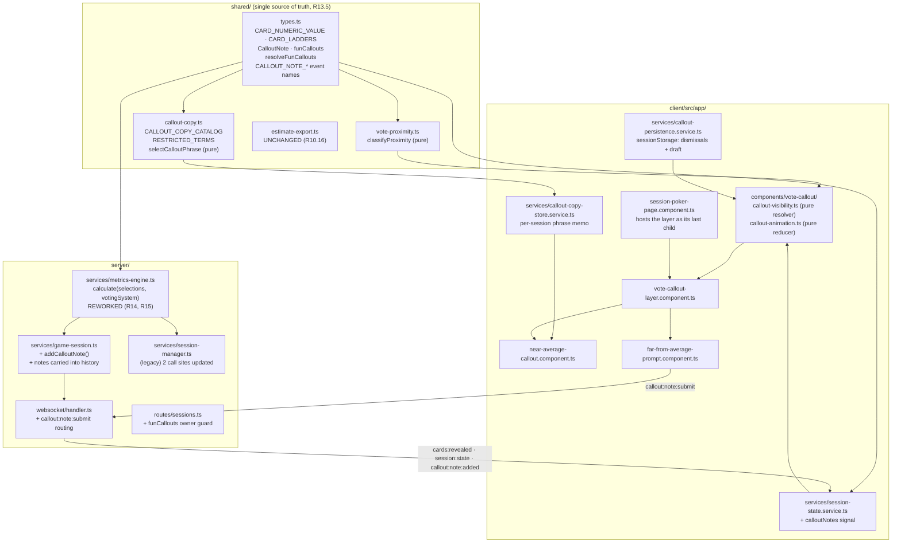
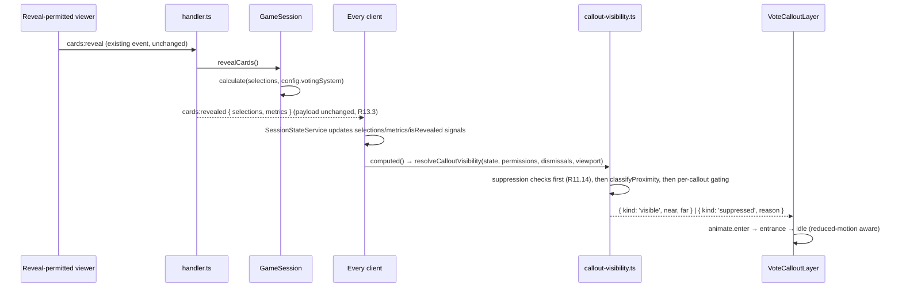
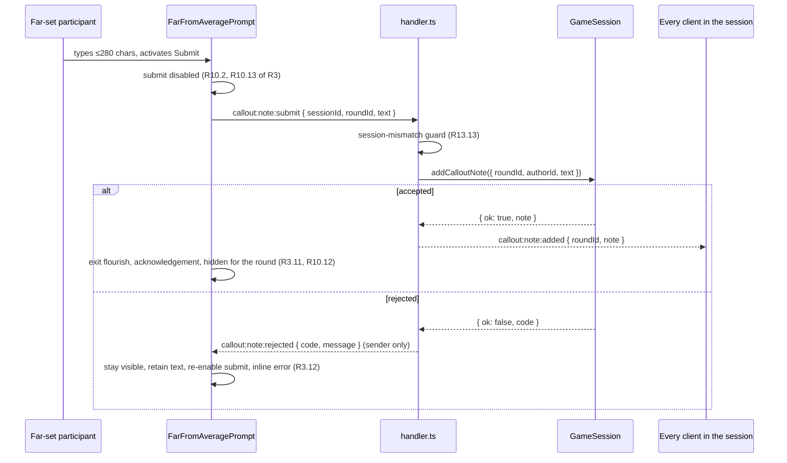

# Design Document — Vote Reveal Fun Callouts

## Overview

Two floating, heavily animated panels appear on the Scrum Poker board when cards are revealed:
a **Near_Average_Callout** that celebrates, by name, the participants whose votes landed closest
to the average (shown to reveal-permitted viewers), and a **Far_From_Average_Prompt** that privately
invites a participant whose vote landed far from the average to add a short note. Both leave with a
comic exit when the next story starts.

The feature is deliberately lopsided in where its complexity lives:

- **Nothing new is broadcast for the callouts themselves.** `average`, `selections`, `metrics` and
  round `status` already reach every client in `cards:revealed` and `session:state`. The near/far
  classification is therefore derived client-side by a pure function. Only the optional
  **Callout_Note** needs a new WebSocket event pair (R13.3).
- **The server work is a repair, not a feature.** Requirements 14 and 15 fix two confirmed defects in
  `server/src/services/metrics-engine.ts`: non-number card values corrupting `average`, `mode` and
  `spread`, and outlier detection being inert outside the plain Fibonacci deck. That repair is
  independent of the callouts and carries the strictest non-regression constraints in the spec.
- **The client work is mostly motion and suppression.** The visibility of each panel is a `computed()`
  over state that already exists, with the suppression conditions of Requirement 11 evaluated *before*
  any display condition so that R11.14's precedence is structural rather than incidental.

Four conclusions from reading the real code shape the design, and each is called out where it bites:

1. `@angular/animations` is **not** an installed dependency (it is an optional peer of
   `@angular/platform-browser` only). R5.14 is therefore satisfied by construction; all motion is
   native CSS keyframes plus Angular's `animate.enter` / `animate.leave` primitives built into
   `@angular/core` 21.2.
2. The real z-index ladder on the session page is `settings 49/50 → qr 99/100 → mobile history
   backdrop 999 → dialogs and menus 1000 → countdown 9999 → toast 10000`. The Vote_Callout_Layer is
   placed at **900** — above every content section, below every overlay R7.3 names.
3. `calculate()` is called with **one argument** by both existing metrics test files. R15.1 wants the
   voting system as an argument and R14.15/R13.2 want those tests to pass unedited. Those two cannot
   both hold with a *required* second parameter. See **Flagged conflict 1**.
4. R14.16 asks for the `asCardValue` workaround in the export tests to become unnecessary, but that
   helper sits on `GameSession.selectCard` and `ParticipantVote.cardValue`, not on `calculate`.
   Satisfying it requires a type-level widening chain through `shared/types.ts`. See
   **Card value widening**.

This feature touches the poker board only. `retro-session-registry.ts`, `retro-handler.ts`,
`retro-routes.ts` and every `retro-*` component are untouched (R13.1).

---

## Architecture

### Where the new pieces sit



### Data flow on reveal — no new traffic



### Data flow on note submission — the one new event pair



**Why a dedicated `callout:note:rejected` event rather than the existing `error` event:**
`SessionStateService` already subscribes to `error` and raises a toast for every occurrence. Routing
note rejections through it would produce a toast *and* the inline error R3.12 requires, and would put
new codes into a flow R13.3 asks to leave unchanged. A separate event keeps the existing error channel
and its toast behaviour byte-identical.

### Derivation chain, in evaluation order

| Stage | Unit | Purity | Requirements |
|---|---|---|---|
| 1 | `resolveCalloutVisibility` suppression block | pure | R11.1–R11.5, R11.11–R11.14, R6.7, R7.5, R7.10 |
| 2 | `classifyProximity` | pure | R1.1–R1.20 |
| 3 | per-callout gating (permission, dismissal, far membership, connection) | pure | R2.2, R2.11, R3.2, R11.12, R12.1–R12.5 |
| 4 | `selectCalloutPhrase` + per-round memo | pure + memo | R4.3–R4.5, R4.14, R2.4, R3.5 |
| 5 | view-model build (truncation, 8-name cap, summary) | pure | R8.3, R8.4 |
| 6 | `reduceCalloutLifecycle` animation phases | pure | R5.6–R5.17, R6.1–R6.3 |
| 7 | CSS keyframes and custom properties | declarative | R5.1–R5.5, R5.7, R5.11, R6.1–R6.3 |

Stages 1–6 are pure functions with no Angular, DOM, clock or storage dependency. That is deliberate:
it is what makes 23 of the 31 correctness properties verifiable with `fast-check` instead of through
a rendered component.

---

## Components and Interfaces

### 1. Shared layer — `shared/types.ts` additions

Everything crossing the client/server boundary is declared once here and imported from both sides
(R13.5). The client reaches it through the `@shared/*` tsconfig path alias; the server through the
relative `../../../shared/types` import it already uses.

#### 1.1 Card_Numeric_Value (R14.1, R14.2)

```ts
/**
 * Card_Numeric_Value: the real number a card contributes to numeric statistics.
 * Absence from this map is the definition of "has no Card_Numeric_Value" (R14.2, R14.3).
 *
 * A Map, not a Record<string, number>: the keys must keep their number/string identity so
 * that the numeric card 0 and a hypothetical string '0' can never alias, and so that
 * lookups take the selection value directly with no String() coercion.
 */
export const CARD_NUMERIC_VALUE: ReadonlyMap<ExtendedCardValue, number> = new Map<
  ExtendedCardValue,
  number
>([
  // fibonacci (also covers the 0,1,2,8 shared with power-of-2 and modified-fibonacci)
  [0, 0], [1, 1], [2, 2], [3, 3], [5, 5], [8, 8],
  [13, 13], [21, 21], [34, 34], [55, 55], [89, 89],
  // power-of-2 extras
  [4, 4], [16, 16], [32, 32], [64, 64],
  // modified-fibonacci extras
  ['½', 0.5], [20, 20], [40, 40], [100, 100],
  // coffee, no-clue, break, XS, S, M, L, XL, XXL are intentionally absent (R14.2)
]);

/** True exactly when the value has a Card_Numeric_Value (R14.3). */
export function cardNumericValue(value: ExtendedCardValue): number | undefined {
  return CARD_NUMERIC_VALUE.get(value);
}

export function isNumericCard(value: ExtendedCardValue): boolean {
  return CARD_NUMERIC_VALUE.has(value);
}
```

#### 1.2 Card_Ladder (R1.2, R15.2)

```ts
/**
 * Card_Ladder: the active system's card values that have a Card_Numeric_Value, ascending by
 * that value, duplicates collapsed, non-numeric values excluded (R1.2).
 *
 * Precomputed once per system at module load so both the classifier and the metrics engine
 * do a Map lookup instead of a sort per call (R1.20).
 *
 *   fibonacci          → [0, 1, 2, 3, 5, 8, 13, 21, 34, 55, 89]   (11 entries)
 *   modified-fibonacci → [0, '½', 1, 2, 3, 5, 8, 13, 20, 40, 100] (11 entries)
 *   power-of-2         → [0, 1, 2, 4, 8, 16, 32, 64]              (8 entries)
 *   t-shirt            → []                                       (0 entries, R11.4)
 */
export const CARD_LADDERS: Readonly<Record<VotingSystemType, readonly ExtendedCardValue[]>> =
  buildCardLadders();

/** Ladder of a possibly-unknown system identifier; empty for an unknown one (R1.19, R15.11). */
export function cardLadderFor(votingSystem: string): readonly ExtendedCardValue[] {
  return (CARD_LADDERS as Record<string, readonly ExtendedCardValue[]>)[votingSystem] ?? [];
}

/** Zero-based index of a card on a ladder, or -1 (R1.3, R15.3). */
export function ladderIndexOf(
  ladder: readonly ExtendedCardValue[],
  value: ExtendedCardValue
): number {
  return ladder.indexOf(value);
}
```

`buildCardLadders()` filters `VOTING_SYSTEMS[system]` by `CARD_NUMERIC_VALUE.has`, sorts ascending by
the mapped value, and collapses equal mapped values to the first occurrence. The `t-shirt` ladder
falls out empty with no special case, which is exactly how R11.4 is described as following from R11.3.

#### 1.3 Callout_Note (R10.2, R10.10, R13.6)

```ts
/** One short note a participant attached to a Voting_Round. */
export interface CalloutNote {
  id: string;            // UUID, server-assigned
  roundId: string;       // the round the note was WRITTEN FOR, not the current one (R10.15)
  authorId: string;
  authorName: string;    // denormalised so history renders without a participant lookup (R10.11)
  text: string;          // already trimmed; ≤ NOTE_MAX_LENGTH (R10.9)
  storedAt: string;      // ISO 8601, server clock; the ordering key for R10.11
}

export const NOTE_MAX_LENGTH = 280;

/** Rejection codes; each maps to exactly one acceptance criterion. */
export type CalloutNoteRejection =
  | 'NOTE_SESSION_MISMATCH'   // R13.13
  | 'NOTE_INVALID'            // malformed payload shape
  | 'NOTE_EMPTY'              // R10.7
  | 'NOTE_TOO_LONG'           // R10.6
  | 'NOTE_ROUND_UNKNOWN'      // R10.8
  | 'NOTE_DUPLICATE';         // R10.17

export const CALLOUT_NOTE_SUBMIT = 'callout:note:submit';
export const CALLOUT_NOTE_ADDED = 'callout:note:added';
export const CALLOUT_NOTE_REJECTED = 'callout:note:rejected';

export interface CalloutNoteSubmitPayload { sessionId: string; roundId: string; text: string; }
export interface CalloutNoteAddedPayload { roundId: string; note: CalloutNote; }
export interface CalloutNoteRejectedPayload {
  roundId: string;
  code: CalloutNoteRejection;
  message: string;
}
```

#### 1.4 Note collections on the round and the history entry (R10.10, R13.6)

```ts
export interface VotingRound {
  // ...existing fields unchanged...
  /** Optional so every existing round literal and stored record stays valid. */
  calloutNotes?: CalloutNote[];
}

export interface HistoryEntry {
  // ...existing fields unchanged...
  calloutNotes?: CalloutNote[];
}
```

**The Map/JSON boundary (R13.6).** `VotingRound.selections` is a `Map` and already needs
`Object.fromEntries` on the way out and `new Map(Object.entries(...))` on the way in — that asymmetry
is the project's documented pitfall. The note collection is therefore modelled as a **plain array,
never a Map**, so `serializeRound` passes it through untouched and `JSON.parse(JSON.stringify(x))`
is deeply equal to `x` by construction, preserving text, author id, round id and position for
0 to 100 notes. A `Map<authorId, CalloutNote>` would have read more naturally for the
one-note-per-author rule of R10.17, and was rejected precisely because it would re-create the
serialisation hazard. The uniqueness rule is instead enforced by a linear scan in
`GameSession.addCalloutNote`, which is O(participants) on a collection bounded by the participant
count.

Normalising on receipt (R13.12):

```ts
/** Treats anything that is not a well-formed note array as empty (R13.12). */
export function normaliseCalloutNotes(value: unknown): CalloutNote[] {
  if (!Array.isArray(value)) return [];
  return value.filter(isCalloutNote);
}
```

#### 1.5 `funCallouts` on `SessionConfiguration` (R6.5, R6.6, R6.11)

```ts
export interface SessionConfiguration {
  // ...existing fields unchanged...
  /**
   * Controls whether the fun callouts appear in this session.
   * Optional so configuration records that omit it stay valid; an absent or
   * non-boolean value is treated as `true` (see `resolveFunCallouts`).
   */
  funCallouts?: boolean;  // default: true
}

/**
 * Single coercion point for the `funCallouts` default (R6.11).
 * Deliberately a separate function from `resolveFluidCardHeight` rather than a call into it:
 * the two fields are independent, and R6.11's "matching the handling already established"
 * is read as the same shape and the same single-point discipline, not literal reuse of a
 * retro-scoped helper, which would couple the poker board to a retro default (R13.1).
 */
export function resolveFunCallouts(value: unknown): boolean {
  return typeof value === 'boolean' ? value : true;
}
```

`DEFAULT_SESSION_CONFIG` gains `funCallouts: true`. `SessionRegistry.createSession` normalises once at
creation — `funCallouts: resolveFunCallouts(config.funCallouts)` — so every `getSessionState()` and
every `session:config-updated` broadcast carries a real boolean (R6.6, R6.8).

#### 1.6 Card value widening (R14.16)

`asCardValue` appears in `shared/__tests__/estimate-export.property.spec.ts` and
`server/src/routes/__tests__/sessions-export.spec.ts`, at `GameSession.selectCard(...)` and at
`ParticipantVote.cardValue`. Widening only `calculate` would leave it in place. The following
type-level widening removes the need for it:

| Declaration | Before | After |
|---|---|---|
| `VotingRound.selections` | `Map<string, CardValue>` | `Map<string, ExtendedCardValue>` |
| `ParticipantVote.cardValue` | `CardValue \| null` | `ExtendedCardValue \| null` |
| `VotingMetrics.mode` | `CardValue \| null` | `ExtendedCardValue \| null` (R14.14) |
| `GameSession.selectCard` / `getSelections` / `RevealResult.selections` | `CardValue` | `ExtendedCardValue` |
| `session-manager.selectCard` / `getSelections` / `RevealResult` | `CardValue` | `ExtendedCardValue` |
| `calculate` first parameter | `Map<string, CardValue>` | `ReadonlyMap<string, ExtendedCardValue>` |
| client `SessionStateService._selections` and the `cards:revealed` payload type | `CardValue` | `ExtendedCardValue` |
| client `deriveBoardCards` / `BoardCard.cardValue` | `CardValue` | `ExtendedCardValue` |

`CardValue` is a strict subtype of `ExtendedCardValue`, so every *write* still compiles unchanged;
only annotations that *read* into a `CardValue`-typed slot move. `CardValue` itself is **not**
redefined — renaming or widening the existing type would silently change the meaning of every
exhaustive switch over it. The change is purely type-level with zero runtime effect, which is what
keeps it compatible with R13.2 and R13.3. Test files that annotate a local as
`Map<string, CardValue>` continue to compile, because such a map is still assignable to the widened
parameter.

**Flagged:** this widening touches ~8 files beyond the feature's own. It is required only by R14.16's
"the `asCardValue` workaround helper is no longer required" clause. If that clause were relaxed to
"the metrics engine needs no cast", the change would shrink to the single `calculate` signature. The
design proceeds with the full widening as written.

### 2. Metrics engine rework — Requirements 14 and 15

#### 2.1 New signature

```ts
// server/src/services/metrics-engine.ts
export function calculate(
  selections: ReadonlyMap<string, ExtendedCardValue>,
  votingSystem: VotingSystemType | string = 'fibonacci'
): VotingMetrics;
```

**Flagged conflict 1 — the second parameter cannot be required.**
R15.1 says the engine "SHALL accept the active voting system identifier ... as an argument" and R15.10
says "no call site relies on a default voting system value". R14.15 and R13.2 say every pre-existing
metrics test "passes without any edit to its inputs or assertions". Both existing test files
(`metrics-engine.test.ts`, `metrics-engine.property.test.ts`, ~30 call sites) invoke
`calculate(selections)` with one argument. A required second parameter is a TypeScript compile error
at every one of them, which forces edits and breaks R14.15.

Resolution adopted: the parameter is **optional with a `'fibonacci'` default**, and R15.10 is read as
constraining *production* call sites. All four — two in `game-session.ts` (`revealCards`,
`clearBoard`) and two in `session-manager.ts` (`revealCards`, `clearBoard`) — pass it explicitly, and
a source-scan test asserts that each `calculate(` occurrence under `server/src/services/` outside the
engine itself carries a second argument. The default exists solely to keep the legacy single-argument
test calls compiling; it is never reached in production. This is recorded rather than silently
resolved because the literal text of R15.10 and the literal text of R14.15 are in tension.

#### 2.2 How the numeric test changes

| Concern | Today | After |
|---|---|---|
| "is this numeric?" | `!SPECIAL_CARDS.includes(v)` — so `'XS'` and `'½'` are *numeric* | `CARD_NUMERIC_VALUE.has(v)` (R14.3) |
| average | `acc + v` over raw values — string concatenation / `NaN` for `'XS'`, `'½'` | mean of mapped values (R14.4) |
| spread | `Math.max(...raw)` → `NaN` for non-numbers | mapped max − mapped min (R14.5) |
| mode | compared with `value < mode` on mixed types | computed over mapped values, **returned as the card value** (R14.13, R14.14) |
| outliers | `FIBONACCI_INDEX` lookup → `undefined` for every non-Fibonacci card, so no outlier was ever flagged on the other three decks | `ladderIndexOf(cardLadderFor(votingSystem), v)` (R15.2, R15.3) |
| unknown card value | counted in `distribution`, silently treated as numeric | counted in `distribution`, excluded from every numeric field (R14.17) |

#### 2.3 Algorithm

```
calculate(selections, votingSystem = 'fibonacci'):
  1. distribution: count String(cardValue) for EVERY entry, including specials,
     t-shirt sizes and values from no known system.          (R14.12, R14.17, R12 of R14)
  2. numericVotes: entries whose value is in CARD_NUMERIC_VALUE,
     carried as { userId, card, numeric }.                   (R14.3, R14.7)
  3. if numericVotes.length < 2:
       return { average: null, mode: null, spread: null, distribution,
                outliers: [], numericVoteCount, insufficientData: true }   (R14.8, R14.9)
  4. average = sum(numeric) / numericVotes.length            (R14.4)
  5. spread  = max(numeric) − min(numeric)                   (R14.5)
  6. mode:
       counts: Map<numeric, count> and a representative card per numeric value
       winner = greatest count, ties broken by the LEAST numeric value   (R14.13)
       return the representative CARD for that numeric value             (R14.14)
  7. ladder = cardLadderFor(votingSystem)
     if ladder.length < 2 → outliers = []                    (R15.6, R15.11)
     else modeIndex = ladderIndexOf(ladder, modeCard)
          if modeIndex < 0 → outliers = []   (mode from a foreign deck)
          else outliers = userIds, in selections iteration order, whose
               ladderIndexOf(ladder, card) is ≥ 0 and |index − modeIndex| > 2
                                                              (R15.3, R15.8, R15.9)
  8. return all seven fields.                                (R15.13)
```

Step 6's "representative card" is what makes `'½'` report as `'½'` rather than `0.5` (R14.14): the
count map is keyed by the mapped number, and each key also records the first card value observed
with that number. Since `buildCardLadders` collapses duplicate mapped values, and no system contains
two distinct cards with the same mapped value, the representative is unambiguous.

Step 7's iteration order is the `selections` Map insertion order, which is what the current
implementation uses, so R15.7's "with the order of its entries preserved" holds.

#### 2.4 Fibonacci non-regression (R14.15, R15.7, R13.2)

For a selection map drawn only from the plain Fibonacci deck plus the special cards, the new code is
observationally identical to the old:

- `distribution` — unchanged code path.
- numeric classification — on that deck, `CARD_NUMERIC_VALUE.has(v)` and `!SPECIAL_CARDS.includes(v)`
  agree on every value.
- `average`, `spread` — the mapped value of every Fibonacci card *is* that card, so the arithmetic is
  identical.
- `mode` — the mapped values are the cards themselves, so "greatest count, least value" selects the
  same card, and the representative card is that same number.
- `outliers` — `CARD_LADDERS.fibonacci` is element-for-element `FIBONACCI_SEQUENCE`, so
  `ladderIndexOf` returns exactly what `FIBONACCI_INDEX.get` returned, with the same `> 2` threshold
  and the same iteration order.

This is verified by property, not by argument: a **frozen reference copy** of the current
implementation is committed as `server/src/services/__tests__/metrics-engine.baseline.ts` (exported as
`calculateBaseline`, never imported by production code), and one `fast-check` property compares all
seven fields of the new engine against it over generated maps drawn from
`[...FIBONACCI_SEQUENCE, ...SPECIAL_CARDS]`. That is the only way to make R14.15 and R15.7 testable
rather than aspirational.

#### 2.5 `insufficientData` semantics change — a deliberate, user-visible regression-by-design

**Flagged.** R14.9 makes every `t-shirt` round report `insufficientData: true` with `average`,
`mode` and `spread` all null. Today a t-shirt round reports `insufficientData: false` with
`mode: 'L'`-style values and `average`/`spread` of `NaN`. Consequences:

1. `MetricsComponent` switches from showing `NaN`-derived values to showing
   *"Insufficient data — fewer than 2 numeric votes"* for every t-shirt round. The message is now
   accurate in substance but its wording ("numeric votes") is a poor fit for a deck that has none.
   The design keeps the existing string so no existing assertion changes; improving the copy is a
   separate concern and is listed under *Deferred* below.
2. `computeConsensusLevel` returns `'none'` for every t-shirt round, because it short-circuits on
   `insufficientData`. Its `t-shirt` branch (which reads ordinal positions out of `distribution`)
   becomes **unreachable from real engine output**. The branch and its tests are left in place —
   `shared/__tests__/consensus.spec.ts` and `consensus.property.spec.ts` build `VotingMetrics`
   literals by hand, so all of their assertions still pass unedited — but the consensus indicator
   will no longer appear on a t-shirt board. This is the direct consequence of Decision 11 in
   requirements.md ("a t-shirt round now reports `insufficientData` rather than fabricating
   numbers") and is called out here so it is accepted rather than discovered.
3. The export layer is unaffected in shape: `formatAverage` already renders a non-finite average as
   `-`, and `formatMetricValue` renders a null mode or spread as `-`. For a t-shirt round the mode
   column changes from e.g. `L` to `-`. No existing export test asserts that cell literally — the
   one t-shirt export test compares the route output against `buildEstimateExportCsv(...)` of the
   same history, so it stays green — but the exported document for a t-shirt session does change.
   R10.16 is about this feature not altering the *format*, which it does not.

#### 2.6 Call sites (R15.10)

```ts
// game-session.ts — revealCards()
const metrics = calculate(this.currentRound.selections, this.config.votingSystem);
// game-session.ts — clearBoard()
const metrics = calculate(this.currentRound.selections, this.config.votingSystem);
// session-manager.ts — revealCards() and clearBoard()
//   This legacy module holds no configuration, so it passes DEFAULT_SESSION_CONFIG.votingSystem
//   explicitly rather than relying on the parameter default, which is what R15.10 asks for.
const metrics = calculate(currentRound.selections, DEFAULT_SESSION_CONFIG.votingSystem);
```

`session-manager.ts` is the pre-`GameSession` module-level implementation still covered by
`session-manager.test.ts` and `session-manager.property.test.ts`. It holds no `SessionConfiguration`,
so there is no session voting system to pass. Passing `DEFAULT_SESSION_CONFIG.votingSystem` keeps the
call site explicit (no reliance on the parameter default) while preserving its current behaviour
exactly, since the default *is* `'fibonacci'`. **Flagged:** this is the one call site where "pass the
active voting system" has no active voting system to pass.

#### 2.7 Affected existing tests

| File | Expected outcome |
|---|---|
| `metrics-engine.test.ts` | passes unedited — all inputs are Fibonacci + specials |
| `metrics-engine.property.test.ts` | passes unedited — generators draw from `ALL_CARDS` and `FIBONACCI_SEQUENCE` only |
| `game-session.*.test.ts` / `.spec.ts` | pass unedited — Fibonacci sessions |
| `session-manager.*.test.ts` | pass unedited |
| `sessions-export.spec.ts` | passes; `asCardValue` is **deleted** and the call sites type-check directly (R14.16) |
| `shared/__tests__/estimate-export.property.spec.ts` | passes; `asCardValue` deleted (R14.16) |
| `shared/__tests__/consensus*.spec.ts` | pass unedited (hand-built metrics literals) |
| `server/src/__tests__/isolation.spec.ts` | extended with the new shared export names |

### 3. Proximity classifier — `shared/vote-proximity.ts`

This is the single most property-tested unit in the feature, so it is designed to be trivially
testable: one exported pure function, primitive-and-Map inputs, a plain-object result, no Angular,
no DOM, no clock.

**Why it lives in `shared/` even though only the client uses it.** `server/jest.config.ts` has
`roots: ['<rootDir>/src', '<rootDir>/../shared']`, so a `shared/__tests__/*.property.spec.ts` file
runs under Jest with `fast-check` resolving through `modulePaths`, with no Angular test harness and no
jsdom. The same file is importable from the client via `@shared/vote-proximity`. `shared/` already
holds pure logic of exactly this kind (`estimate-export.ts`, `csv.ts`).

```ts
// shared/vote-proximity.ts
import {
  cardLadderFor, cardNumericValue, type ExtendedCardValue, type VotingSystemType,
} from './types';

export const NEAR_THRESHOLD = 0.75;   // R1.7
export const FAR_THRESHOLD = 2.0;     // R1.8
export const DISTANCE_PRECISION = 6;  // R1.7, R1.8, R1.9

export interface ProximityInput {
  /** userId → selected card. Absent keys and null/undefined values are "no selection" (R1.10). */
  readonly selections: ReadonlyMap<string, ExtendedCardValue | null | undefined>;
  /** The computed average. Accepts anything so R1.13 is a total guard, not a type error. */
  readonly average: unknown;
  /** Accepts a bare string so an unknown identifier is data, not a type error (R1.19). */
  readonly votingSystem: VotingSystemType | string;
  /** userId → display name, used only for the ordering tie-break (R1.16). */
  readonly displayNames: ReadonlyMap<string, string>;
}

export interface ClassifiedParticipant {
  readonly userId: string;
  readonly displayName: string;
  readonly ladderDistance: number;   // already rounded to DISTANCE_PRECISION
}

export interface ProximityResult {
  /** Ordered: ascending distance, then case-insensitive name, then userId (R1.16). */
  readonly near: readonly ClassifiedParticipant[];
  /** Same comparator, so the result is deterministic for the private prompt too. */
  readonly far: readonly ClassifiedParticipant[];
  /** Every classified participant's distance, keyed by userId (R1.1). */
  readonly distances: ReadonlyMap<string, number>;
}

export const EMPTY_PROXIMITY: ProximityResult = {
  near: [], far: [], distances: new Map(),
};

export function classifyProximity(input: ProximityInput): ProximityResult;
```

#### 3.1 Algorithm

```
classifyProximity({ selections, average, votingSystem, displayNames }):

  # Guards first, each returning EMPTY_PROXIMITY, never throwing.
  if typeof average !== 'number' or !Number.isFinite(average):  return EMPTY     (R1.13)
  ladder = cardLadderFor(votingSystem)                                           (R1.19 → [])
  if ladder.length < 2:                                          return EMPTY     (R1.14)

  averagePos = averageLadderPosition(average, ladder)

  near = [], far = [], distances = new Map()
  for (userId, card) of selections:
      if card is null or undefined:            continue                           (R1.10)
      numeric = cardNumericValue(card)
      if numeric is undefined:                 continue        # specials, t-shirt (R1.11, R1.12)
      index = ladder.indexOf(card)
      if index < 0:                            continue        # foreign deck      (R1.12)
      d = round6(abs(index − averagePos))                                          (R1.3)
      entry = { userId, displayName: displayNames.get(userId) ?? userId, ladderDistance: d }
      distances.set(userId, d)
      if d <= NEAR_THRESHOLD:       near.push(entry)                               (R1.7)
      else if d >= FAR_THRESHOLD:   far.push(entry)                                (R1.8)
      # otherwise classified into neither                                          (R1.9)

  return { near: near.sort(compare), far: far.sort(compare), distances }           (R1.16)
```

```
averageLadderPosition(average, ladder):
  values = ladder.map(cardNumericValue)              # strictly ascending by construction
  if average <= values[0]:                   return 0                              (R1.5, R1.18)
  if average >= values[last]:                return last                           (R1.6, R1.18)
  i = greatest index with values[i] <= average
  if values[i] === average:                  return i                              (R1.18)
  return i + (average − values[i]) / (values[i+1] − values[i])                      (R1.4)
```

```
round6(x) = Math.round(x * 1e6) / 1e6

compare(a, b) =
     a.ladderDistance − b.ladderDistance
  || lower(a.displayName) < lower(b.displayName) ? −1 : > ? 1 : 0        # code-unit, not locale
  || a.userId < b.userId ? −1 : > ? 1 : 0
```

The name comparison uses code-unit ordering rather than `localeCompare`, matching the deliberate
choice already documented in `shared/estimate-export.ts`: it keeps ordering identical across
runtimes and locales, which a property test depends on.

#### 3.2 Design notes

- **Clamping before interpolation (R1.5, R1.6, R1.18).** `average <= values[0]` and
  `average >= values[last]` use non-strict comparisons, so an average exactly equal to the first or
  last ladder value takes the clamp branch and lands on that exact index — which is what R1.18
  requires for those two positions. R1.4's strict-between condition is therefore the only branch that
  interpolates, and its divisor is never zero because ladder values are strictly ascending.
- **Rounding placement (R1.7–R1.9).** The 6-decimal rounding is applied once, to the distance, before
  any threshold comparison. Rounding the interpolated *position* instead would let two participants at
  the same true distance fall on opposite sides of a threshold. The rounded value is also what the
  result reports, so a test can recompute the comparison from the returned number.
- **Independence from `outliers` (R1.15).** `ProximityInput` has no `VotingMetrics` member, so the
  function cannot read the field, and it returns no `outliers`, so it cannot write it. A source-scan
  test asserts the string `outliers` never appears in `vote-proximity.ts`. The mode-relative and
  average-relative notions stay two functions with two result types (R15.12).
- **Disjointness is structural (R1.1, Property 1).** `NEAR_THRESHOLD < FAR_THRESHOLD` and the
  `if/else if` chain mean a participant is pushed to at most one array. No runtime check is needed, and
  the property test confirms the invariant rather than papering over a possible overlap.
- **Purity (R1.17).** Only reads are performed on `selections` and `displayNames`; the result arrays
  are freshly allocated. No `Date`, `Math.random`, `window` or `process` reference appears in the
  module, which a source-scan test asserts.
- **Performance (R1.20).** One pass over the selections plus one `Array.prototype.sort` of at most
  `n` entries, with per-entry work bounded by `ladder.indexOf` over ≤11 elements. For n=100 this is
  a few thousand operations — orders of magnitude inside the 50 ms budget.

#### 3.3 Worked examples (for the boundary tests R13.11 demands)

Fibonacci ladder `[0,1,2,3,5,8,13,21,34,55,89]`, indices `0..10`.

| Votes | average | averagePos | participant | distance | set |
|---|---|---|---|---|---|
| 3, 5 | 4 | `3 + (4−3)/(5−3) = 3.5` | 3 (idx 3) | 0.5 | **near** |
| 3, 5 | 4 | 3.5 | 5 (idx 4) | 0.5 | **near** |
| 2, 5, 5 | 4 | 3.5 | 2 (idx 2) | 1.5 | neither (R1.9) |
| 1, 8 | 4.5 | `3 + 1.5/2 = 3.75` | 1 (idx 1) | 2.75 | **far** |
| 1, 8 | 4.5 | 3.75 | 8 (idx 5) | 1.25 | neither |
| 5, 5, 5, 89 | 26 | `8 + (26−21)/(34−21) = 8.3846…` | 5 (idx 4) | 4.384615 | **far** |
| 5, 5, 5, 89 | 26 | 8.3846… | 89 (idx 10) | 1.615385 | neither |
| 3, 5 (synthetic avg 3.75) | 3.75 | 3.75 | 3 (idx 3) | **0.75** | **near** (inclusive, R1.7) |
| 2, 13 (synthetic avg 4) | 4 | 3.5 | 13 (idx 6) | **2.5** | far |
| synthetic avg giving exactly 2.0 | — | — | — | **2.0** | **far** (inclusive, R1.8) |

Modified-Fibonacci ladder `[0,'½',1,2,3,5,8,13,20,40,100]`: votes `0, '½', 1` give average
`0.5`, `averagePos = 1` exactly (R1.18, since `cardNumericValue('½') === 0.5`), so all three sit at
distances `1, 0, 1` — `'½'` near, `0` and `1` in the unclassified band. This is the case Decision 10
in requirements.md exists to protect: before the Requirement 14 repair, that round's average was
`NaN`.

T-shirt: the ladder is empty, `length < 2`, so the result is `EMPTY_PROXIMITY` with no special case
(R1.14 → R11.3 → R11.4).

### 4. Copy catalog and phrase selection — `shared/callout-copy.ts`

#### 4.1 Shapes

```ts
export type CalloutSection =
  | 'nearAverage'      // R4.2: 6–40 entries
  | 'farFromAverage'   // R4.2: 6–40 entries
  | 'fullAgreement'    // R4.2: 2–40 entries
  | 'wideSpread'       // R4.2: 2–40 entries
  | 'acknowledgement'; // required by R10.12; see the flag below

export type CalloutCopyCatalog = Readonly<Record<CalloutSection, readonly string[]>>;

export const CALLOUT_COPY_CATALOG: CalloutCopyCatalog = { /* §4.2 */ };

/** Restricted_Term_List: three groups, each term carried with its forms (R4.13). */
export interface RestrictedTerm {
  /** Lower-case word sequences; each is matched whole-word against the entry's tokens. */
  readonly forms: readonly string[];
}
export interface RestrictedTermList {
  readonly errorAttributing: readonly RestrictedTerm[];      // binds farFromAverage (R4.6)
  readonly rankingAndComparison: readonly RestrictedTerm[];  // binds nearAverage   (R4.7)
  readonly regionSpecificIdiom: readonly RestrictedTerm[];   // binds every entry   (R4.9)
}
export const RESTRICTED_TERMS: RestrictedTermList = { /* §4.3 */ };

/** Whole-word, case-insensitive, inflection-aware presence check (R4.13). */
export function containsRestrictedTerm(
  entry: string,
  group: readonly RestrictedTerm[]
): boolean;

/** Deterministic phrase selection (R4.3–R4.5, R4.14). */
export function selectCalloutPhrase(
  catalog: CalloutCopyCatalog,
  section: CalloutSection,
  roundId: string,
  previousIndex: number
): { readonly index: number; readonly text: string } | null;
```

**Flagged — the fifth section.** R10.12 requires the post-submit acknowledgement to be "drawn from
the Callout_Copy_Catalog", but R4.2 enumerates bounds for only four sections. The catalog therefore
carries a fifth `acknowledgement` section. R4.2's bounds do not mention it, so the design applies the
same discipline voluntarily: at least 2 entries, distinct within the section, and subject to R4.9
(12–90 characters, ≤2 glyphs, no region-specific idiom) and R4.13, which are written as "every entry
in the Callout_Copy_Catalog" and so bind it. R4.11's person rule names only the near and far
sections; acknowledgement entries use second person because they are shown in the private prompt.

#### 4.2 Catalog — proposed entries

These are written to prove the constraints are jointly satisfiable, since several interact: a
far-from-average entry must end in a question mark, contain a second-person pronoun, avoid every
error-attributing term (including the very common word *off*), avoid every region-specific idiom,
and fit 12–90 characters.

```ts
export const CALLOUT_COPY_CATALOG: CalloutCopyCatalog = {
  // No second-person pronoun, no ranking or comparison term, no digit, group reference only
  // (R4.7, R4.11). Each entry 12–90 chars with at most one glyph (R4.9).
  nearAverage: [
    'Same wavelength, no discussion needed 📡',
    'These cards came out of the same deck of thinking.',
    'Minds met in the middle with no negotiation at all.',
    'Agreement spotted in the wild 🌿',
    'The average and this little group are quietly in tune.',
    'A small club of matching instincts has formed here.',
    'This group landed on the same note 🎵',
    'Cards aligned. Suspiciously smooth, this one.',
  ],

  // Every entry is a question ending in '?', addresses the participant's reasoning, carries a
  // second-person pronoun, names nobody, and contains no error-attributing term
  // (R4.6, R4.11). 12–90 chars (R4.9).
  farFromAverage: [
    'Your card tells a different story. Want to share the plot?',
    'You saw something the average did not. What was it?',
    'Care to narrate what your estimate is seeing?',
    'What is the risk you spotted that the rest have not?',
    'Would you like to add a note about your thinking?',
    'Something in this story caught your eye. Say more?',
    'Your number has a reason behind it. Write it down?',
    'Is there a detail you would like the team to hear?',
  ],

  fullAgreement: [
    'Unanimous. Somebody should frame this moment 🖼',
    'Every card agrees. Rare weather, this.',
    'A single number, no debate, nothing to discuss.',
  ],

  // Shown instead of names, so it must reveal nothing about who voted how (R2.8, R11.8).
  wideSpread: [
    'The estimates went sightseeing in every direction 🧭',
    'Broad range today. Plenty left to talk about.',
    'These cards hold genuinely different opinions.',
  ],

  acknowledgement: [
    'Noted and shared with the team. Thank you 🙏',
    'Your note is on the round now. Appreciated.',
  ],
};
```

Constraint audit of the proposed entries:

| Constraint | Check |
|---|---|
| R4.2 section sizes | near 8 ∈ [6,40]; far 8 ∈ [6,40]; full 3 ∈ [2,40]; wide 3 ∈ [2,40] |
| R4.2 intra-section distinctness | all distinct after case folding and whitespace normalisation |
| R4.9 length | shortest `'Agreement spotted in the wild 🌿'` (32); longest `'Your card tells a different story. Want to share the plot?'` (58) — all within 12–90 |
| R4.9 glyph count | at most one per entry |
| R4.6 trailing `?` | every far entry ends with `?` |
| R4.6 error-attributing terms | no *wrong, outlier, off, worst, weird, mistake* in any far entry; note `'out of'` in a near entry is the whole word *of*, not *off*, which whole-word matching distinguishes |
| R4.7 ranking terms | no *closest, best, top, first, rank, score, accurate, winner, beat* in any near entry |
| R4.7 no participant count | no near entry contains a digit; `'A single number'` in the full-agreement section counts card values, not people, and that section is outside R4.7's scope |
| R4.11 person | every far entry has *you/your*; no near entry has any second-person pronoun |
| R2.9 no consensus-label collision | no entry trim-and-lowercase-equals `full agreement`, `partial agreement`, `high divergence` |
| R4.10 glyph-free text carries the message | removing every glyph leaves a complete sentence in each entry |

#### 4.3 Restricted_Term_List and the matching rule

```ts
export const RESTRICTED_TERMS: RestrictedTermList = {
  errorAttributing: [
    { forms: ['wrong', 'wrongly', 'wrongs'] },
    { forms: ['outlier', 'outliers', 'outlying'] },
    { forms: ['off'] },
    { forms: ['worst'] },
    { forms: ['weird', 'weirdly', 'weirder', 'weirdest'] },
    { forms: ['mistake', 'mistakes', 'mistaken', 'mistook'] },
  ],
  rankingAndComparison: [
    { forms: ['close', 'closer', 'closest'] },
    { forms: ['near', 'nearer', 'nearest'] },
    { forms: ['good', 'better', 'best'] },
    { forms: ['top', 'tops', 'topped'] },
    { forms: ['first'] }, { forms: ['second'] }, { forms: ['third'] },
    { forms: ['rank', 'ranks', 'ranked', 'ranking'] },
    { forms: ['score', 'scores', 'scored', 'scoring'] },
    { forms: ['accuracy', 'accurate', 'accurately'] },
    { forms: ['precise', 'precisely', 'precision'] },
    { forms: ['win', 'wins', 'won', 'winner', 'winners', 'winning'] },
    { forms: ['beat', 'beats', 'beaten'] },
    { forms: ['lead', 'leads', 'leader', 'leading'] },
    { forms: ['champion', 'champions'] },
    { forms: ['podium'] }, { forms: ['prize', 'prizes'] },
  ],
  regionSpecificIdiom: [
    { forms: ['ballpark'] },
    { forms: ['home run', 'home runs', 'homer', 'homers'] },
    { forms: ['slam dunk', 'slam dunks'] },
    { forms: ['touchdown', 'touchdowns'] },
    { forms: ['hail mary'] },
    { forms: ['left field'] },
    { forms: ['curveball', 'curveballs'] },
    { forms: ['wicket', 'wickets', 'sticky wicket'] },
    { forms: ['googly', 'googlies'] },
    { forms: ['touch base'] },
    { forms: ['ninth inning'] },
  ],
};
```

```ts
/** Lower-cases and splits on every non-letter, so punctuation and glyphs are boundaries. */
function tokenise(entry: string): string[] {
  return entry.toLowerCase().split(/[^a-z]+/i).filter((t) => t.length > 0);
}

export function containsRestrictedTerm(
  entry: string,
  group: readonly RestrictedTerm[]
): boolean {
  const tokens = tokenise(entry);
  for (const term of group) {
    for (const form of term.forms) {
      const want = form.split(' ');
      for (let i = 0; i + want.length <= tokens.length; i++) {
        if (want.every((w, k) => tokens[i + k] === w)) return true;
      }
    }
  }
  return false;
}
```

**Why explicit inflection forms rather than a stemmer (a non-obvious choice R4.13 forces).** The
obvious implementation of "including its plural and verb-inflected forms" is suffix stripping:
compare the term against the entry token with trailing `s/es/ed/ing/er/est` removed. That produces
false positives that would silently forbid useful copy — *offer* stems to *off*, *topic* would need a
prefix guard, *closet* stems to *close*. Because the catalog and the term list are both small, fixed
data, enumerating the forms is cheaper, has no false positives, and makes the whole check decidable
and total, which is what Property 20 asserts. The near-miss cases (*offer* vs *off*, *topic* vs
*top*, *leaden* vs *lead*) are explicit negative test cases.

**Enforcement is a test, not a runtime guard.** R4.6, R4.7 and R4.9 describe the catalog, not the
rendering path. The catalog is fixed data, so a single exhaustive scan at test time proves the
constraints for every entry. Checking at runtime would burn cycles on every reveal to re-prove a
property of a constant, and would need a failure behaviour for copy that cannot exist in a passing
build. `shared/__tests__/callout-copy.spec.ts` runs the scan.

#### 4.4 Phrase selection

```ts
/** FNV-1a over `roundId|section`: deterministic, no clock, no random source (R4.3). */
function seedIndex(roundId: string, section: CalloutSection, size: number): number {
  let h = 0x811c9dc5;
  const key = `${roundId}|${section}`;
  for (let i = 0; i < key.length; i++) {
    h ^= key.charCodeAt(i);
    h = Math.imul(h, 0x01000193) >>> 0;
  }
  return h % size;
}

export function selectCalloutPhrase(
  catalog: CalloutCopyCatalog,
  section: CalloutSection,
  roundId: string,
  previousIndex: number
): { index: number; text: string } | null {
  const entries = catalog[section];
  if (!entries || entries.length === 0) return null;          // R4.12
  const n = entries.length;

  const index =
    Number.isInteger(previousIndex) && previousIndex >= 0 && previousIndex < n
      ? (previousIndex + 1) % n                                // rotation: R4.5, R4.14
      : seedIndex(roundId, section, n);                        // first appearance: R4.3, R4.4

  return { index, text: entries[index]! };
}
```

Why a **rotation** and not a hash of the round id:

- **R4.14 is a hard coverage guarantee.** "Every entry displayed at least once within any sequence of
  consecutive appearances whose length equals twice the number of entries." A hash of the round id
  gives pseudo-random indices, and a random sequence of length `2n` misses at least one entry with
  high probability (for `n = 8`, the chance of full coverage is well under 1%). A strict rotation
  covers all `n` entries in exactly `n` consecutive appearances, hence certainly within `2n`.
- **R4.5 falls out of the rotation**: `(previousIndex + 1) % n ≠ previousIndex` for every `n ≥ 2`.
- **R4.3 is still satisfied**: the result is a function of `(roundId, section, previousIndex)` only.
  The round id is consulted solely to seed the *first* appearance in the session, which is what makes
  two concurrently created sessions start on different entries instead of every session opening with
  entry 0.
- **R4.4 totality**: a `previousIndex` of `-1`, a non-integer, or any value outside `[0, n)` takes the
  seed branch, so every input yields an entry of the requested section, and every catalog entry is a
  non-blank string by R4.9's 12-character minimum.

**Flagged edge case:** for a single-entry section, the rotation returns `previousIndex` again and
R4.5 is unsatisfiable. R4.2's minimum of 2 entries per section prevents this, and the catalog test
asserts every section has `length >= 2`, so the condition is unreachable rather than handled.

#### 4.5 Where `previousIndex` and the per-round memo live

`CalloutCopyStoreService` (`providedIn: 'root'`) holds two maps, both keyed within the current
session and cleared when the routed session id changes (R12.5):

```ts
private lastIndexBySection = new Map<CalloutSection, number>();          // feeds previousIndex (R4.3)
private chosenByRound = new Map<`${string}:${CalloutSection}`, number>(); // stability (R2.4, R3.5)

phraseFor(section: CalloutSection, roundId: string): string | null {
  const key = `${roundId}:${section}` as const;
  const memo = this.chosenByRound.get(key);
  if (memo !== undefined) return CALLOUT_COPY_CATALOG[section][memo] ?? null;

  const picked = selectCalloutPhrase(
    CALLOUT_COPY_CATALOG, section, roundId,
    this.lastIndexBySection.get(section) ?? -1,              // -1 on first appearance (R4.3)
  );
  if (!picked) return null;                                   // R4.12
  this.chosenByRound.set(key, picked.index);
  this.lastIndexBySection.set(section, picked.index);
  return picked.text;
}
```

The memo is what makes R2.4 and R3.5 hold across every re-render, state refresh and reconnect within
a round: the first resolution for a `(roundId, section)` pair is the only one that consults the
rotation. `chosenByRound` is bounded by the number of rounds seen in the tab; it is cleared on session
change and on sign-out. **Flagged:** the memo and the rotation cursor are per-tab in-memory state, not
persisted, so a page reload re-seeds the rotation for that tab. R4.3's "within the same Poker_Session"
is interpreted as "as observed by this client", which is the only interpretation available without
new broadcast traffic — and R13.3 asks for none.

### 5. Visibility resolution — `callout-visibility.ts` (pure)

R11.14 requires suppression to be evaluated before display "so that a satisfied suppression condition
always overrides a satisfied display condition". The design makes that **structural**: a single pure
function runs every suppression check as an early `return` in one block, and the display branch is
unreachable unless all of them pass. There is no combination of flags that can re-order them, and
this makes Property 23 provable over the full state cross-product rather than over a hand-picked set
of cases.

```ts
export type SuppressionReason =
  | 'no-session'            // no routed session id
  | 'session-not-found'     // R11.11
  | 'countdown-active'      // R7.5
  | 'fun-callouts-off'      // R6.7
  | 'viewport-too-small'    // R7.10
  | 'not-revealed'          // R11.5
  | 'insufficient-data'     // R11.1, R11.7
  | 'non-finite-average'    // R11.2
  | 'unknown-voting-system' // R1.19
  | 'short-ladder'          // R11.3, R11.4
  | 'no-classification'     // R11.13, R2.13
  | 'empty-copy-section';   // R4.12

export interface CalloutResolverInput {
  readonly routedSessionId: string | null;
  readonly stateSessionId: string | null;   // R12.5: must equal routedSessionId
  readonly sessionNotFound: boolean;
  readonly countdownActive: boolean;
  readonly connectionBlocked: boolean;      // R11.12
  readonly funCallouts: unknown;            // raw; coerced by resolveFunCallouts (R6.11)
  readonly votingSystem: string;
  readonly round: { readonly id: string; readonly status: string } | null;
  readonly metrics: VotingMetrics | null;
  readonly selections: ReadonlyMap<string, ExtendedCardValue | null | undefined>;
  readonly displayNames: ReadonlyMap<string, string>;
  readonly viewerId: string | null;
  readonly hasRevealPermission: boolean;    // already role-and-permission aware
  readonly dismissals: readonly DismissalRecord[];
  readonly alreadyVisible: { readonly near: boolean; readonly far: boolean };
  readonly viewport: { readonly width: number; readonly height: number };
  readonly sectionSizes: Readonly<Record<CalloutSection, number>>;
}

export interface NearCalloutModel {
  readonly roundId: string;
  readonly variant: 'nearAverage' | 'fullAgreement' | 'wideSpread';  // R2.7, R2.8
  readonly names: readonly { readonly full: string; readonly shown: string }[];  // R8.3, R8.4
  readonly hiddenNameCount: number;                                   // R8.3 summary element
  readonly replayEntrance: boolean;                                   // R11.12
}
export interface FarPromptModel {
  readonly roundId: string;
  readonly replayEntrance: boolean;
}

export type CalloutResolution =
  | { readonly kind: 'suppressed'; readonly reason: SuppressionReason }
  | { readonly kind: 'visible';
      readonly near: NearCalloutModel | null;
      readonly far: FarPromptModel | null };

export function resolveCalloutVisibility(input: CalloutResolverInput): CalloutResolution;
```

#### 5.1 Resolution order

```
# ---- Suppression block: every check is an early return (R11.14) -------------
1  routedSessionId is null                           → suppressed 'no-session'
2  stateSessionId !== routedSessionId                → suppressed 'no-session'        (R12.5)
3  sessionNotFound                                   → suppressed 'session-not-found' (R11.11)
4  countdownActive                                   → suppressed 'countdown-active'  (R7.5)
5  !resolveFunCallouts(funCallouts)                   → suppressed 'fun-callouts-off'  (R6.7)
6  viewport.width  < MIN_LAYER_VIEWPORT_WIDTH
   or viewport.height < MIN_LAYER_VIEWPORT_HEIGHT    → suppressed 'viewport-too-small'(R7.10)
7  round is null or round.status !== 'revealed'
   or metrics is null                                → suppressed 'not-revealed'      (R11.5)
8  metrics.insufficientData
   or metrics.numericVoteCount < 2                   → suppressed 'insufficient-data' (R11.1, R11.7)
9  metrics.average is not a finite number            → suppressed 'non-finite-average'(R11.2)
10 cardLadderFor(votingSystem).length === 0 and the
   identifier is not a known system                  → suppressed 'unknown-voting-system'
11 cardLadderFor(votingSystem).length < 2            → suppressed 'short-ladder'      (R11.3, R11.4)

# ---- Classification --------------------------------------------------------
12 { near, far } = classifyProximity({ selections, average: metrics.average,
                                       votingSystem, displayNames })
13 near.length === 0 and far.length === 0            → suppressed 'no-classification' (R11.13, R2.13)

# ---- Variant selection (near panel) ---------------------------------------
14 numericVoters = count of selections with a Card_Numeric_Value on this ladder
   variant = far.length === 0 && near.length === numericVoters && numericVoters >= 2
               ? 'fullAgreement'                                                       (R2.7, R11.6)
           : near.length === 0 ? 'wideSpread'                                          (R2.8, R11.8, R11.10)
           : 'nearAverage'
15 sectionSizes[variant] === 0                       → suppressed 'empty-copy-section' (R4.12)

# ---- Per-callout gating (NOT suppression; each panel decides alone) --------
16 nearVisible = hasRevealPermission                                                   (R2.1, R2.2)
                 && !dismissed(sessionId, round.id, 'near')                            (R2.11, R12.3)
                 && !(connectionBlocked && !alreadyVisible.near)                       (R11.12)
17 farVisible  = viewerId !== null && far contains viewerId                            (R3.1, R3.2)
                 && !dismissed(sessionId, round.id, 'far')                             (R3.9, R12.3)
                 && !(connectionBlocked && !alreadyVisible.far)                        (R11.12)
18 names = variant === 'wideSpread' ? [] : near.slice(0, MAX_NAMES).map(truncate)      (R2.3, R2.8, R8.3)
   hiddenNameCount = variant === 'wideSpread' ? 0 : max(0, near.length − MAX_NAMES)    (R8.3)
19 return { kind: 'visible',
            near: nearVisible ? { roundId, variant, names, hiddenNameCount,
                                  replayEntrance: !connectionBlocked } : null,
            far:  farVisible  ? { roundId, replayEntrance: !connectionBlocked } : null }
```

Notes on specific criteria:

- **R2.5 / R2.6 are structural.** `NearCalloutModel` carries no distance, index, rank or count field,
  and `names` is built from `near` only. There is no path by which a Far_Set display name or any
  Far_Set-derived number can reach the near panel, because the model type has nowhere to put one.
  `distances` from the classifier is not forwarded into either model — which also satisfies R4.8's
  "retain no per-Participant Ladder_Distance beyond the Voting_Round", since the value lives only in
  the `computed()`'s transient result and is never written to storage.
- **R3.6 is structural for the same reason.** `FarPromptModel` carries only the round id and the
  entrance flag; the phrase comes from the copy store and the labels are constants.
- **R3.4** needs no special case: steps 16 and 17 are independent, so a reveal-permitted viewer who is
  also in the Far_Set gets both models, and each panel owns its own dismissal record.
- **R11.9 / R11.10** need no extra logic either. `selections` and `displayNames` are signals, so a
  `participant:left` event re-runs the `computed()`, `classifyProximity` reclassifies against the
  remaining selections, and the name disappears. The phrase survives because `CalloutCopyStoreService`
  memoises per `(roundId, section)` and the section only changes if the variant changes — which is
  exactly R11.10's "display the wide-spread variant" when the Near_Set empties while the Far_Set
  remains non-empty.
- **R2.14** needs no eviction on round change: `dismissed(...)` matches on the *current* round id, so
  a record for an earlier round simply stops matching.
- **R11.12** is modelled as a gate rather than a suppression because the requirement distinguishes
  already-visible callouts (which stay) from new ones (which do not appear). `replayEntrance: false`
  tells the layer to mount the element in its resting state with no entrance animation.
- **R7.10's thresholds.** `MIN_LAYER_VIEWPORT_WIDTH = 320` and `MIN_LAYER_VIEWPORT_HEIGHT = 420`.
  Derivation: a usable panel needs 220 px of content plus the 16 px edge gap on each side (252 px),
  and the narrowest viewport the rest of the board supports is 320 px, so below 320 px the clearances
  of R7.1 and the size limits of R7.7 cannot both hold. 420 px of height is the point at which 40% of
  the viewport (R7.7) stops accommodating a two-line phrase plus a 44 px input (R8.7) above the
  header and deck clearances.

### 6. Components

All three are standalone, signal-based, declare their own `imports`, register no NgModule, and are
reached through the already lazy-loaded session route without adding an eager route (R13.7).

```
client/src/app/components/vote-callout/
  callout-visibility.ts                      pure resolver (§5)
  callout-animation.ts                       pure lifecycle reducer (§7.6)
  vote-callout-layer.component.ts            the Vote_Callout_Layer host
  near-average-callout.component.ts
  far-from-average-prompt.component.ts
  unsent-note.component.ts                   the Unsent_Note_Element (R10.13)
  vote-callout.keyframes.scss                imported once from styles.scss (§7.1)
```

#### 6.1 `VoteCalloutLayerComponent`

Rendered as the **last child of `.session-poker-page`**, after `<main>` and after the countdown
overlay, so DOM order places its controls after every board control in the tab sequence (R9.4) and
so no board element can sit above it in paint order without an explicit z-index.

```ts
@Component({
  selector: 'app-vote-callout-layer',
  standalone: true,
  imports: [NearAverageCalloutComponent, FarFromAveragePromptComponent, UnsentNoteComponent],
  template: `
    <!-- One announcement channel per callout, OUTSIDE the animated subtree (R9.2, R9.3, R9.11) -->
    <p class="vote-callout-layer__sr" role="status" aria-live="polite" aria-atomic="true">
      {{ nearAnnouncement() }}
    </p>
    <p class="vote-callout-layer__sr" role="status" aria-live="polite" aria-atomic="true">
      {{ farAnnouncement() }}
    </p>

    <div class="vote-callout-layer" [class.vote-callout-layer--still]="reducedMotion()">
      @if (resolution().kind === 'visible' && nearModel(); as near) {
        <app-near-average-callout
          [model]="near" [phrase]="nearPhrase()" [reducedMotion]="reducedMotion()"
          [stagger]="staggerMs()" [animatedNameCount]="animatedNameCount()"
          (dismissed)="onDismiss('near')" (removed)="onRemoved('near')" />
      }
      @if (resolution().kind === 'visible' && farModel(); as far) {
        <app-far-from-average-prompt
          [model]="far" [phrase]="farPhrase()" [reducedMotion]="reducedMotion()"
          (dismissed)="onDismiss('far')" (removed)="onRemoved('far')" />
      }
      @if (unsentDraft(); as draft) {
        <app-unsent-note [draft]="draft" />
      }
    </div>
  `,
})
export class VoteCalloutLayerComponent { /* ... */ }
```

State surface:

| Member | Kind | Source | Requirements |
|---|---|---|---|
| `resolution` | `computed` | `resolveCalloutVisibility(...)` over session state, permissions, dismissals, viewport | R11.14 |
| `nearModel` / `farModel` | `computed` | narrow `resolution()` | R2.1, R3.1 |
| `nearPhrase` / `farPhrase` | `computed` | `CalloutCopyStoreService.phraseFor(variant, roundId)` | R2.4, R3.5 |
| `reducedMotion` | `computed` | OS `matchMedia` signal **or** `!resolveFunCallouts(config.funCallouts)` | R6.1–R6.3, R6.12 |
| `staggerMs` | `computed` | `computeStagger(nameCount)` | R5.3 |
| `animatedNameCount` | `computed` | `budget.plan(nameCount)` | R5.12, R5.13 |
| `nearAnnouncement` / `farAnnouncement` | `computed` | phrase + names + summary, glyph-stripped | R9.2, R9.3, R9.11, R4.10 |
| `unsentDraft` | `computed` | `CalloutPersistenceService.draft()` filtered to this session | R10.13, R12.10 |
| `viewport` | `signal` | `resize` + `visualViewport` listeners, 150 ms trailing debounce | R8.6, R8.7 |

The DOM order inside `.vote-callout-layer` places the near callout first, so with the layer anchored
to the bottom-right edge and laid out `flex-direction: column-reverse`, the near callout renders
nearest the anchored edge and the prompt next (R7.6).

`onDismiss(kind)` writes a Dismissal_Record and triggers the exit; `onRemoved(kind)` releases the
animation budget. `ngOnDestroy` clears every timer and `cancelAnimationFrame`s every pending handle,
and removes the elements without an exit (R12.6) — the layer simply stops rendering, since
`animate.leave` only runs while the host is alive.

#### 6.2 `NearAverageCalloutComponent`

```ts
readonly model = input.required<NearCalloutModel>();
readonly phrase = input.required<string>();
readonly reducedMotion = input<boolean>(false);
readonly stagger = input<number>(70);
readonly animatedNameCount = input<number>(24);
readonly dismissed = output<void>();
readonly removed = output<void>();
```

Template shape (abbreviated):

```html
<section class="callout callout--near"
         [class.callout--still]="reducedMotion()"
         animate.enter="callout-enter-pop"
         animate.leave="callout-leave-pop"
         (animationend)="onAnimationEnd($event)"
         (keydown.escape)="onEscape($event)">
  <p class="callout__phrase">{{ phraseText() }}<span class="callout__glyph" aria-hidden="true">{{ phraseGlyph() }}</span></p>
  @if (model().names.length > 0) {
    <ul class="callout__names">
      @for (name of model().names; track name.full; let i = $index) {
        <li class="callout__name"
            [class.callout__name--at-rest]="i >= animatedNameCount()"
            [style.--name-index]="i"
            [attr.title]="name.full"
            [attr.aria-label]="name.full">{{ name.shown }}</li>
      }
    </ul>
  }
  @if (model().hiddenNameCount > 0) {
    <p class="callout__summary">and {{ model().hiddenNameCount }} more</p>
  }
  <button class="callout__dismiss" type="button"
          aria-label="Dismiss the vote agreement callout"
          (click)="dismissed.emit()">Got it</button>
</section>
```

- The glyph is split out of the phrase into an `aria-hidden` span, and the announcement string is
  built from the glyph-free text, so the glyph is excluded from the accessible name and the message
  survives its removal (R4.10).
- Every name element is present in the DOM from the first render; the stagger is a CSS
  `animation-delay` driven by the `--name-index` custom property, not a progressive insertion. That
  is what lets R9.11 hold — the live region is a separate node whose text is written once.
- `title` and `aria-label` both carry the untruncated name (R8.4); the visible text is the
  18-character prefix plus `…` when truncated.
- No name element carries a distance, an index badge or an ordinal (R2.5). `--name-index` is a CSS
  custom property with no rendered representation.

#### 6.3 `FarFromAveragePromptComponent`

```ts
readonly model = input.required<FarPromptModel>();
readonly phrase = input.required<string>();
readonly reducedMotion = input<boolean>(false);
readonly dismissed = output<void>();
readonly removed = output<void>();

readonly draft = signal<string>('');                 // empty on each appearance (R3.7)
readonly pending = signal<boolean>(false);           // R3.13
readonly errorMessage = signal<string | null>(null); // R3.12
readonly accepted = signal<boolean>(false);          // R10.12
readonly canSubmit = computed(() => !this.pending() && this.draft().trim().length > 0); // R10.3
```

Controls:

| Control | Label | Accessible name | Requirements |
|---|---|---|---|
| textarea | — | `Add a note about your estimate` | R3.7, R10.1 (`maxlength="280"`), R8.7 (`min-height: 44px`) |
| submit | `Share this` | `Share your note on this round` | R10.2, R3.13 |
| dismiss | `No thanks, all good` | `Decline to add a note about your estimate` | R3.8 |

R3.8 requires the dismiss label to state declining as a complete and consequence-free choice and to
exclude *cancel*, *skip*, *ignore* and *later*. `No thanks, all good` satisfies both, and both controls
share one `.callout__action` class so their `font-size` and box size are identical by construction,
which is what the test asserts.

On submit: `pending.set(true)`, send `callout:note:submit`, and resolve on either
`callout:note:added` for this author and round (→ `accepted.set(true)`, show the acknowledgement
phrase, remove the input and submit control, then exit — R3.11, R10.12) or `callout:note:rejected`
(→ `pending.set(false)`, keep the text, show the inline error — R3.12, R10.6–R10.8).

The component bridges exactly two WebSocket streams into signals (`CALLOUT_NOTE_ADDED`,
`CALLOUT_NOTE_REJECTED`) and unsubscribes in `ngOnDestroy`. Those are the only new RxJS subscriptions
the feature adds, and both are WS-event bridges, which is the one case the project conventions permit.

#### 6.4 `UnsentNoteComponent` (R10.13–R10.15, R10.18, R12.10)

A compact element, not an animated callout, so it has no entrance, idle or exit flourish and no
dismissal record. It renders the retained text read-only with a submit and a discard control, and it
submits against the **stored** round id, not the current one (R10.15). It survives any number of round
starts (R10.14) because its visibility derives from the persisted draft, not from round state, and it
is removed only on acceptance (R10.15) or discard (R10.18).

#### 6.5 Host page change

`session-poker-page.component.ts` gains one import and one element, placed last:

```html
        <app-countdown-overlay ... />
        <app-vote-callout-layer />   <!-- last child: tab order (R9.4), paint order (R7.4) -->
      </div>
    }
```

It is rendered inside the `@else` branch, so the session-not-found state holds no callout element at
all (R11.11), and **outside** every `.interaction-blocker` wrapper, so a paused connection does not
make a visible callout inert — R11.12 asks for already-visible callouts to stay displayed, and the
resolver's `connectionBlocked` gate handles the "no new callouts" half. No other change to the host
page: the existing header, metrics, deck, issue, history, countdown and dialog markup is untouched.

### 7. Animation design

All motion is native CSS keyframes and transitions driven by Angular's `animate.enter` /
`animate.leave` primitives from `@angular/core`. `@angular/animations` is not in
`client/package.json` and no third-party animation library is added, so R5.14 holds by construction;
a test asserts the dependency sets and source-scans for the forbidden import.

#### 7.1 Where the CSS lives

The keyframes and the custom-property defaults go in `vote-callout.keyframes.scss`, imported once
from `client/src/styles.scss`. Component styles carry layout only. Two reasons:

1. `@keyframes` declared inside a component with emulated encapsulation are not scoped, so declaring
   them once globally avoids duplicate global rules per component instance.
2. `angular.json` sets an `anyComponentStyle` budget of 6 kB warning / 12 kB error. Keeping the
   keyframe blocks out of the component style arrays keeps both new components comfortably inside it.

#### 7.2 Tokens

```scss
.vote-callout-layer {
  --callout-entrance-ms: 420ms;   /* R5.1, R5.2: within 300–600 */
  --callout-exit-ms: 320ms;       /* R5.7: within 250–450 */
  --callout-idle-ms: 2600ms;      /* R5.4: within 1500–4000 */
  --callout-idle-iterations: 11;  /* 11 × 2600 = 28 600 ms < 30 000 (R5.5) */
  --callout-reduced-ms: 150ms;    /* R6.1: at most 150 */
  --callout-stagger: 70ms;        /* overwritten per render by computeStagger (R5.3) */
  --callout-edge-gap: 16px;
  --callout-ease-out: cubic-bezier(0.22, 1, 0.36, 1);   /* monotone ease-out-quint */
  --callout-ease-in: cubic-bezier(0.55, 0, 1, 0.45);    /* monotone ease-in */
}
```

**Why the overshoot is in the keyframes and not in the easing curve.** The natural choice for a
"bouncy" entrance is a back-easing bezier such as `cubic-bezier(0.34, 1.56, 0.64, 1)`, whose control
point above 1 produces the overshoot. R5.1 pins the overshoot peak to the band 105–112% and the rest
state to 100% ± 0.5%, and a bezier's peak is an emergent property of the curve that is awkward to
pin to a band and impossible to assert by reading a stylesheet. The design therefore puts the
overshoot in an explicit intermediate keyframe and uses a **monotone** easing curve between
keyframes, so the peak is exactly the declared 108% and the single-overshoot requirement is readable
from the CSS. The `--callout-ease-out` curve is still strongly decelerating, so the motion reads as a
bounce.

#### 7.3 Entrance flourishes

```scss
/* Near callout — scale pop. R5.1: start 50% ∈ [40,60], peak 108% ∈ [105,112], rest 100%. */
@keyframes callout-pop-in {
  0%   { transform: scale(0.5);  opacity: 0; }
  60%  { transform: scale(1.08); opacity: 1; }
  100% { transform: scale(1);    opacity: 1; }
}

/* Far prompt — slide and settle. R5.2: offscreen start, 9° ∈ [6,15] settling to 0°. */
@keyframes callout-slide-in {
  0%   { transform: translateX(calc(100% + var(--callout-edge-gap))) rotate(9deg); opacity: 0; }
  65%  { transform: translateX(-2%) rotate(-1.2deg);  opacity: 1; }
  100% { transform: translateX(0)   rotate(0deg);     opacity: 1; }
}

.callout--near { animation: callout-pop-in var(--callout-entrance-ms) var(--callout-ease-out) both; }
.callout--far  { animation: callout-slide-in var(--callout-entrance-ms) var(--callout-ease-out) both; }
```

The layer is anchored with `right: var(--callout-edge-gap)`, so `translateX(100% + gap)` at keyframe
0% places the panel's left edge exactly at the viewport's right edge — "at least 100 percent of the
panel width outside the nearest viewport edge" (R5.2). The final keyframe is `translateX(0)
rotate(0deg)`, which is within R5.2's 1 px and 0.1° tolerances exactly.

#### 7.4 Name stagger (R5.3, R5.13)

```scss
.callout__name {
  animation: callout-pop-in var(--callout-entrance-ms) var(--callout-ease-out) both;
  animation-delay: calc(var(--callout-stagger) * var(--name-index));
}
.callout__name--at-rest { animation: none; opacity: 1; transform: none; }  /* R5.13 */
```

```ts
export const ENTRANCE_MS = 420;
export const STAGGER_WINDOW_MS = 900;   // R5.3
export const STAGGER_MIN_MS = 40;
export const STAGGER_MAX_MS = 90;

/** R5.3: 40–90 ms per step, whole sequence inside 900 ms, reducing toward 40 as needed. */
export function computeStagger(nameCount: number): number {
  const steps = Math.max(1, nameCount - 1);
  const budget = Math.floor((STAGGER_WINDOW_MS - ENTRANCE_MS) / steps);   // 480 / steps
  return Math.min(STAGGER_MAX_MS, Math.max(STAGGER_MIN_MS, budget));
}
```

With `MAX_NAMES = 8` (R8.3), the worst case is 7 steps: `floor(480 / 7) = 68 ms`, and
`420 + 7 × 68 = 896 ms ≤ 900`. For 2–6 names the budget exceeds 90 ms so the clamp gives the
preferred 90 ms. The function is a pure arithmetic claim over counts, which is what makes R5.3
property-testable for counts well beyond 8.

#### 7.5 Idle flourish and the handoff (R5.4, R5.5, R5.15)

```scss
@keyframes callout-idle {
  0%, 100% { transform: translate3d(0, 0, 0)     rotate(0deg); }
  25%      { transform: translate3d(0, -2px, 0)  rotate(0.6deg); }
  75%      { transform: translate3d(0,  2px, 0)  rotate(-0.6deg); }
}

.callout--idle {
  animation: callout-idle var(--callout-idle-ms) ease-in-out var(--callout-idle-iterations) both;
}
```

- Amplitudes: 2 px ∈ [1, 4] and 0.6° ∈ [0.3, 1.5] (R5.4); period 2600 ms ∈ [1500, 4000] (R5.4).
- **R5.5 is satisfied by a finite iteration count, not a timer.** 11 iterations × 2600 ms = 28 600 ms
  < 30 000 ms, and the 100% keyframe *is* the resting transform, so the animation ends exactly at
  rest with no settle transition and no residual motion. A JS timer would have to interrupt mid-cycle
  and then animate back, which is both more code and a worse visual. The 300 ms settle allowance of
  R5.5 is therefore consumed as 0 ms.
- **R5.15 handoff.** `callout-pop-in` ends at `scale(1)` and `callout-idle` begins at
  `translate3d(0,0,0) rotate(0deg)`; both are the identity transform, so the discontinuity at the
  swap is exactly 0 px and 0°. The swap is driven by the `animationend` event for the entrance
  animation name, with a `setTimeout(ENTRANCE_MS + 80)` fallback for environments that do not fire it
  (jsdom, a backgrounded tab). Both paths dispatch the same `entrance-end` event into the reducer,
  which is idempotent, so the idle phase starts once and within 100 ms.

#### 7.6 Exit flourish, cancellation, and the lifecycle reducer

```scss
@keyframes callout-pop-out {
  0%   { transform: var(--callout-exit-from, none); opacity: var(--callout-exit-opacity, 1); }
  100% { transform: translateY(70%) rotate(14deg) scale(0.25); opacity: 0; }
}
.callout--exiting {
  animation: callout-pop-out var(--callout-exit-ms) var(--callout-ease-in) forwards;
}
```

R5.7 audit: scale 0.25 ≤ 0.30 ✓, rotation 14° ≥ 12° ✓, downward translate 70% ≥ 50% of panel height
✓, opacity to 0 ✓, duration 320 ms ∈ [250, 450] ✓. Only `transform` and `opacity` are animated
(R5.11); `filter` is permitted but unused.

**Exit during entrance (R5.16).** On an exit trigger the component reads
`getComputedStyle(el).transform` and `.opacity` once, writes them into `--callout-exit-from` and
`--callout-exit-opacity` on the element, then swaps the class. Keyframe 0% reads those properties, so
the exit starts from exactly the transform and opacity the element held at cancellation, and the
entrance animation is replaced in the same frame (well inside the 50 ms bound). The reducer moves
straight from `entering` to `exiting`, so `start-idle` is never emitted — R5.16's "SHALL NOT start
that callout's Idle_Flourish" is a property of the state machine, not a guard that could be forgotten.

The reducer, in `callout-animation.ts`:

```ts
export type CalloutPhase = 'entering' | 'idle' | 'exiting' | 'removed';

export type LifecycleEvent =
  | { kind: 'show'; reducedMotion: boolean }
  | { kind: 'entrance-end' }
  | { kind: 'exit-trigger'; cause: ExitCause }
  | { kind: 'exit-end' }
  | { kind: 'exit-deadline' };

export type ExitCause =
  | 'round-started' | 'board-cleared' | 'revote' | 'left-revealed'   // R5.6, R5.9
  | 'dismissed' | 'suppressed' | 'fun-callouts-off';                 // R5.9, R11.15, R6.9

export interface LifecycleState {
  readonly phase: CalloutPhase;
  readonly reducedMotion: boolean;
  readonly idleStarted: boolean;
  readonly removalCount: number;   // must never exceed 1 (R5.10, Properties 11, 19)
  readonly budgetHeld: number;
}

export type LifecycleEffect =
  | { kind: 'start-idle' }
  | { kind: 'capture-transform' }
  | { kind: 'arm-exit-deadline'; ms: number }
  | { kind: 'remove' }
  | { kind: 'release-budget'; count: number };

export const EXIT_REMOVAL_DEADLINE_MS = 700;   // R5.17

export function reduceCalloutLifecycle(
  state: LifecycleState, event: LifecycleEvent
): { state: LifecycleState; effects: LifecycleEffect[] };
```

Transition table:

| Phase | Event | Next | Effects |
|---|---|---|---|
| initial / `removed` | `show` | `entering` | — (budget acquired by the layer before `show`) |
| `entering` | `entrance-end` | `idle` | `start-idle` **unless** `reducedMotion` (R6.2) |
| `entering` | `exit-trigger` | `exiting` | `capture-transform`, `arm-exit-deadline 700` (R5.16, R5.17) |
| `idle` | `exit-trigger` | `exiting` | `arm-exit-deadline 700` |
| `exiting` | `exit-trigger` | `exiting` | — (R5.10: the running exit completes once) |
| `exiting` | `exit-end` \| `exit-deadline` | `removed` | `remove`, `release-budget` — `removalCount` 0 → 1 (R5.8, R5.17) |
| `removed` | any of `entrance-end`, `exit-trigger`, `exit-end`, `exit-deadline` | `removed` | — (removal exactly once) |
| `idle` | `entrance-end` | `idle` | — (idempotent, covers the `animationend`/timeout race) |

Exit triggers are produced by the layer from existing signals, not by new events:

| Trigger | Detected from | Requirement |
|---|---|---|
| new round started | `currentRound().id` changes | R5.6 |
| board cleared | `currentRound()` becomes `null` | R5.9 |
| re-vote | `round:started` with the same story → a new round id | R5.9 |
| left revealed state | `isRevealed()` false or `metrics()` null | R5.9, R11.15 |
| dismissed | the dismiss control or Escape | R5.9, R2.11, R3.9 |
| suppressed | `resolution().kind` becomes `'suppressed'` | R11.15 |
| `funCallouts` off | `resolveFunCallouts(config.funCallouts)` becomes false | R6.9 |

**R6.9 composed with R6.1 — flagged.** When `funCallouts` flips to `false`, Reduced_Motion_Mode
becomes active *by definition* (the glossary defines it as OS-reduce **or** the session setting being
disabled), while R6.9 says to play the Exit_Flourish. The two compose rather than conflict: the exit
runs, and under Reduced_Motion_Mode R6.1 realises it as the ≤150 ms opacity-only transition. The
removal still happens exactly once when that transition completes. This is stated explicitly because
reading R6.9 alone would suggest the full comic exit plays on a setting whose own definition forbids
transform animation.

#### 7.7 Simultaneous animation budget (R5.12, R5.13)

```ts
export const ANIMATION_BUDGET = 24;

export class AnimationBudget {
  constructor(private readonly capacity = ANIMATION_BUDGET) {}
  private held = 0;
  /** Grants as many as remain; returns the number granted. */
  acquire(requested: number): number { /* ... */ }
  release(count: number): void { /* ... */ }
  get inFlight(): number { return this.held; }
}
```

One instance per layer, not a root service, so two layers can never share a counter. Counted
elements are: the near panel (1), each animated name chip (≤ 8 by R8.3), and the far panel (1) — at
most 10 in practice, so the 24-element ceiling is structurally unreachable on the real name cap. The
budget is implemented anyway, and `animatedNameCount = budget.plan(nameCount)` drives the
`--at-rest` class, because R5.13 specifies the surplus behaviour and Property 13 asserts the bound.
The surplus path is tested against a synthetic small capacity so the branch is actually exercised.
The budget is released by the reducer's `release-budget` effect, including on the 700 ms deadline
path (R5.17), so a callout whose `animationend` never fires cannot leak its share.

#### 7.8 Reduced motion and the opt-out (R6.1–R6.4, R6.12)

Two independent sources, one computed:

```ts
private readonly osReduce = signal<boolean>(
  typeof window !== 'undefined' &&
  window.matchMedia('(prefers-reduced-motion: reduce)').matches
);
// R6.12: the live preference change, bridged into the signal, so no reload is needed.
constructor() {
  const mq = window.matchMedia('(prefers-reduced-motion: reduce)');
  const onChange = (e: MediaQueryListEvent) => this.osReduce.set(e.matches);
  mq.addEventListener('change', onChange);
  this.destroyRef.onDestroy(() => mq.removeEventListener('change', onChange));
}
readonly reducedMotion = computed(() =>
  this.osReduce() || !resolveFunCallouts(this.sessionState.sessionConfig()?.funCallouts)
);
```

Belt and braces, deliberately:

```scss
/* The CSS path: holds even if the JS signal is wrong or a stylesheet loads standalone. */
@media (prefers-reduced-motion: reduce) {
  .vote-callout-layer .callout,
  .vote-callout-layer .callout__name {
    animation: none !important;
    transform: none !important;
    transition: opacity var(--callout-reduced-ms) linear !important;
  }
}
/* The class path: covers the funCallouts half of Reduced_Motion_Mode, which no media query sees. */
.vote-callout-layer--still .callout,
.vote-callout-layer--still .callout__name {
  animation: none;
  transform: none;
  transition: opacity var(--callout-reduced-ms) linear;
}
```

- R6.1: entrance and exit become an opacity-only transition of 150 ms; `animate.leave` still holds
  the element until the transition ends, then removes it.
- R6.2: the reducer emits no `start-idle` under `reducedMotion`, so no looping animation is scheduled
  on any element in the layer — the absence is in the *plan*, not only in the CSS, which is what
  Property 12 checks.
- R6.3: no keyframe and no transition in either block touches `transform`, `translate`, `rotate` or
  `scale`.
- R6.4: the view models are built by the same resolver regardless of motion, so phrase text, name
  list, name order, hidden-name count and every control are identical. The property compares the two
  view models for deep equality.

#### 7.9 Timer and frame-request hygiene (R12.6)

Every `setTimeout` the layer and the callouts create is recorded in an instance array and cleared in
`ngOnDestroy`; no `requestAnimationFrame` is used at all (the single `capture-transform` effect runs
synchronously in the event handler), so there is no frame request to cancel. A component test asserts
both: zero pending fake timers after destroy, and zero `requestAnimationFrame` calls over the whole
lifecycle.

### 8. Non-blocking placement and layering

#### 8.1 The real z-index ladder, and where the layer goes

Values read from the actual source, not an abstract scale:

| Element | File | z-index |
|---|---|---|
| board, metrics, deck, story, issue, history sections | `session-poker-page.component.ts` | none (static flow) |
| settings backdrop / panel | `session-settings-panel.component.ts` | 49 / 50 |
| QR backdrop / popup | `session-poker-page.component.ts` | 99 / 100 |
| stars animation (inside the board) | `stars-animation.component.ts` | 100 |
| **Vote_Callout_Layer** | **new** | **900** |
| mobile history backdrop | `session-poker-page.component.ts` | 999 |
| mobile history overlay, end-session dialog, user menu | `session-poker-page.component.ts`, `user-menu.component.ts` | 1000 |
| countdown overlay | `countdown-overlay.component.ts` | 9999 |
| toast container, skip link | `toast.component.ts`, `styles.scss` | 10000 |

900 is strictly above every content section and every in-page popover, and strictly below the mobile
history overlay, the dialogs, the countdown overlay and the toast container, which is exactly the
ordering R7.3 and R7.4 describe. `.session-poker-page` is `position: relative` with no `z-index`, so
it creates no stacking context and the layer's 900 competes directly with those values in the root
stacking context.

```scss
.vote-callout-layer {
  position: fixed;
  z-index: 900;                       /* R7.3, R7.4 */
  right: var(--callout-edge-gap);     /* 16px */
  bottom: var(--callout-edge-gap);
  display: flex;
  flex-direction: column-reverse;     /* near callout nearest the anchored edge (R7.6) */
  gap: 8px;                           /* R7.6: ≥ 8px between the two panels */
  align-items: flex-end;
  max-width: min(360px, calc(100vw - 16px));  /* R7.7 */
  max-height: 40vh;                            /* R7.7 */
  pointer-events: none;                        /* R7.2 */
  isolation: isolate;                          /* one stacking context (R7.3) */
}
.vote-callout-layer .callout {
  pointer-events: none;               /* the panel body stays transparent to pointers */
  overflow-y: auto;                   /* R7.7: content scrolls inside the callout */
  overscroll-behavior: contain;        /* no scroll chaining to the page */
  max-height: 40vh;
}
.vote-callout-layer button,
.vote-callout-layer textarea {
  pointer-events: auto;               /* R7.2: only the interactive controls take pointers */
}
.vote-callout-layer .callout,
.vote-callout-layer .callout * { /* no z-index declared anywhere inside (R7.3) */ }
```

- **R7.2** — `pointer-events: none` on the layer and on each panel body, `auto` only on the controls,
  so a click in the gap between controls reaches the topmost session-page element beneath it. No
  element in the layer calls `preventDefault` on pointer events.
- **R7.3** — `isolation: isolate` makes the layer a single stacking context and no descendant rule
  declares a `z-index`, so nothing inside can escape above 900; the overlays above it therefore paint
  over every overlapping callout pixel.
- **R7.1 / R7.6 clearances.** The layer is anchored bottom-right with a 16 px inset, which exceeds the
  8 px minimum clearance from the header (top of the page), the metrics panel and the deck region
  (both inside the scrolling `.session-poker-page__board-area`, which the fixed layer does not
  overlap at the bottom-right inset on viewports at or above the R7.10 minimums). **Flagged:** the
  zero-intersection and ≥8 px clearance claims of R7.1 and R7.6 are geometric facts about a real
  rendered layout. jsdom reports zero-sized boxes, so `getBoundingClientRect` assertions would be
  vacuous. They are verified by a documented manual layout check at 320, 375, 768, 1024 and 1440 px
  widths, recorded in the verification notes; the automated test asserts only the anchoring offsets
  and the absence of overlap-producing declarations.
- **R7.5 / R7.12** — the countdown is a suppression condition in the resolver, so while it is active
  the layer renders nothing at all and there is nothing to hit-test; when it clears, the `computed()`
  re-resolves in the same change-detection cycle and each still-eligible callout returns.
- **R7.8** — the layer writes no `body` style, mounts no backdrop, and sets neither `inert` nor
  `aria-modal`. Because it is `position: fixed`, mounting and unmounting it cannot change
  `document.scrollingElement.scrollHeight` or the page scroll offset; a component test asserts both
  are unchanged around mount and unmount.
- **R7.9** — only `transform` and `opacity` are animated, both off the layout path, and the layer is
  fixed, so no element outside it can be displaced during an animation. This follows from the R5.11
  assertion plus the `position: fixed` declaration rather than needing its own measurement.
- **R7.11** — nothing in the layer calls `.focus()` on mount and there is no focus trap; the tab
  sequence is plain DOM order.

#### 8.2 Responsive behaviour (Requirement 8)

```scss
@media (max-width: 767px) {
  .vote-callout-layer {
    left: var(--callout-edge-gap);
    right: var(--callout-edge-gap);
    max-width: calc(100vw - 32px);   /* R8.1 */
    max-height: 45vh;                /* R8.2 */
    overflow-y: auto;                /* R8.2: scroll rather than grow */
  }
  .vote-callout-layer button,
  .vote-callout-layer textarea { min-width: 32px; min-height: 32px; }  /* R9.9 */
  .callout__input { min-height: 44px; }                                /* R8.7 */
}
.callout__names { display: flex; flex-wrap: wrap; gap: 6px; }           /* R8.5 */
.callout__name  { overflow-wrap: anywhere; }                            /* R8.5 */
```

- **R8.3 / R8.4** are handled in the resolver's view-model build, not in CSS: at most 8 names in the
  supplied order, the remainder as one summary element carrying the count, and names over 18
  characters truncated to an 18-character prefix plus `…` with the full name on `title` and
  `aria-label`.
- **R8.6** — the layer holds a `viewport` signal fed by a `resize` listener with a 150 ms trailing
  debounce; the width/height caps are CSS so they re-apply immediately, and the signal only drives
  the R7.10 suppression decision and the height budget. 150 ms of debounce leaves ample margin inside
  the 300 ms bound.
- **R8.7 / R8.8** — a `visualViewport` `resize` listener feeds the same signal, and a pure
  `computeLayerHeightBudget(viewportHeight, keyboardInset)` returns the layer's max height, reducing
  it below 45 vh when the input would otherwise be covered. **Flagged:** the on-screen keyboard
  behaviour of a mobile browser cannot be reproduced in jsdom. The automated test covers the pure
  height-budget function and asserts the listener is registered; the keyboard behaviour itself is a
  documented manual device check.

### 9. Accessibility design

#### 9.1 Exactly one atomic announcement per appearance (R9.2, R9.3, R9.11)

The two live regions are **siblings of the animated subtree**, not inside it:

```html
<p class="vote-callout-layer__sr" role="status" aria-live="polite" aria-atomic="true">
  {{ nearAnnouncement() }}
</p>
```

```ts
readonly nearAnnouncement = computed(() => {
  const near = this.nearModel();
  if (!near) return '';
  const parts = [stripGlyphs(this.nearPhrase() ?? '')];
  if (near.names.length > 0) parts.push(near.names.map((n) => n.full).join(', '));
  if (near.hiddenNameCount > 0) parts.push(`and ${near.hiddenNameCount} more`);
  return parts.join('. ');
});
```

Why this shape:

- One text node, written once per appearance, so a screen reader produces one announcement.
  `aria-atomic="true"` makes it announce as a whole (R9.2, R9.3).
- The staggered name chips live **outside** the live region and are all present from the first
  render, so neither the stagger nor the idle loop can trigger a further announcement. The computed
  string changes only when the phrase, the names or the hidden count change — which is precisely
  R9.11's condition.
- `stripGlyphs` removes every decorative glyph before announcing (R4.10), and the glyphs themselves
  are rendered in `aria-hidden` spans, so they appear in neither the announcement nor any accessible
  name.
- The region exists whenever the layer does and empties to `''` when the callout is hidden, so the
  node is never inserted or removed mid-announcement (an insertion is a common cause of a double or
  missed announcement).

**Flagged:** the 1000 ms and 500 ms bounds of R9.2 and R9.3 and the actual screen-reader output are
not automatable here. The design satisfies them structurally — the computed resolves synchronously in
the same change-detection cycle as the panel's appearance, so the text is in the region before the
first paint — and the automated test asserts the region's role, `aria-live`, `aria-atomic` and text
content. Real output on NVDA, JAWS and VoiceOver is a manual verification item.

#### 9.2 Focus (R9.1, R9.8, R9.12, R7.11)

- **On appear:** nothing in either component calls `focus()` and no element carries `autofocus`, so
  `document.activeElement`, the caret position and the text selection of whatever held focus are
  untouched (R9.1).
- **On removal with focus inside:** before the element is removed, the component checks
  `el.contains(document.activeElement)`. If true it focuses the session page's main board region,
  which already exists as `id="main-content"` on `.session-poker-page__board-area`, adding
  `tabindex="-1"` to it so it is focusable without entering the tab sequence. The move happens in the
  same task as the removal, inside the 100 ms bound (R9.8).
- **On removal with focus elsewhere:** the `contains` check is false, so nothing is called and focus,
  caret and selection stay exactly where they were (R9.12).

#### 9.3 Keyboard (R9.4, R9.7)

- **Tab order** is plain DOM order. The layer is the last child of `.session-poker-page`, so every
  callout control follows every main-board control. No element in the layer carries a positive
  `tabindex`; only the controls are focusable; the panels themselves are plain `<section>` elements
  with no `tabindex` (R9.4).
- **Escape** is bound per callout as `(keydown.escape)` with `stopPropagation()`, so the event never
  reaches the sibling callout and only the focused panel dismisses — through exactly the same handler
  as its dismiss control, including discarding unsubmitted text (R9.7).

#### 9.4 Names, target sizes and contrast (R9.5, R9.6, R9.9, R9.10)

| Control | `aria-label` | Requirement |
|---|---|---|
| near dismiss | `Dismiss the vote agreement callout` | R9.5 |
| far submit | `Share your note on this round` | R9.5 |
| far dismiss | `Decline to add a note about your estimate` | R9.5, R3.8 |
| far textarea | `Add a note about your estimate` | R9.5 |
| unsent submit | `Share your saved note on its original round` | R9.5 |
| unsent discard | `Discard your saved note` | R9.5 |

All six are non-empty, name the action, identify their callout, and are pairwise distinct within the
layer (R9.5). Every control declares `min-width: 32px; min-height: 32px` including inside the mobile
media block (R9.9).

```scss
.vote-callout-layer :is(button, textarea):focus-visible {
  outline: 2px solid #1b3fa8;   /* ≥ 2 CSS px, fully surrounding (R9.6) */
  outline-offset: 2px;
}
.callout { background: #ffffff; color: #1a1a2e; }   /* 15.9:1 (R9.10) */
.callout__summary { color: #4a5568; }               /* 7.5:1 on #ffffff (R9.10) */
.callout__action  { background: #1b3fa8; color: #ffffff; }  /* 8.6:1 (R9.10) */
```

**Flagged:** contrast ratios require real colour compositing, which jsdom does not perform. The
ratios above are computed from the chosen tokens against the panel background and recorded here; the
automated check is `axe-core`'s `color-contrast` rule run over the rendered callouts in the component
test, which is best-effort in jsdom, plus the recorded figures. The focus-indicator contrast of R9.6
(`#1b3fa8` against `#ffffff`, 8.6:1 ≥ 3:1) is recorded the same way.

### 10. Note transport and persistence

#### 10.1 Events

| Direction | Event | Payload | Recipients |
|---|---|---|---|
| client → server | `callout:note:submit` | `{ sessionId, roundId, text }` | — |
| server → clients | `callout:note:added` | `{ roundId, note: CalloutNote }` | every connection joined to that session (R10.4, R10.5, R13.4) |
| server → client | `callout:note:rejected` | `{ roundId, code, message }` | the sending connection only (R10.6–R10.8, R10.17, R13.13) |

These are the only additions to the WebSocket surface. Every existing event — `story:submit`,
`card:select`, `cards:reveal`, `cards:revealed`, `board:clear`, `board:cleared`, `round:started`,
`round:revote`, `role:change`, `history:clear`, `participant:remove`, `participant:removed`,
`participant:joined`, `participant:left`, `issue:*`, `session:state`, `session:config-updated`,
`auto:reveal-triggered`, `error` — keeps its name, its payload fields and its recipient set unchanged
(R13.3). The `cards:revealed` payload in particular gains nothing: the classification is derived from
what it already carries.

#### 10.2 Server-side routing and validation

`handleEvent` gains one case. It sits **outside** the permission `switch` that precedes the dispatch
switch, because any participant may submit a note — the privacy of the prompt is a client-side
display decision, and the server authorises by authorship, not by role.

```ts
case CALLOUT_NOTE_SUBMIT:
  handleCalloutNoteSubmit(ws, user, sessionId, session, data);
  break;
```

```ts
function handleCalloutNoteSubmit(ws, user, sessionId, session, data): void {
  const { sessionId: claimed, roundId, text } = data ?? {};

  // 1. Session mismatch — checked first so a cross-session attempt never touches state (R13.13).
  if (typeof claimed !== 'string' || claimed !== sessionId) {
    return rejectNote(ws, roundId, 'NOTE_SESSION_MISMATCH',
      'This note was addressed to a different session.');
  }
  // 2. Shape.
  if (typeof roundId !== 'string' || roundId.length === 0 || typeof text !== 'string') {
    return rejectNote(ws, roundId, 'NOTE_INVALID', 'The note could not be read.');
  }
  // 3/4/5/6 are delegated to the session, which owns the round and the history (R10.6–R10.8, R10.17).
  const result = session.addCalloutNote({ roundId, authorId: user.id,
                                          authorName: user.displayName, text });
  if (!result.ok) return rejectNote(ws, roundId, result.code, NOTE_MESSAGES[result.code]);

  broadcastToSession(sessionId, CALLOUT_NOTE_ADDED, { roundId, note: result.note });
}
```

`GameSession.addCalloutNote` applies the remaining checks in this order:

```
3. trimmed = text.trim()
   if trimmed.length === 0            → { ok: false, code: 'NOTE_EMPTY' }        (R10.7)
4. if trimmed.length > NOTE_MAX_LENGTH → { ok: false, code: 'NOTE_TOO_LONG' }    (R10.6)
5. target = currentRound?.id === roundId ? currentRound
          : history.find(e => e.roundId === roundId)
   if target is undefined             → { ok: false, code: 'NOTE_ROUND_UNKNOWN' } (R10.8)
6. if target.calloutNotes?.some(n => n.authorId === authorId)
                                      → { ok: false, code: 'NOTE_DUPLICATE' }     (R10.17)
7. note = { id: uuid(), roundId, authorId, authorName, text: trimmed,
            storedAt: new Date().toISOString() }
   (target.calloutNotes ??= []).push(note)                                        (R10.4, R10.5, R10.9)
   touch(); return { ok: true, note }
```

Order rationale: the empty check precedes the length check only because the two are mutually
exclusive (an empty-after-trim string is also ≤280), so either order satisfies both R10.6 and R10.7;
empty-first reads more naturally. Both precede round resolution deliberately, so a malformed note
gets its specific message regardless of whether the round exists, which is what R10.6's wording
("return an error message indicating the 280-character limit") asks for. The duplicate check is last
so a participant who submits a too-long note first is not then locked out by a non-existent stored
note.

`text` is stored exactly as trimmed with no other modification (R10.9); Angular's interpolation
escapes it on render, so markup inside a note displays literally. No `innerHTML` and no
`DomSanitizer.bypassSecurityTrust*` is used anywhere in this feature.

#### 10.3 Carry-over into history and rendering (R10.10, R10.11)

`GameSession.clearBoard` already builds the `HistoryEntry`; it gains one line:

```ts
const entry: HistoryEntry = {
  // ...existing fields unchanged...
  calloutNotes: this.currentRound.calloutNotes ? [...this.currentRound.calloutNotes] : undefined,
};
```

A copy, not the live array, so a later mutation of the round's array cannot reach a saved entry.
Text, author and round id are carried unchanged (R10.10). R10.5's history path means a note can also
be added *after* the entry is saved, which is why `addCalloutNote` searches the history as well.

`SessionHistoryComponent` gains a block inside the existing expanded detail region:

```html
@if (entry.calloutNotes?.length) {
  <h4>Notes</h4>
  <ul class="session-history__notes">
    @for (note of orderedNotes(entry); track note.id) {
      <li class="session-history__note">
        <span class="session-history__note-author">{{ note.authorName }}</span>
        <span class="session-history__note-text">{{ note.text }}</span>
      </li>
    }
  </ul>
}
```

`orderedNotes` is a pure function sorting by `storedAt` ascending with the stored index as a stable
tie-break — the same decorate-sort-undecorate pattern `shared/estimate-export.ts` already uses, for
the same reason (R10.11). The full stored text is rendered, never truncated.

#### 10.4 Export stays unchanged (R10.16)

`shared/estimate-export.ts` is not modified. `SUMMARY_HEADER`, `VOTE_HEADER`, `buildSummaryRow` and
`buildVoteRows` never read `calloutNotes`, so the CSV is byte-identical whether or not notes exist.
This is asserted by a property: for every generated history, the document built with notes attached
equals the document built from the same history with the field removed.

#### 10.5 The Unsent_Note_Element retention model (R10.13–R10.15, R10.18, R12.10)

A single draft per tab, held as a pure reducer plus persisted state:

```ts
export interface NoteDraft {
  readonly sessionId: string;
  readonly roundId: string;   // the round the text was WRITTEN FOR (R10.15)
  readonly text: string;
}

export type DraftEvent =
  | { kind: 'typed'; sessionId: string; roundId: string; text: string }
  | { kind: 'round-changed'; roundId: string }
  | { kind: 'submitted' }       // optimistic; reverted on rejection
  | { kind: 'accepted' }        // R10.15: cleared only after the server accepts
  | { kind: 'rejected' }
  | { kind: 'discarded' }       // R10.18
  | { kind: 'session-changed'; sessionId: string }
  | { kind: 'signed-out' };     // R12.7

export function reduceNoteDraft(
  state: NoteDraft | null, event: DraftEvent
): NoteDraft | null;
```

- `typed` with non-whitespace text stores the draft against the **current** round id; typing it empty
  clears it.
- `round-changed` keeps the draft untouched — the draft already carries its own round id, so the new
  round simply no longer matches it, and the layer renders the `UnsentNoteComponent` instead of the
  prompt (R10.13). This is why the draft survives arbitrarily many round starts with no extra state
  (R10.14).
- `submitted` sets a pending flag; `accepted` clears the draft; `rejected` keeps it, so the element
  survives a rejection (R10.15).
- `discarded` clears it and sends nothing (R10.18).
- `session-changed` and `signed-out` clear it (R12.5, R12.7).

`UnsentNoteComponent` is visible exactly when a draft exists whose `roundId` differs from the current
round id and whose `sessionId` matches the routed session. R12.10 then needs no extra logic: a draft
restored from storage after a reload is in precisely that state, and it submits against its stored
round id.

### 11. Client persistence model

`sessionStorage`, not `localStorage` — R12.2 and R12.3 require storage "scoped to the browser tab",
and the project already uses `sessionStorage` for exactly that reason with the key
`scrum-poker-return-to`. `localStorage` holds only `scrum-poker-token` and `scrum-poker-user`, and the
project's code-quality instructions ask that nothing else be added there.

```ts
// client/src/app/services/callout-persistence.service.ts
const DISMISSAL_KEY = 'scrum-poker-callout-dismissals';
const DRAFT_KEY = 'scrum-poker-callout-draft';
export const DISMISSAL_LIMIT = 50;   // R12.2

export interface DismissalRecord {
  readonly sessionId: string;
  readonly roundId: string;
  readonly callout: 'near' | 'far';
  readonly at: number;               // epoch ms, the eviction ordering key
}
```

```ts
@Injectable({ providedIn: 'root' })
export class CalloutPersistenceService {
  // In-memory mirror, hydrated in the constructor: every read goes through it, so the
  // restore-before-evaluate ordering of R12.9 is guaranteed by injection order rather
  // than by a lifecycle hook that could run after the first visibility evaluation.
  private readonly _dismissals = signal<readonly DismissalRecord[]>([]);
  private readonly _draft = signal<NoteDraft | null>(null);
  private storageAvailable = true;

  readonly dismissals = this._dismissals.asReadonly();
  readonly draft = this._draft.asReadonly();

  constructor() { this.hydrate(); }   // R12.9

  /** Appends, then evicts oldest-first so the 50 most recent survive (R12.2). */
  recordDismissal(record: DismissalRecord): void {
    this._dismissals.update((current) =>
      [...current, record].slice(-DISMISSAL_LIMIT)
    );
    this.persistDismissals();
  }

  /** R12.8: a failed write degrades to the in-memory mirror, silently. */
  private persistDismissals(): void {
    if (!this.storageAvailable) return;
    try {
      sessionStorage.setItem(DISMISSAL_KEY, JSON.stringify(this._dismissals()));
    } catch {
      this.storageAvailable = false;   // no toast, no error indication (R12.8)
    }
  }

  /** R12.7: called from SessionStateService.reset(), which logout already invokes. */
  clearAll(): void { /* clears both signals and removes both keys, transmitting nothing */ }
}
```

- **R12.2** — records are keyed by the `(sessionId, roundId, callout)` triple, stored tab-scoped, and
  the array is truncated with `slice(-50)` so the retained set is always the 50 most recent and the
  oldest is discarded first. `at` is carried so the ordering is explicit rather than relying on array
  position alone.
- **R12.3** — the resolver's `dismissed(...)` predicate matches on the current triple, so the callout
  stays withheld across re-render, reload (the mirror is hydrated from storage) and reconnect, for as
  long as that round is current.
- **R12.8** — on an unavailable or failing store, `storageAvailable` flips to false, writes stop, and
  the mirror continues to serve reads for the lifetime of the page. The dismissed callout stays
  withheld for the remainder of the round and no error is surfaced.
- **R12.9** — hydration happens in the service constructor. Because `VoteCalloutLayerComponent`
  injects the service, Angular constructs it before the component, which is before the first read of
  the `resolution()` computed. The ordering is therefore a consequence of the dependency graph, not of
  a hook ordering that could regress.
- **R12.7** — `clearAll()` removes both keys and resets both signals without any HTTP or WebSocket
  call. It is invoked from `SessionStateService.reset()`, which `AuthService.logout()` already calls,
  so no change to `AuthService` and no new injector gymnastics are needed. **Flagged:** this couples
  `SessionStateService.reset()` to the callout store. The alternative — calling it from
  `AuthService.logout()` — would need the same `injector.get` workaround the service already uses to
  break the `SessionStateService ↔ AuthService` cycle, which is strictly worse.
- **R12.5** — a `session-changed` event (routed session id differs from the stored one) clears the
  draft and prunes dismissals for the previous session. The resolver additionally refuses to produce
  any model when `stateSessionId !== routedSessionId`, so even a stale signal cannot leak a callout
  from one session into another.

Nothing stored carries a Ladder_Distance, a score or a cumulative statistic (R4.8). The two records
above are the complete set of what this feature persists.

### 12. Session settings and configuration (R6.8, R6.10, R6.13)

`SessionSettingsPanelComponent` gains one checkbox in the Additional Options fieldset:

```html
<label class="toggle-label">
  <input type="checkbox" formControlName="funCallouts" (change)="onFieldChange()" />
  <span class="toggle-text">Fun callouts</span>
  <span class="toggle-description">
    Show the playful panels that appear when cards are revealed
  </span>
</label>
```

**Flagged conflict 2 — the settings panel is visible to non-owner moderators.** The panel renders when
`isOwner` is true, and the host page passes `isSessionOwner()`, which is `user.role === 'moderator'`
— not true session ownership. `PUT /api/sessions/:id/config` likewise accepts the owner **or** any
moderator participant. R6.10 requires a `funCallouts` change from anyone other than the session owner
to be rejected with no state change and no broadcast. Two coordinated changes resolve this without
altering the route's behaviour for any other field:

1. **Client:** the `funCallouts` control renders only when `sessionState.ownerId() === currentUser().id`,
   and `onFieldChange()` includes the `funCallouts` key in the PUT body only in that case. A non-owner
   moderator therefore never sends the field, and their edits to the other fields keep working exactly
   as today.
2. **Server:** `PUT /api/sessions/:sessionId/config` gains a guard *before* `updateConfig`:

```ts
const incoming = req.body.config ?? {};
if (Object.prototype.hasOwnProperty.call(incoming, 'funCallouts')) {
  if (session.ownerId !== user.id) {
    // R6.10: no state change, no broadcast, error to the submitter only.
    res.status(403).json({ error: 'FORBIDDEN', setting: 'funCallouts' });
    return;
  }
  if (typeof incoming.funCallouts !== 'boolean') {
    // R6.13: same treatment for a non-boolean value.
    res.status(400).json({ error: 'INVALID_SETTING', setting: 'funCallouts' });
    return;
  }
}
```

The guard rejects the **whole request** when it carries an unauthorised or malformed `funCallouts`,
which is what R6.10's "SHALL leave the stored configuration unchanged, SHALL broadcast no
configuration update" requires. Because the client omits the field unless the user is the owner, no
legitimate edit is ever rejected by it. This is the only behavioural change to an existing route, and
it is additive: a request without the `funCallouts` key takes exactly the path it takes today.

On acceptance, the existing `broadcastConfigUpdate` → `session:config-updated` → `sessionConfig`
signal path carries the new value to every connected participant with no reload (R6.8), and the
`reducedMotion`/suppression computeds re-evaluate in the same cycle. A client that predates the field
ignores it and behaves as before. `SessionRegistry.createSession` normalises through
`resolveFunCallouts`, so `funCallouts` is a real boolean in every stored configuration and every
broadcast (R6.6, R6.11).

---

## Data Models

### New and changed types

| Type | Location | Status | Requirements |
|---|---|---|---|
| `CARD_NUMERIC_VALUE: ReadonlyMap<ExtendedCardValue, number>` | `shared/types.ts` | new | R14.1, R14.2 |
| `cardNumericValue`, `isNumericCard` | `shared/types.ts` | new | R14.3 |
| `CARD_LADDERS`, `cardLadderFor`, `ladderIndexOf` | `shared/types.ts` | new | R1.2, R15.2 |
| `CalloutNote` | `shared/types.ts` | new | R10.2, R10.10 |
| `CalloutNoteRejection` | `shared/types.ts` | new | R10.6–R10.8, R10.17, R13.13 |
| `CALLOUT_NOTE_SUBMIT` / `_ADDED` / `_REJECTED` + payload interfaces | `shared/types.ts` | new | R13.3, R13.5 |
| `NOTE_MAX_LENGTH = 280` | `shared/types.ts` | new | R10.1, R10.6 |
| `normaliseCalloutNotes` | `shared/types.ts` | new | R13.12 |
| `resolveFunCallouts` | `shared/types.ts` | new | R6.11 |
| `SessionConfiguration.funCallouts?: boolean` | `shared/types.ts` | added field | R6.5, R6.6 |
| `DEFAULT_SESSION_CONFIG.funCallouts: true` | `shared/types.ts` | added field | R6.6 |
| `VotingRound.calloutNotes?: CalloutNote[]` | `shared/types.ts` | added field | R10.4, R13.6 |
| `HistoryEntry.calloutNotes?: CalloutNote[]` | `shared/types.ts` | added field | R10.10 |
| `VotingRound.selections`, `ParticipantVote.cardValue`, `VotingMetrics.mode` | `shared/types.ts` | widened to `ExtendedCardValue` | R14.14, R14.16 |
| `ProximityInput`, `ProximityResult`, `ClassifiedParticipant`, `classifyProximity` | `shared/vote-proximity.ts` | new module | R1.* |
| `NEAR_THRESHOLD`, `FAR_THRESHOLD`, `DISTANCE_PRECISION` | `shared/vote-proximity.ts` | new | R1.7–R1.9 |
| `CalloutSection`, `CalloutCopyCatalog`, `CALLOUT_COPY_CATALOG` | `shared/callout-copy.ts` | new module | R4.1, R4.2 |
| `RestrictedTermList`, `RESTRICTED_TERMS`, `containsRestrictedTerm` | `shared/callout-copy.ts` | new | R4.13 |
| `selectCalloutPhrase` | `shared/callout-copy.ts` | new | R4.3–R4.5, R4.14 |
| `calculate(selections, votingSystem?)` | `server/.../metrics-engine.ts` | signature change | R15.1, R15.10 |
| `GameSession.addCalloutNote` | `server/.../game-session.ts` | new method | R10.4–R10.8, R10.17 |
| `SuppressionReason`, `CalloutResolverInput`, `CalloutResolution`, `NearCalloutModel`, `FarPromptModel`, `resolveCalloutVisibility` | `client/.../vote-callout/callout-visibility.ts` | new | R11.14 |
| `CalloutPhase`, `LifecycleEvent`, `LifecycleEffect`, `reduceCalloutLifecycle` | `client/.../vote-callout/callout-animation.ts` | new | R5.6–R5.17 |
| `DismissalRecord`, `NoteDraft`, `reduceNoteDraft` | `client/.../services/callout-persistence.service.ts` | new | R10.13–R10.15, R12.2 |
| `VotingMetrics.outliers` | `shared/types.ts` | **unchanged** name, position and `string[]` shape | R15.13 |
| `shared/estimate-export.ts`, `shared/csv.ts` | — | **unchanged** | R10.16 |
| `retro-*` modules | — | **unchanged** | R13.1 |

### Constants

| Constant | Value | Requirement |
|---|---|---|
| `NEAR_THRESHOLD` | `0.75` | R1.7 |
| `FAR_THRESHOLD` | `2.0` | R1.8 |
| `DISTANCE_PRECISION` | `6` | R1.7–R1.9 |
| `MAX_NAMES` | `8` | R8.3 |
| `NAME_TRUNCATE_AT` | `18` | R8.4 |
| `NOTE_MAX_LENGTH` | `280` | R10.1, R10.6 |
| `DISMISSAL_LIMIT` | `50` | R12.2 |
| `ANIMATION_BUDGET` | `24` | R5.12 |
| `ENTRANCE_MS` | `420` | R5.1, R5.2 |
| `EXIT_MS` | `320` | R5.7 |
| `IDLE_PERIOD_MS` / `IDLE_ITERATIONS` | `2600` / `11` | R5.4, R5.5 |
| `REDUCED_MOTION_MS` | `150` | R6.1 |
| `STAGGER_WINDOW_MS` / `STAGGER_MIN_MS` / `STAGGER_MAX_MS` | `900` / `40` / `90` | R5.3 |
| `EXIT_REMOVAL_DEADLINE_MS` | `700` | R5.17 |
| `CALLOUT_LAYER_Z_INDEX` | `900` | R7.3, R7.4 |
| `LAYER_EDGE_GAP_PX` / `MIN_CLEARANCE_PX` / `PANEL_GAP_PX` | `16` / `8` / `8` | R7.1, R7.6 |
| `MAX_PANEL_WIDTH_PX` | `360` | R7.7 |
| `MIN_LAYER_VIEWPORT_WIDTH` / `_HEIGHT` | `320` / `420` | R7.10 |

### Storage schema (tab-scoped `sessionStorage`)

| Key | Shape | Bound | Requirement |
|---|---|---|---|
| `scrum-poker-callout-dismissals` | `DismissalRecord[]` | 50 records, oldest evicted | R12.2 |
| `scrum-poker-callout-draft` | `NoteDraft \| absent` | one draft per tab | R10.13, R12.10 |

Existing keys `scrum-poker-token`, `scrum-poker-user` (`localStorage`) and
`scrum-poker-return-to` (`sessionStorage`) are untouched.

---

## Correctness Properties

*A property is a characteristic or behavior that should hold true across all valid executions of a
system — essentially, a formal statement about what the system should do. Properties serve as the
bridge between human-readable specifications and machine-verifiable correctness guarantees.*

This feature is a good fit for property-based testing because its core is a set of pure functions
over a large input space: selection maps across four card ladders, generated strings for notes and
copy, and generated event sequences for the animation lifecycle. The library is `fast-check`, already
a devDependency of both the client (`^4.7.0`) and the shared suites. Each property below is
implemented by a **single** property-based test running a minimum of 100 iterations.

### Property 1: Near and Far sets are disjoint

*For any* selection map, voting system and average, the Near_Set and the Far_Set returned by the
Proximity_Classifier share no member.

**Validates: Requirements 1.1, 1.7, 1.8, 1.9**

### Property 2: Classification soundness

*For all* classified participants, that participant cast a selection that has a Card_Numeric_Value
and appears in the Card_Ladder of the active voting system; no participant without a selection, with
a special card, with a t-shirt size, or with a card from another deck is ever classified.

**Validates: Requirements 1.10, 1.11, 1.12, 15.8, 15.9**

### Property 3: Suppression under insufficient data

*For any* input in which the average is absent, not a number, or not finite, or in which the
Card_Ladder holds fewer than two entries, or in which the voting system identifier is unknown, the
Proximity_Classifier returns an empty Near_Set, an empty Far_Set and an empty distance collection,
without raising an error.

**Validates: Requirements 1.13, 1.14, 1.19**

### Property 4: Distance monotonicity

*For any* two classified participants, if the first has a strictly smaller Ladder_Distance than the
second, then membership of the second in the Near_Set implies membership of the first in the
Near_Set, and membership of the first in the Far_Set implies membership of the second in the Far_Set.

**Validates: Requirements 1.7, 1.8, 1.9**

### Property 5: Near ordering is stable and non-decreasing

*For any* selection map and display-name map, the Near_Set ordering is non-decreasing in
Ladder_Distance, with ties broken by case-insensitive display name and then by ascending user ID, and
two calls with the same inputs produce the same order.

**Validates: Requirements 1.16**

### Property 6: Classifier purity and idempotence

*For any* input, calling the Proximity_Classifier twice yields deeply equal results and leaves the
input selection map and display-name map unmodified.

**Validates: Requirements 1.17**

### Property 7: Copy selection totality

*For every* Voting_Round identifier, every section of the Callout_Copy_Catalog and every
previous-entry index — including −1, non-integers, and values outside the section's index range — the
phrase selection function returns exactly one entry that belongs to the requested section and
contains at least one non-whitespace character.

**Validates: Requirements 4.3, 4.4**

### Property 8: Copy non-repetition

*For every* Voting_Round identifier and every previous-entry index within the requested section's
range, the selected entry's index differs from that previous index.

**Validates: Requirements 4.5**

### Property 9: Copy tone constraints

*For every* entry of the Callout_Copy_Catalog, the entry is between 12 and 90 characters, carries at
most 2 decorative glyphs, and contains no term from the region-specific idiom group; every
far-from-average entry ends in a question mark, carries a second-person pronoun and contains no term
from the error-attributing group; every near-average entry carries no second-person pronoun, no digit
and no term from the ranking and comparison group.

**Validates: Requirements 4.6, 4.7, 4.9, 4.11**

### Property 10: Exit totality

*For every* generated sequence of round-state transitions, any transition that starts a new round,
clears the board, starts a re-vote, leaves Revealed_State, satisfies a suppression condition, or
disables the fun-callout setting drives every visible callout to the removed state and leaves no
callout element in the document.

**Validates: Requirements 5.6, 5.8, 5.9, 6.9, 11.15**

### Property 11: Exit idempotence

*For every* generated sequence containing two or more exit triggers for the same callout, the
lifecycle reducer emits exactly one removal effect and one budget release for that callout.

**Validates: Requirements 5.10**

### Property 12: Reduced-motion safety

*For any* callout and any round state, while Reduced_Motion_Mode is active the produced animation
plan contains no looping phase and no keyframe or transition targeting the CSS `transform`,
`translate`, `rotate` or `scale` properties.

**Validates: Requirements 6.1, 6.2, 6.3**

### Property 13: Animation budget

*For every* generated participant list and every sequence of acquire and release operations, the
count of elements the Vote_Callout_Layer animates simultaneously is at most 24, and every name beyond
the granted count is marked to render at its resting transform.

**Validates: Requirements 5.12, 5.13**

### Property 14: Note round-trip across the WebSocket boundary

*For every* generated Callout_Note collection of 0 to 100 notes, serialising the collection for
transport and deserialising it yields a collection deeply equal to the original — preserving each
note's text, author identifier, round identifier and position — and the serialised form contains no
`Map` instance.

**Validates: Requirements 13.6**

### Property 15: Note validation

*For every* generated string, the note is accepted exactly when its trimmed length lies between 1 and
280 inclusive, and is otherwise rejected with the specific code for its failure and with nothing
stored.

**Validates: Requirements 10.1, 10.2, 10.3, 10.6, 10.7, 10.9**

### Property 16: Session isolation

*For every* generated pair of distinct Poker_Session states, the callout state derived for the first
session is independent of the state of the second, and a note event whose session identifier differs
from the sending connection's session is rejected with nothing stored and nothing broadcast.

**Validates: Requirements 12.5, 13.4, 13.13**

### Property 17: Entrance-to-idle handoff termination

*For every* generated sequence of animation lifecycle events, a callout whose Entrance_Flourish
completes without an intervening exit trigger reaches the idle phase, and any subsequent exit trigger
still drives that callout to removal from the document exactly once.

**Validates: Requirements 5.8, 5.15**

### Property 18: Exit-during-entrance cancellation

*For every* generated exit trigger that arrives while the Entrance_Flourish is still running, the
resulting plan captures the held transform, schedules no idle phase for that callout, and terminates
with the callout element removed exactly once.

**Validates: Requirements 5.8, 5.16**

### Property 19: Exit removal deadline

*For every* generated callout whose Exit_Flourish reports no completion event, the callout element is
removed exactly once by the 700 millisecond deadline measured from the exit trigger, and the
simultaneous animation budget it held is released.

**Validates: Requirements 5.17**

### Property 20: Restricted-term check totality

*For every* entry of every section of the Callout_Copy_Catalog and every form of every term of every
group of the Restricted_Term_List, the whole-word case-insensitive presence check terminates and
returns a boolean, matching the term in any letter case and in any of its declared forms while
rejecting near-miss tokens that merely contain the term as a substring.

**Validates: Requirements 4.13**

### Property 21: Copy coverage within twice the section length

*For every* section of the Callout_Copy_Catalog and every generated sequence of consecutive
appearances of that section whose length equals twice the number of entries in that section, every
entry of that section is selected at least once.

**Validates: Requirements 4.14**

### Property 22: One note per participant per round

*For every* generated sequence of Callout_Note submissions, the stored collection of a Voting_Round
holds at most one note per participant, and every submission after a participant's first accepted
note for that round is rejected with the stored note left unchanged, whether the round is current or
already in history.

**Validates: Requirements 10.4, 10.5, 10.10, 10.17**

### Property 23: Suppression precedence

*For every* generated combination of round state, metrics, voting system, permissions, viewport,
configuration and page state, whenever any suppression condition of Requirement 11 holds, the
resolved visibility of both the Near_Average_Callout and the Far_From_Average_Prompt is hidden,
regardless of which display conditions also hold.

**Validates: Requirements 11.1, 11.2, 11.3, 11.4, 11.5, 11.7, 11.13, 11.14, 6.7, 7.5, 7.10, 4.12**

### Property 24: Dismissal record eviction bound

*For every* generated sequence of dismissals, the stored Dismissal_Record collection holds at most 50
records, holds the 50 most recent dismissals of that sequence, and retains the record for the current
combination of session identifier, round identifier and callout identity whenever that dismissal is
among the 50 most recent.

**Validates: Requirements 12.2, 12.3, 2.11, 2.14, 3.9**

### Property 25: No NaN metrics

*For every* generated selection map over every voting system, including maps mixing special cards,
t-shirt sizes and the `'½'` card, the `average` the Metrics_Engine returns is null or a finite number
and the `spread` it returns is null or a finite number, and neither is `NaN`.

**Validates: Requirements 14.4, 14.5, 14.10, 14.11, 14.17**

### Property 26: Null metrics exactly on insufficient numeric votes

*For every* generated selection map and voting system, `average` and `spread` are null exactly when
fewer than two selections have a Card_Numeric_Value, and are non-null finite numbers otherwise;
`insufficientData` agrees with that condition, and the `t-shirt` system always takes the null branch.

**Validates: Requirements 14.7, 14.8, 14.9**

### Property 27: Fibonacci metrics non-regression

*For every* generated selection map drawn from the plain `fibonacci` deck and the special cards, each
of `average`, `mode`, `spread`, `distribution`, `outliers`, `numericVoteCount` and `insufficientData`
equals the value produced by the frozen pre-change Metrics_Engine for the same selection map, with
the order of the `outliers` entries preserved.

**Validates: Requirements 13.2, 14.15, 15.7**

### Property 28: Outlier soundness

*For every* generated selection map and voting system, every member of `outliers` cast a selection
whose card value has a Card_Numeric_Value, appears in the Card_Ladder of that voting system, and
holds a Card_Ladder index whose absolute difference from the Card_Ladder index of `mode` is greater
than 2; and every non-member fails at least one of those conditions.

**Validates: Requirements 15.2, 15.3, 15.4, 15.5, 15.8, 15.9**

### Property 29: Outlier emptiness on short ladders

*For every* generated selection map and every voting system whose Card_Ladder holds fewer than two
entries, including `t-shirt` and every unknown identifier, the returned `outliers` collection is
empty and the remaining metrics fields are returned without raising an error.

**Validates: Requirements 15.6, 15.11**

### Property 30: Distribution totality

*For every* generated selection map and voting system, the sum of the counts in `distribution` equals
the number of selections in that map, and `distribution` holds exactly one key per distinct card
value present, including special cards, t-shirt sizes and values belonging to no known system.

**Validates: Requirements 14.12, 14.17**

### Property 31: Mode card-value fidelity

*For every* generated selection map whose `mode` is non-null, the returned `mode` is a card value
present in the selections whose Card_Numeric_Value is the modal Card_Numeric_Value, with ties
resolved to the least Card_Numeric_Value, so a round whose modal value is the `modified-fibonacci`
`'½'` card reports `mode` as `'½'` rather than as `0.5`.

**Validates: Requirements 14.13, 14.14, 14.18**

---

## Error Handling

The feature's guiding rule is that a callout is a garnish: anything that goes wrong must leave the
board working and, wherever possible, must be invisible. Nothing in this feature raises a toast for
its own failures except the note rejection path, which the participant explicitly initiated.

| Condition | Behaviour | Requirement |
|---|---|---|
| Average is `null`, `undefined`, `NaN` or infinite | Classifier returns the empty result; resolver suppresses with `'non-finite-average'`; the board and metrics panel render normally | R1.13, R11.2 |
| Card_Ladder has fewer than two entries (`t-shirt`) | Empty classification; suppressed with `'short-ladder'`; no special-cased t-shirt branch | R1.14, R11.3, R11.4 |
| Voting system identifier matches no known system | `cardLadderFor` returns `[]`, so the classifier returns the empty result and the engine returns an empty `outliers`; every other metrics field is still returned | R1.19, R15.11 |
| Selection carries a card from no known system | Counted in `distribution`, excluded from every numeric field and from `outliers`; no throw | R14.17 |
| Requested copy section is absent or empty | `selectCalloutPhrase` returns `null`; the resolver suppresses with `'empty-copy-section'`; no empty panel, no placeholder text | R4.12 |
| `calloutNotes` on a received round or history payload is not a well-formed note array | `normaliseCalloutNotes` yields `[]`; every other field of the received state is applied unchanged; the board keeps rendering with no uncaught error | R13.12 |
| Note event's session id differs from the connection's session | Rejected with `NOTE_SESSION_MISMATCH` before any state is touched; nothing stored, nothing broadcast; the error goes to the sending connection only | R13.13 |
| Note text empty after trim | `NOTE_EMPTY`; nothing stored; the input and submit control stay available for another attempt | R10.7 |
| Note text over 280 after trim | `NOTE_TOO_LONG`; nothing stored; the text is retained in the input and submit is re-enabled | R10.6 |
| Note round id matches no round and no history entry | `NOTE_ROUND_UNKNOWN`; nothing stored; the text is retained and submit is re-enabled | R10.8 |
| A second note from the same author for the same round | `NOTE_DUPLICATE`; the stored note is left unchanged | R10.17 |
| Note submission times out with no reply | The submit control stays disabled only until the next `callout:note:added`, `callout:note:rejected` or round change; a round change collapses the prompt into the Unsent_Note_Element with the text retained | R3.13, R10.13 |
| `sessionStorage` unavailable or a write throws | Dismissals and the draft are held in the in-memory mirror for the lifetime of the page; the dismissed callout stays withheld for the round; no error indication is shown | R12.8 |
| Viewport too small to satisfy the clearances and the size limits together | Both callouts are suppressed rather than rendered overlapping the header, the metrics panel or the deck | R7.10 |
| `animationend` never fires for an exit (backgrounded tab, jsdom) | The 700 ms deadline removes the element exactly once and releases the budget | R5.17 |
| `animationend` never fires for an entrance | The `ENTRANCE_MS + 80` fallback dispatches `entrance-end`; the reducer is idempotent so the idle phase starts once | R5.15 |
| A non-owner or non-boolean `funCallouts` change reaches the config route | The whole request is rejected (403 / 400) with the stored configuration unchanged and no broadcast; the error reaches the submitter only | R6.10, R6.13 |
| A participant named in a visible callout leaves the session | Reclassification drops the name within one change-detection cycle; the phrase is unchanged while the Near_Set stays non-empty, and the panel switches to the wide-spread variant if the Near_Set empties while the Far_Set is non-empty | R11.9, R11.10 |
| Connection drops while a callout is visible | The visible callout stays displayed without replaying its entrance; no new callout appears until the connection is restored | R11.12 |
| Session-not-found page state | The layer is inside the `@else` branch, so no callout element exists in the document at all | R11.11 |

---

## Testing Strategy

### Runners and resolution — read this before writing a test

- **The client runner is Vitest**, invoked through `ng test` with the `@angular/build:unit-test`
  builder, `setupFiles: ['src/test-setup.ts']` and a jsdom-style environment. It is **not** Karma and
  **not** Jasmine. Use `import { describe, it, expect, beforeEach } from 'vitest'` as the existing
  specs do. `TestBed` with `ComponentFixture` and `componentRef.setInput` is the established pattern
  here (see `consensus-indicator.component.spec.ts`) and works fine; `@testing-library/angular`
  (`^19.2.1`) is available for interaction-heavy tests.
- **`@shared/*` resolves through the tsconfig path alias**, not through a Jest `moduleNameMapper`.
  The client gets it from `client/tsconfig.json#compilerOptions.paths`; the server gets the shared
  suites through `jest.config.ts#roots: ['<rootDir>/src', '<rootDir>/../shared']` plus
  `modulePaths: ['<rootDir>/node_modules']`, which is what lets a `shared/__tests__` file resolve
  `fast-check`. Do not add a separate mapper.
- **Pure logic goes in `shared/`** wherever both runners could want it, so one file is exercised by
  the server Jest suite with no Angular harness at all. That is why `vote-proximity.ts` and
  `callout-copy.ts` live there.
- Run single-shot, not in watch mode: `cd server && npm test` and `cd client && npm test`.

### Property tests — the 31 properties and where they run

| Property | File | Runner | Unit under test |
|---|---|---|---|
| 1, 2, 3, 4, 5, 6 | `shared/__tests__/vote-proximity.property.spec.ts` | Jest | `classifyProximity` |
| 7, 8, 20, 21 | `shared/__tests__/callout-copy.property.spec.ts` | Jest | `selectCalloutPhrase`, `containsRestrictedTerm` |
| 9 | `shared/__tests__/callout-copy.spec.ts` | Jest | the catalog as data (exhaustive scan) |
| 10, 11, 17, 18, 19 | `client/.../vote-callout/callout-animation.property.spec.ts` | Vitest | `reduceCalloutLifecycle` |
| 12, 13 | `client/.../vote-callout/callout-animation.property.spec.ts` | Vitest | `reduceCalloutLifecycle`, `AnimationBudget`, `computeStagger` |
| 14 | `shared/__tests__/callout-note-transport.property.spec.ts` | Jest | note serialisation and `normaliseCalloutNotes` |
| 15, 22 | `server/src/services/__tests__/callout-notes.property.spec.ts` | Jest | `GameSession.addCalloutNote` |
| 16 | `server/src/websocket/__tests__/callout-note-routing.property.spec.ts` | Jest | `handleCalloutNoteSubmit`, multi-session delivery |
| 23 | `client/.../vote-callout/callout-visibility.property.spec.ts` | Vitest | `resolveCalloutVisibility` |
| 24 | `client/.../services/callout-persistence.property.spec.ts` | Vitest | dismissal store |
| 25, 26, 28, 29, 30, 31 | `server/src/services/__tests__/metrics-engine-extended.property.spec.ts` | Jest | `calculate` over all four systems |
| 27 | `server/src/services/__tests__/metrics-engine-baseline.property.spec.ts` | Jest | `calculate` vs `calculateBaseline` |

Each file tags its properties with the required comment form:

```ts
// Feature: vote-reveal-fun-callouts, Property 1: For any selection map, voting system and
// average, the Near_Set and the Far_Set share no member.
it('near and far sets are disjoint', () => {
  fc.assert(fc.property(proximityInputArb, (input) => { /* ... */ }), { numRuns: 100 });
});
```

Generators worth naming:

- `extendedCardArb` — `fc.constantFrom(...ALL_EXTENDED_CARDS)`, so t-shirt sizes, `'½'`, special
  cards and cross-deck values all appear in maps for every system. This is the generator that would
  have caught the two defects Requirements 14 and 15 repair.
- `foreignCardArb` — `fc.oneof(extendedCardArb, fc.constantFrom('XXXL', 999, '?'))` cast through a
  single typed helper, for R14.17 and R1.12.
- `averageArb` — `fc.oneof(fc.double(), fc.constant(NaN), fc.constant(Infinity), fc.constant(null),
  fc.constant(undefined), fc.string(), fc.object())`, for R1.13.
- `ladderAverageArb` — convex combinations of adjacent ladder values plus values below the minimum,
  above the maximum and exactly on each entry, for R1.4–R1.6 and R1.18.
- `lifecycleEventArb` — `fc.array(fc.oneof(show, entranceEnd, exitTrigger, exitEnd, exitDeadline))`,
  which is what makes Properties 10, 11, 17, 18 and 19 one reducer suite instead of five component
  tests with fake timers.
- `resolverInputArb` — the full cross-product of suppression-relevant flags, for Property 23.

### Example-based and boundary tests (R13.11)

Named cases alongside the properties, because R13.11 asks for them explicitly:

| Case | Assertion | Requirement |
|---|---|---|
| Ladder distance exactly `0.75` | classified **near** (inclusive) | R1.7, R13.11 |
| Ladder distance exactly `2.0` | classified **far** (inclusive) | R1.8, R13.11 |
| Ladder distance `0.750001` and `1.999999` | classified into **neither** | R1.9, R13.11 |
| Note of exactly 280 trimmed characters | accepted and stored | R10.1, R13.11 |
| Note of exactly 281 trimmed characters | rejected `NOTE_TOO_LONG`, nothing stored | R10.6, R13.11 |
| Note of only whitespace | rejected `NOTE_EMPTY`, nothing stored | R10.7, R13.11 |
| Four card ladders | literal expected arrays, `t-shirt` empty | R1.2 |
| `'½'` modal round | `mode === '½'` | R14.14 |
| `power-of-2` round with `0` and `64` | outliers flagged (today: none) | R15.4 |
| `modified-fibonacci` round with `'½'` and `100` | outliers flagged (today: none) | R15.5 |
| t-shirt round | `insufficientData === true`, `average`/`mode`/`spread` all null | R14.9 |

### Component tests (Vitest + TestBed / `@testing-library/angular`)

| Area | Assertions | Requirements |
|---|---|---|
| Near callout rendering | names, order, truncation plus `title`, summary count, no digit in any name chip, dismiss control | R2.3, R2.5, R8.3, R8.4 |
| Near callout privacy | no Far_Set name or count anywhere in the rendered output | R2.6 |
| Permission gating | appears for each `revealPermission` mode that grants the viewer, disappears when permission is lost | R2.1, R2.2 |
| Far prompt privacy | zero WebSocket sends across appear, type, dismiss | R3.3, R3.9 |
| Far prompt lifecycle | submit disables, acceptance shows the acknowledgement and removes the controls, each rejection code retains the text and re-enables | R3.11–R3.13, R10.12 |
| Dismiss labels | literal text, four forbidden words absent, equal font and box size with submit | R3.8 |
| Both panels | independent dismissal, DOM order, Escape scoped to the focused panel | R3.4, R9.7 |
| Live regions | one `role="status"` `aria-live="polite"` `aria-atomic="true"` node per callout, correct text, no glyph, text written once per appearance | R9.2, R9.3, R9.11, R4.10 |
| Focus | `activeElement`, caret and selection unchanged on appear; moved to `#main-content` on removal with focus inside; untouched on removal with focus outside | R9.1, R9.8, R9.12 |
| Tab order | every callout control's DOM index exceeds every board control's; no positive `tabindex` | R9.4 |
| Accessible names | non-empty and pairwise distinct within the layer | R9.5 |
| No layout interference | `document.scrollingElement.scrollHeight` and `scrollTop` unchanged around mount and unmount; no `inert`, no `aria-modal`, no backdrop | R7.8 |
| Pointer behaviour | `pointer-events` is `none` on the layer and the panels, `auto` on the controls | R7.2 |
| No timeout | fake timers advanced far beyond any plausible auto-dismiss; both panels still present | R2.12, R3.10 |
| Countdown | layer renders nothing while active, returns when it clears | R7.5, R7.12 |
| Reduced motion | `matchMedia` stubbed to reduce: no transform animation, same text, names and operable controls; a live `change` event re-applies without a reload | R6.1–R6.4, R6.12 |
| Teardown | zero pending fake timers and zero `requestAnimationFrame` calls after destroy | R12.6 |
| History panel | author and full text rendered, oldest first, markup in a note displayed literally | R10.11, R10.9 |
| Unsent note | survives repeated round changes, submits against the original round id, discard sends nothing, a stale draft restored from storage appears bound to its round | R10.13–R10.15, R10.18, R12.10 |
| `axe-core` | no violations over the rendered layer, including the `color-contrast` rule as a best-effort check | R9.6, R9.10 |

### Server tests (Jest)

| Area | Assertions | Requirements |
|---|---|---|
| Metrics engine | the six extended properties plus the frozen-baseline property | R14, R15 |
| Call sites | source-scan: each of the four production `calculate(` calls passes a second argument | R15.10 |
| Note storage | validation order, one note per author per round, current-round and history-round paths | R10.4–R10.8, R10.17 |
| Note routing | delivered only to connections joined to that session; zero to another session; zero to the retro endpoint | R13.4 |
| Session mismatch | rejected, nothing stored, nothing broadcast, error to the sender only | R13.13 |
| History carry-over | notes copied into the entry on `clearBoard` with text, author and round id unchanged | R10.10 |
| Export | the built CSV is byte-identical with and without notes | R10.16 |
| Config route | owner accepted; non-owner moderator and plain participant rejected with no state change and no broadcast; non-boolean rejected | R6.8, R6.10, R6.13 |
| `funCallouts` default | `resolveFunCallouts` property over booleans, `undefined`, `null`, strings, numbers and objects; registry normalises at creation | R6.6, R6.11 |
| Non-regression | every existing poker event's name, payload key set and recipient set compared against recorded baselines | R13.3 |
| Isolation | extend `server/src/__tests__/isolation.spec.ts`'s added-shared-exports list; import-scan the retro modules for callout symbols | R13.1, R13.5 |

### What cannot be verified automatically

Stated plainly, with the substitute check, rather than left as an implied gap:

| Claim | Why not automatable here | How it is checked instead |
|---|---|---|
| R7.1, R7.6, R7.7, R8.1, R8.2, R8.5 geometry — zero intersection, ≥8 px clearance, width and height caps, name wrapping | jsdom performs no layout; `getBoundingClientRect` returns zeros, so an assertion would pass vacuously | Stylesheet assertions on the declarations plus a documented manual layout check at 320 / 375 / 768 / 1024 / 1440 px, recorded in the verification notes |
| R9.6 and R9.10 contrast ratios | jsdom does not composite colour | Ratios computed from the design tokens and recorded in §9.4; `axe-core`'s `color-contrast` rule run as a best-effort check |
| R8.7 on-screen keyboard behaviour | The mobile visual viewport cannot be reproduced | Unit test of `computeLayerHeightBudget` and an assertion that the `visualViewport` listener is registered; device check on iOS Safari and Android Chrome |
| R9.2, R9.3 real screen-reader output and timing | No screen reader in the harness | Live-region structure and text asserted; manual pass with NVDA, JAWS and VoiceOver |
| R5.1, R5.2, R5.4, R5.7 perceived motion | jsdom neither interpolates keyframes nor composites | Keyframe percentages, durations and easing tokens parsed and asserted from the stylesheet; visual review of the recorded bands |
| R1.20 50 ms budget, R2.1 / R3.1 1-second bounds, R6.8 / R6.12 / R11.9 2-second bounds | Wall-clock assertions on CI are flaky and uninformative | One timed example for R1.20; the rest hold structurally because every path is a synchronous `computed()` with no scheduling, which a test asserts by checking that no `setTimeout` gates visibility |
| R4.6 "addresses the Participant's reasoning" | A judgement about meaning, not a decidable predicate | Human review of the catalog, recorded in §4.2's audit table |
| R13.8 strict-mode cleanliness, R13.9 suite completion, R13.10 coverage ≥90% | Build- and CI-level facts | Type-check and build in CI; both suites run single-shot; coverage thresholds scoped to the feature's files |

### Coverage posture (R13.10)

The ≥90% statement and branch target is achievable because the units carrying the branches —
`classifyProximity`, `selectCalloutPhrase`, `containsRestrictedTerm`, `resolveCalloutVisibility`,
`reduceCalloutLifecycle`, `reduceNoteDraft`, `addCalloutNote`, `calculate` — are pure functions whose
every branch is reachable from a property generator. The residual uncovered lines will be the
geometry-dependent and `matchMedia`-dependent paths listed above; those are kept deliberately thin
(one declaration or one listener registration each) so they cannot drag the figure below the
threshold.

---

## Flagged Tensions Between the Requirements and the Real Code

Collected here so none is resolved silently. Each is explained in full at the section referenced.

1. **`calculate`'s second parameter cannot be required** (§2.1). R15.1 and R15.10 want the voting
   system as an argument with no call site relying on a default; R14.15 and R13.2 want the existing
   metrics tests to pass unedited, and all ~30 of their calls pass one argument. Resolution: the
   parameter is optional with a `'fibonacci'` default, every production call site passes it
   explicitly, and a source-scan test enforces that. The default exists only to keep the legacy test
   calls compiling.

2. **The settings panel and the config route are moderator-gated, not owner-gated** (§12). R6.10
   requires owner-only `funCallouts` changes. Resolution: the client renders and sends the field only
   for the true owner (`ownerId` match), and the route rejects any request carrying the key from a
   non-owner. No other field's behaviour changes.

3. **`session-manager.ts` has no active voting system to pass** (§2.6). R15.10 names its two
   `calculate` call sites, but that legacy module holds no `SessionConfiguration`. Resolution: it
   passes `DEFAULT_SESSION_CONFIG.votingSystem` explicitly, which is behaviour-preserving and keeps
   the call site free of an implicit default.

4. **R14.9 changes visible behaviour for t-shirt rounds** (§2.5). The metrics panel switches to
   "Insufficient data" and the consensus indicator disappears for every t-shirt round, because
   `computeConsensusLevel` short-circuits on `insufficientData`. Its `t-shirt` branch becomes
   unreachable from real engine output. All existing consensus tests still pass (they build metrics
   literals by hand). This is the intended consequence of Decision 11, recorded so it is accepted
   rather than discovered. The exported CSV for a t-shirt session changes its mode cell from a size to
   `-`; the format is unchanged, so R10.16 holds.

5. **R14.16 forces a type-level widening beyond the metrics engine** (§1.6). The `asCardValue` helper
   sits on `selectCard` and `ParticipantVote.cardValue`, not on `calculate`, so removing the need for
   it widens `VotingRound.selections`, `ParticipantVote.cardValue`, `VotingMetrics.mode` and the two
   session modules' signatures to `ExtendedCardValue`, touching ~8 files. Zero runtime effect, but
   wider than the requirement's wording suggests at a glance.

6. **R10.12 needs a fifth catalog section that R4.2 does not bound** (§4.1). The acknowledgement
   section is added with the same discipline applied voluntarily: ≥2 distinct entries, subject to
   R4.9 and R4.13, which are written over "every entry in the Callout_Copy_Catalog".

7. **R6.9 and R6.1 compose rather than conflict** (§7.6). Disabling `funCallouts` makes
   Reduced_Motion_Mode active by definition, so the Exit_Flourish R6.9 asks for is realised as the
   ≤150 ms opacity-only exit of R6.1. Removal still happens exactly once.

8. **R4.3's "within the same Poker_Session" is per-tab** (§4.5). The phrase rotation cursor and the
   per-round memo are in-memory client state. Making them genuinely session-wide would need new
   broadcast traffic, which R13.3 asks to avoid. A reload re-seeds the rotation for that tab.

9. **R4.13's inflection matching cannot use a stemmer** (§4.3). Suffix stripping produces false
   positives (*offer* → *off*) that would silently forbid usable copy. Forms are therefore enumerated
   per term as data.

10. **Several requirements are not automatably verifiable in this harness.** Enumerated with their
    substitute checks in the Testing Strategy's *What cannot be verified automatically* table:
    geometry (R7.1, R7.6, R7.7, R8.1, R8.2, R8.5), contrast (R9.6, R9.10), the on-screen keyboard
    (R8.7), real screen-reader output (R9.2, R9.3), perceived motion (R5.1, R5.2, R5.4, R5.7), the
    sub-second and 2-second timing bounds, and R4.6's "addresses the Participant's reasoning".

11. **R7.2's prescribed mechanism makes R7.7's scroll container unreachable by pointer** (§8.1).
    R7.2 does not merely state the outcome, it prescribes the implementation: `pointer-events: none`
    on the layer and `auto` **only** on the interactive controls. A panel body with
    `pointer-events: none` cannot receive wheel or touch-drag events, so the `overflow-y: auto`
    container R7.7 requires exists but cannot be scrolled by pointer, and it is not in the tab
    sequence either (R9.4 limits that to the controls), so it cannot be scrolled by keyboard.
    The design follows R7.2's literal mechanism, because it is the more specific instruction and
    because letting the panel body swallow pointer events would break the feature's central promise
    of never getting in the way of the board. In practice overflow is close to unreachable: the
    content is one ≤90-character phrase (R4.9), at most 8 names truncated to 18 characters (R8.3,
    R8.4) and one summary line, against a 40 vh / 45 vh budget (R7.7, R8.2). If overflow is observed
    in review, the narrowest fix consistent with both requirements is `pointer-events: auto` on the
    scroll container only while it actually overflows, which keeps the non-overflowing case — the
    normal case — fully transparent to pointers. That conditional is **not** implemented now; it is
    recorded here as the agreed remedy.

### Deferred, and deliberately out of scope

- The `MetricsComponent` insufficient-data message still reads *"Insufficient data — fewer than 2
  numeric votes"*, which is an awkward fit for a t-shirt deck that has no numeric votes by design. The
  string is kept so no existing assertion changes; rewording it is a separate concern.
- The consensus indicator's now-unreachable `t-shirt` branch in `computeConsensusLevel` is left in
  place rather than deleted, because R15.13's spirit — existing consumers keep reading existing
  fields unmodified — and R13.2's "every pre-existing metrics test passes without any edit to its
  assertions" both favour leaving it alone.
- Translating the Callout_Copy_Catalog. The catalog is data precisely so this is possible later
  (R4.1); no i18n infrastructure is introduced now.
